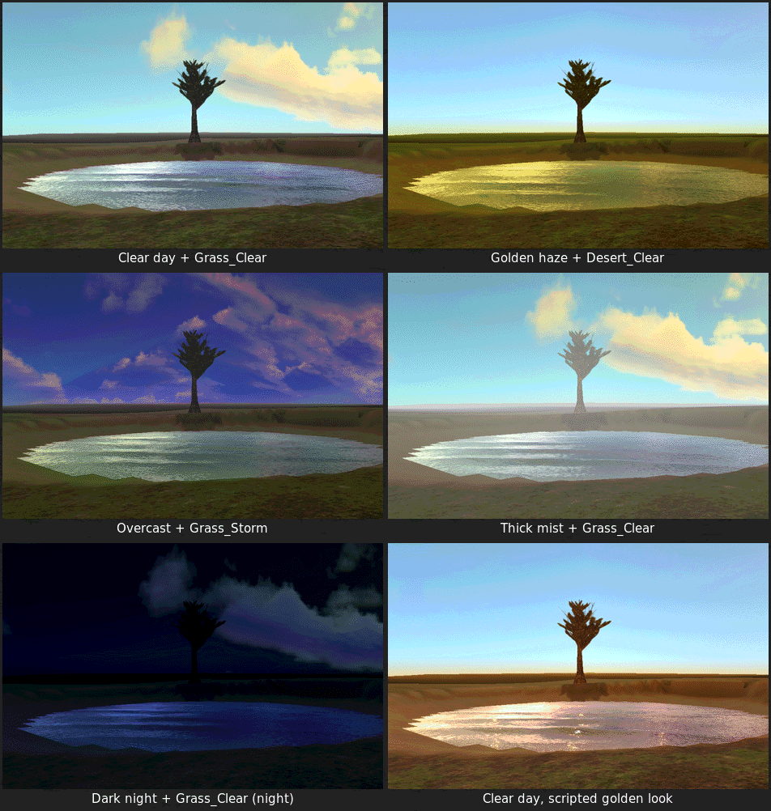
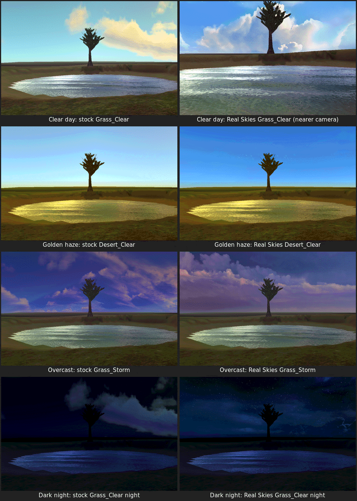

# Design: areas that look alive

Status: design, not built. Written 2026-11-25 for the maintainer's review before any code; every question decided the same
day.

Landscaper areas get skies that match their light, particles (mist, spray, fireflies, leaves, dust, light shafts) placed where
the ground calls for them, and local light. All of it goes into the areas, so every builder's area gets it. Filming demos with
[nwn-director](https://github.com/plenarius/nwn-director) builds on that content with per-shot look presets ("Filming" below).

Words used here:

- **Sky:** a row of `skyboxes.2da` and its four models (dawn, day, dusk, night).
- **Preset:** one of the Sky & fog panel's light and fog settings (`js/atmosphere.js`).
- **Emitter:** an MDL `node emitter`: a source of particles, drawn by the client.
- **Baked emitter:** an emitter the export writes into a tile model, as it writes placeables' triangles into tiles today.

## The short version

- **Skies:** start from Savant1974's [Real Skies](https://neverwintervault.org/project/nwnee/hakpak/real-skies-hak-version) for the
  five stock skies, re-encoded so it fits NWSync (its 77 MB textures are five times NWSync's 15 MB limit). It doesn't fix the
  mismatch: in the trial, four of five presets got a sky that contradicts their light, with Real Skies as with stock. So add new
  `skyboxes.2da` rows for the presets: dusk, golden haze, overcast, swamp, thick mist, a starry night. Most re-use Real Skies'
  pictures in other columns; mist and swamp are gradients the engine paints from the preset's colours. Only a desert glare and
  a swamp sky with clouds need an artist.
- **Choosing a sky:** each preset names its sky; the Sky & fog panel shows it and lets the builder pick another. The area keeps
  the sky's id, and the export turns it into a row number, as textures keep ids today.
- **Shipping skies:** a *sky pack*, a sibling of texture packs, with its own checks (models, big textures, rows) and its own hak.
- **Particles:** a pack of eleven emitters, each tuned for one job, with a day and a night colour (particles don't take the
  area's light). Night-only and day-only kinds switch with the tile's own `day` and `night` animations, **confirmed in game**
  once the emitters hang under a dummy named after the tile plus `a`, as stock tiles do (spike 0).
- **Placing them:** an **Ambience** tool beside Scatter. It proposes placements from what the area knows (water, trees, slopes,
  drops, caves) and the builder brushes more or fewer. The export bakes them into the tiles: no `placeables.2da` rows, no objects.
  **Confirmed in game:** an emitter written into a Landscaper tile model draws.
- **Local light:** every Landscaper tile already carries two main lights, exported black; the trial lit them by script. A
  **Light** brush colours them per tile.
  The baked shadow maps shade only the area's sun or moon (step 9): a torch in a tree's shade lights it as it lights open ground.
- **Filming:** nwn-director gets a `look` per shot (golden hour, misty dawn, moonlit, storm), made from script calls that exist in
  the game today plus temporary stock placeables and lights. For colours no script can set (the sun's), the director films in a
  copy of the area with other light. A GPU on an off-screen display gives the director shadows, grass and screen effects.

## What the code shows today

The editor is [nwn-landscaper-web](https://github.com/plenarius/nwn-landscaper-web) at `main` fbc5b9b, and the engine is this
repository at `master` b5fd6a1. Paths starting `js/` or `index.html` are the editor's; the rest are this repository's.

- **Presets** (`js/atmosphere.js`): ten. Clear day, golden haze, dusk, overcast, swamp and thick mist cycle day and night; dark
  night is always night; cave, torchlit cave and indoors are underground. A preset sets the sun's and moon's ambient, diffuse and
  fog colours, fog amount, shadows and view distance. It names no sky.
- **The sky** is a number in Area settings (`js/settings.js:66`, 0 to 255), listed from `skyboxes.2da`'s labels
  (`src/settings.rs:81`) and written as the `.are`'s `SkyBox` byte (`src/settings.rs:156`). Underground areas get 0
  (`src/generator/generate.rs:433`); an imported area keeps its original's (`generate.rs:443`). The sample landscapes pick stock
  rows: the canyon and dunes take Desert_Clear with golden haze, the snowy pass Winter_Clear with overcast, the lake valley
  Grass_Clear with clear day (`js/starters.js:328`).
- **Texture packs** (`docs/TEXTURE-PACKS.md`): zips of opaque PNGs at most 512 px a side plus a `pack.json`, checked and installed
  into the library, built into `ls_textures.hak`. Nothing else rides in them.
- **Placeables:** the Place and Scatter panels offer `placeables.2da`'s rows from the configured haks (`src/models.rs:176`,
  `LANDSCAPER_HAKS`). The Landscaper never writes that table. Baked objects (the default) copy only their models' triangles into
  the tiles (`src/objects.rs`), so a placeable's emitters and lights are lost when it is baked.
- **Tile lights:** each tile model has two light nodes, `ml1` (5 m up, radius 14 m) and `ml2`, and the `.set` says so
  (`src/generator/tile.rs:411`). The exported `.are` leaves every tile's `Tile_MainLight1` and `Tile_MainLight2` at 0, black. No
  tile has source lights or animations.
- **Baked shadows:** one fixed sun direction for day and night (`src/shade.rs`). The tile shader multiplies its final colour by
  the shadow map after all lighting (`src/shared.rs:112`), so torches and tile lights are darkened in baked shade too.

### Skies in the game files

`skyboxes.2da` has seven rows: (None), Grass_Clear, Grass_Storm, Desert_Clear, Winter_Clear, Icy and Black. Columns:
`LABEL`, `STRING_REF` (the toolset's name), `CYCLICAL` (1: the four models follow the time of day) and the models `DAWN`, `DAY`,
`DUSK` and `NIGHT`. The `.are` field is a byte, so a module can have rows up to 255.

A stock sky model (`sky_001` and its siblings, classification `EFFECT`) is a dome of two meshes: a wall of 80 vertices from 459 m
below to 309 m above the model's origin, 378 to 545 m out, with a 1024 px texture, and a cap of 25 vertices at the top with a
512 px texture. Both textures are 24-bit TGA. A new sky is four models and up to eight textures; the four models can share one
mesh layout and differ only in their `bitmap` names.

### Real Skies, test-installed

The EE hak version (1.02, `real_skies_1.02.7z`, 382 MB) unpacks to one `Real_Skies.hak` of 1.34 GB: 17 models and 17 textures.
It replaces stock models by name and adds no `skyboxes.2da` rows.

| Stock row | Real Skies covers | Look |
|---|---|---|
| Grass_Clear | dawn, day, dusk, night | golden sunrise, blue sky with cumulus, pink dusk, moon with faint stars |
| Grass_Storm | dawn, day, dusk, night | orange and grey, heavy grey cloud, purple, dark cloud |
| Desert_Clear | dawn, day, dusk, night | hazy pink, clear blue with cirrus, red horizon, **a starry night with a moon** |
| Winter_Clear | dawn, day, dusk, night | grey with a low sun, pale grey-blue, peach, stars and a clouded moon |
| Icy | **day only** | pale cyan-grey; dawn, dusk and night stay stock |

- **Pictures:** each a panorama of 14,384 by 1,798 pixels (Grass_Clear's day: 16,384 by 2,048), 24-bit uncompressed TGA, 77 MB
  each (100 MB). 16,384 px is the largest texture many GPUs accept, and older integrated ones stop at 8,192 (inferred, not
  tested here).
- **Mesh:** one band of 48 vertices, 517 to 675 m out, from 75 m below the origin to 381 m above it, offset 100 m east and north.
  It has **no cap and nothing below the horizon**, where the stock dome reaches 459 m down.

The comments' three problems, checked:

- **NWSync, "too large for the manifest": confirmed from the source.** `nwn_nwsync_write` refuses any file over
  `--limit-file-size`, 15 MB by default (neverwinter.nim `nwn_nwsync_write.nim`, `libupdate.nim`). Every Real Skies texture is 77
  MB or more. Re-encoded as DDS DXT1 at 8,192 by 1,024 with mipmaps, each is about 5.6 MB.
- **High camera sees past the band: not seen at 45 m.** With the camera 45 m out and about 18 m up, stock and Real Skies look
  the same: past the edge tiles the client draws the fog colour, and the sky shows only at the top of the frame. The game's
  camera can't look above level, so the missing cap shows only from far higher. **Step 1's flyover** shows it from about 300 m
  above the character, as flat grey, where the stock cap still covers; up to 200 m the two look alike
  ([REAL-SKIES.md](REAL-SKIES.md)).
- **Crash loading Desert_Clear, black triangles on the grass skies: not reproduced** in 17 stills on the CPU renderer, which
  accepts 16,384 px textures. Both likely come from the GPU: a card whose limit is 8,192 px, or one short of memory for 77 MB
  textures (inferred). The DDS re-encode removes both suspects. Step 1 saw none in about 50 more stills; looking down from 60
  m and higher, a black wedge fills the view past the area's edge, with stock skies as with Real Skies.

What the pictures show: the stock skies don't match four of the five presets. Golden haze gets a cold blue desert sky, overcast
a bright sky with pink clouds over flat grey light, thick mist a sunny sky over ground fogged at 20 m. Real Skies looks far better
(real clouds, a starry night) but has the same mismatches, because it replaces the same five skies.

## Questions to settle

Each question gives the decision first and the options not chosen after it.

**Decided (2026-11-25), every question at its recommendation:** Real Skies replaces the five stock skies module-wide, and the
presets get new rows as well (question 1); all ten skies, the re-used and generated ones first (question 2); the preset sets the
sky, and the Sky & fog panel shows it and offers the others (question 3); sky packs with their own hak, adding rows after the
module's own (question 4); particles baked into the tiles, with placeables only for a kind a script must switch off (question 5);
the Light brush, with baked objects keeping their glow (question 6). The build order below follows these.

### 1. Real Skies: replace the stock skies, and add rows

**Decided: both.** A re-encoded Real Skies replaces the five stock skies module-wide, in the team's own hak: every area that uses a
stock row, Landscaper's or not, looks better at once, and it needs no table. The Landscaper's own preset skies are new rows. The
textures become DDS DXT1 at 8,192 by 1,024; Real Skies' band mesh stays unless a flyover shows its open top. (Step 1: only from
about 300 m up, higher than the player's camera goes, so it stays for now.) Icy gets dawn, dusk and night from Winter_Clear,
which Real Skies left stock.

Considered and not chosen:

- **Rows only.** Real Skies' pictures used only in new rows; stock rows stay stock. Areas built elsewhere wouldn't change.
- **Replace only.** No new rows; the presets without a matching sky would stay unmatched.

### 2. Which skies to add

**Decided: all ten,** the generated and re-used ones first, the artist's two later. Each preset that shows a sky names one. Rows
are new; *re-use* means Real Skies' pictures in other columns, with new models (about 5 KB each) and no new art.

| Sky | For preset | Dawn, day, dusk, night | Art |
|---|---|---|---|
| Clear | clear day | the replaced Grass_Clear | none |
| Golden haze | golden haze | Desert dawn, Desert dawn, Grass dusk, Desert night | re-use |
| Dusk | dusk | Grass dusk in the first three, Grass night | re-use |
| Overcast | overcast | Storm dawn, Storm day, Storm dusk, Storm night, its colours flattened | re-use, tinted by the engine |
| Starry night | dark night | Desert night in all four | re-use |
| Dawn haze | (new preset) | Desert dawn, Winter dawn, Winter dusk, Winter night | re-use |
| Thick mist | thick mist | a gradient from the fog colour at the horizon to a lighter top | generated |
| Swamp | swamp | a green-grey gradient from the fog colour; clouds later | generated, then artist |
| Desert glare | (new preset) | a white-hot day, Desert dawn, dusk and night | artist: one day panorama |
| Storm front | (new preset) | the replaced Grass_Storm | none |

A generated sky is a panorama the engine paints from the preset's fog colour at the horizon and its diffuse colour at the top, so
it always matches. The trial's thick mist shows why that matters: ground fogged at 20 m under a sunny sky with clouds.

Considered and not chosen: **only the re-used skies**, leaving thick mist and swamp under a mismatched sky and dropping the two new
presets that need art.

### 3. How the Sky & fog panel chooses a sky

**Decided: the preset names a sky; the panel shows it and offers the others.** Choosing a preset sets the sky too. A **Sky** row
in the panel shows the chosen sky's day picture as a strip, with a list of the installed skies. The area saves the sky's id
(`"sky": "dusk"`), and Area settings stops offering the raw number for Landscaper skies. Without the sky pack a preset falls back
to the nearest stock row, as the sample landscapes do today.

The editor's 3D view can draw the sky's day or night panorama as its background, so the preview matches the game's horizon.

Considered and not chosen: **a separate dropdown in Area settings**, as today, with names instead of numbers. Builders would pick
light and sky apart and get the mismatch this design is about.

### 4. How skies ship

Texture packs can't carry skies: they take only PNGs up to 512 px, and they build one hak of textures. A sky needs models, textures
of 8,192 px and a `skyboxes.2da` row.

**Decided: sky packs, a sibling of texture packs.** The same index, download, hash and atomic install as texture packs, with a
`kind: "sky"` in the index. A sky pack holds models, DDS textures (at most 8,192 px wide, under NWSync's 15 MB) and one entry per
sky (id, name, the four models, the preset it suits). Installed skies go into `ls_skies.hak`. Built in step 2
([SKY-PACKS.md](SKY-PACKS.md)), with two changes: the index lists sky packs in a `skies` list of their own, since the released
Landscapers read every entry of `packs` as a texture pack; and the area keeps its sky's id in its atmosphere
(`"atmosphere": { "sky": "dusk" }`), the Sky & fog panel's own settings.

- **Rows never clash:** the module's `skyboxes.2da` (from its haks, as placeables are read today) decides the rows. At install
  the Landscaper takes the first free run of rows from 32 up and records it. Export writes a `skyboxes.2da` into `ls_skies.hak`:
  the module's table with the pack's rows added. That hak must sit above the module's other haks with a `skyboxes.2da`; the export
  refuses otherwise and says which hak. (The exported module lists it above them itself, so the check is of the module's own
  hak list, the editor's haks.)

Considered and not chosen: **one fixed hak with fixed rows** (say 200 to 220). Simpler, and wrong for any module whose table
already uses those rows.

### 5. Particles: baked into tiles, placeables as the fallback

**Decided: baked into the tiles.** The export writes each placement's emitter nodes into the tile under it, in the tile's
coordinates. No `placeables.2da` rows, no objects on the server, nothing sent per object. Day and night come from the tile's `day`
and `night` animations, as stock tiles key their lights, meshes and emitters (`ttr01_f13_01` keys a light's colour and two meshes'
alpha in `night`; `ttf02_m21_02` keys two candle flames on in `night`). Spike 0 confirmed it in game and found the rule the
trial missed (the emitters hang under the tile's `<tile>a` dummy, "Spike 0" below). The cost: changing one means exporting the
area again, and a script can switch them only a whole tile at a time, through the tile's animation loops.

**Placeables only as the fallback,** for a kind a script must switch off placement by placement. A kind a script switches for a
whole tile (a quest that clears the mist) can be keyed in the tile's `animloop01` instead, which `SetTileAnimationLoops` turns off
and on (spike 0). The pack carries each kind as a placeable model too, with a sample `placeables.2da` row for teams to merge;
filming uses them as well.

Considered and not chosen: **placeables for everything.** Scripts could switch every kind and the toolset could move them, but the
Landscaper can't add the rows (a team must merge them into its table), every placement would be a game object, and day and night
would need a script on a heartbeat or the area's enter event.

### 6. Local light

**Decided: a Light brush, and baked objects keep their glow.**

- **The Light brush** paints each tile's two main light colours (`lightcolor.2da`'s rows 0 to 31, the `TILE_MAIN_LIGHT_COLOR_*`
  names), with presets per area kind: none outdoors by day, warm pools in a village at night, cold blue in a cave. The colours go
  into `Tile_MainLight1` and `Tile_MainLight2`. A tile is 10 m, so this is a broad wash, not a lamp.
- **Lamps and glowing things** stay placeables: `placeables.2da`'s `LightColor` gives an object a light. Baking keeps a mesh's
  self-illumination colour (today it is dropped), so glowing mushrooms or crystals glow when baked.
- **Baked shade must not darken local light.** The shadow map multiplied everything. It now shades the area's sun or moon term
  only (step 9, "The shade split" below).

Considered and not chosen: **light from placeables alone.** Every lit spot would be a game object, and a wash over a village or a
cave would need many of them.

### The shade split (step 9)

**The stock `fslit` alone can't split them, the game's lighting can.** `fslit` only calls `inc_standard`, whose
`ComputeLighting` (in `inc_lighting`) adds the area's own light apart from every other: `lightAreaAmbient` as the starting
ambient, then `lightAreaDiffuse` along `lightAreaDiffuseDirection`, then the local lights: placeables' and spells' lights, and the
tile lights (`RecomputeStaticLighting`). The Landscaper already makes its tile shaders from the installed `fslit` and `vslit`
at run time; it now makes `ls_lighting` from `inc_lighting` the same way, with the area's two colours multiplied by the shade,
and its tile shaders include it in place of the stock one (same include guard). So neither fallback the design listed was
needed: the night keeps its full shade, and no hand-written shader has to follow the game's.

- **Per fragment** (the game's "Performance" shader setting, its default, and "High Quality"): the fragment shader sets the shade
  before the stock lighting runs.
- **Per vertex** ("Minimal": `inc_config` turns fragment lighting off): the light is worked out at each vertex, before the shadow
  map is read. The vertex shader lights each vertex twice, with and without the area's light, and the fragment shader blends the
  two by the shadow map.
- **Unchanged where nothing else lights the ground:** the shade multiplies the light in its own colour space (`ApplyColorSpace`),
  so shaded ground comes out the stock colour times the shadow map, as before.
- **What is no longer shaded:** everything but the sun or moon. A mesh's self-illumination (step 8's baked glow) and the
  emissive colour, and a torch in a chasm or a cave mouth: their fade and darkness are in the same shadow map, so a light there
  now lights the wall as it would anywhere.
- **Checked in the client** (CPU renderer, "Performance" and "Minimal"): a brazier (`placeables.2da` row 57, a placeable light)
  in a baked tree's shade, by day and by night. Before, its pool of light was dimmed by the shade; after, it lights the shade as
  it lights open grass (the pool's brightness up 22% by day, 37% at night). Shade with no other light measured the same to the
  pixel before and after. A tile light set by script (`SetTileMainLightColor`, `RecomputeStaticLighting`) didn't show in this
  test, before or after, so tile lights are covered by the code, not a still.
- **The cost:** one more stock file read and changed (three lines of `inc_lighting`, found by their text; a game update that
  changes them stops the shared hak's build with a message that says which), and tiles lit twice per vertex at "Minimal".

## The particle pack

Each kind is one emitter node (two for spray and light shafts), with its own texture where a stock one doesn't fit. Authoring
and tuning happens in NeverBlender; plenarius/nwn-mdl-spec documents every emitter field and controller. *Live* is the number of
particles one placement keeps alive: birth rate times life. Every kind has a day colour and a darker night colour, since the
trial's mist was as bright at night as by day. Day-only and night-only kinds switch with the tile's `day` and `night`
animations (spike 0's rule).

| Kind | Where | Build | Day and night | Live |
|---|---|---|---|---|
| **Water mist** | over still water, near shores | large soft billboards (`Billboard_to_World_Z`), 3 to 7 m, alpha 0.5, rising 0.1 m/s | thicker at dawn and night | 18 |
| **Waterfall spray** | where water drops more than 1 m | a fountain of splash sprites at the foot, plus a mist puff | always | 16 + 18 |
| **Rapids spray** | steep stretches of a river | small low fountains every 4 m | always | 6 |
| **Fireflies** | grass within 10 m of water, under trees | tiny additive flares (a 0.3 m glow), slow random drift, flickering | night only | 18 |
| **Dust motes, pollen** | sunlit forest gaps, under light shafts, cave mouths | tiny additive points drifting slowly | day only | 30 |
| **Falling leaves** | under tree crowns | stock `fxpa_leaf`, gravity, spin, `affectedByWind` | always | 4 a tree |
| **Snow gusts** | ridges and crests in snowy areas | small fast sprites blown along the wind; the engine's snow does the rest | always | 60 |
| **Blowing sand** | dune crests, desert ridges | low tinted smoke sprites streaming downwind, `affectedByWind` | always | 18 |
| **Embers** | above fire placeables | additive sparks rising and fading | always | 15 |
| **Light shafts** | forest gaps, cave openings | two crossed additive quads (a mesh, not particles) plus dust motes | day only (mesh alpha 0 at night) | 30 |
| **Ground fog** | hollows, swamp | flat sprites 8 to 11 m across (`Billboard_to_Local_Z`), one a second for 10 s | thicker at night | 10 |

**Cost:** the stock models give the scale. `dag_fog_med` keeps 20 particles alive, `tnp_gmist` about 50, the light shaft
`tnp_gsol1` 28 plus its meshes, and `silm_fog_50_lo` 1,250 (25 emitters). The pack keeps each placement under 60 and proposes a
budget of 1,500 live particles in view. A particle is a camera-facing quad: the CPU cost grows with the count, and large soft
sprites cost fill rate on the GPU when they cover the screen, which is why mist uses few big particles at low alpha. Frame times
are not measured yet ("What this design could not check").

**First cut (step 6):** the pack is in [`packs/particles`](../packs/particles/README.md), tuned against client stills. What the
stills showed:

- **A birth rate under 1 draws nothing** (confirmed in the client: leaves and ground fog at 0.5 a second drew no particle; at 1 they
  drew). Every kind uses whole birth rates and gets its count from the particles' life.
- **`Billboard_to_Local_Z` lies flat; `Aligned_to_World_Z` stands upright** (confirmed in the client: the same fog both ways). So
  ground fog is `Billboard_to_Local_Z`, as the stock blob shadow is.
- **Light shafts are additive,** with their own texture and TXI. An alpha-blended quad drew as a flat, even band.
- **Glowing kinds keep their colour at night:** embers and fireflies make their own light. Every other kind's night colour is darker.
- **The placeables switch:** an `off` animation keying the birth rate to 0 stopped an ember placeable placed deactivated.

**Already stock:** mist (`tnp_gmist`, `placeables.2da` row 791), fog (`dag_fog_*`, rows 15080 to 15082; `silm_fog_*`, 15600 to
15609), light shafts (`tnp_gsol*`, rows 762 to 764 and 825 to 828) and a dust plume (row 148). The pack doesn't repeat them; the
filming presets use them.

## Placing them: the Ambience tool

A tool beside Scatter, with the pack's kinds as a palette.

- **Fill** proposes placements for the chosen kinds by rule, at a density the builder sets:
  - mist on water, more where the water is wide and still;
  - spray where two water bodies of different levels touch, or where a river's bed falls faster than 1 m in 4 m;
  - leaves under the crowns of baked trees (the plant list already tells trees from rocks, `src/plants.rs`);
  - fireflies on walkable grass within 10 m of water;
  - motes and light shafts in gaps of 4 to 12 m in tree cover, and at a cave's openings;
  - sand along dune crests, snow gusts along ridges, ground fog in hollows lower than all ground within 15 m.
- **The brush** adds or clears placements of the chosen kind; Shift clears.
- The area saves them as a list (`"ambience": [{ "kind": "mist", "x": 22, "y": 20, "z": 10.3, "scale": 1, "seed": 7 }]`).
- The editor's view draws them as animated points in the kind's colour, and shows night-only kinds when the view shows night.
- **Export** writes each placement's emitter nodes, taken from the pack's model, under the `<tile>a` dummy of the tile that holds
  its point, and its `day` and `night` keys into that tile's animations (spike 0's rule).

### Trial: does a tile model keep its emitters?

The tileset spec says the client keeps only meshes of an *edge* model (plenarius/nwn-tileset-spec, `engine/behaviour.md`, T53),
and that area tiles are loaded with the flag that keeps emitters and lights (`CNWCTile::LoadModel` passes 0). The trial checked
that in the game. One 4 by 4 tile Landscaper area (a current build, a pond and three baked trees) was exported, and one tile model
(`amb_0202`, the pond's middle) was decompiled with cleanmodels, given emitter nodes by hand and compiled again. The module copied
the area five times with five presets, plus one copy that cycles day and night. A script moved the camera; the game client ran
off screen on the CPU (Xvfb and llvmpipe) and took 42 stills in three runs, the second with Real Skies. I looked at every one.

| Finding | Status |
|---|---|
| An emitter written into a Landscaper tile model draws: mist over the pond in every area, the always-on fireflies by day | **confirmed** (in game) |
| The white mist reads as bright at night as at noon | **confirmed** (in game) |
| So particles aren't lit by the area's light, and each kind needs a night colour | **inferred** |
| `SetTileMainLightColor` lights Landscaper tiles, and the baked trees in them, through their `ml1` and `ml2` | **confirmed** (in game) |
| Emitters whose birth rate is keyed in the tile's `night` or `animloop01` animation never drew: not in a fixed-night area, a cycling one at 23:00, or by day | **confirmed** (in game) |
| Why: the hand-written emitters hung straight under the tile's root; keyed emitters switch only under a dummy named `<tile>a` | **confirmed** (in game, spike 0) |
| Area tiles keep emitters and lights; edge models keep meshes only | **inferred** for edges (tileset spec T53; the trial built no edge emitters) |
| `SetFogColor`, `SetFogAmount`, `SetSkyBox` and `SetTileMainLightColor` together make a scripted look on a Landscaper area | **confirmed** (in game, picture above) |

Spike 0 below found the cause and the rule.

### Spike 0: what makes keyed emitters switch

The spike ran the game client off screen, as the trial did, on the trial's area with test emitters in four tiles: one that loops in
`animloop01`, one on by day and keyed off in `night`, one keyed on in `night`. It took 13 runs and looked at every still. A stock
animated tile (the campfire `ttr01_h02_03`, whose flame loops in `animloop01`) sat in the same Landscaper area as the control.

| Finding | Status |
|---|---|
| Keyed emitters switch only when they hang under a dummy named the tile model's name plus `a` (`amb_0202a`), as in every stock animated tile. The same emitters under a dummy of another name, or straight under the tile's root, keep their static birth rate | **confirmed** (in game) |
| Nothing else about a Landscaper tile matters: its ground mesh, lights and walkmesh, the root's orientation, where the dummy sits among the root's children (first, or last after the walkmesh), the emitters' names and settings (the trial's, or the stock flame's) | **confirmed** (in game) |
| Nor does the compiler: the game compiling the trial's ASCII itself failed the same way as cleanmodels' binary | **confirmed** (in game) |
| `tiledefault` isn't needed for day and night: the stock tiles that switch emitters by day and night have none. Every spike tile that switched had one, keying the loop off | **inferred** (the base game's tiles) |
| A fixed-night area plays the tiles' `night`, a fixed-day area their `day` | **confirmed** (in game) |
| A cycling area plays the hour's animation when the player enters, and switches at dusk while the player stays (`night` emitters came on as the clock passed 18:00) | **confirmed** (in game) |
| `SetTime` jumping the clock past dusk doesn't switch the tiles of the area the player is in; they switch at the next dusk, or when the area is entered again | **confirmed** (in game) |
| The `.are`'s `Tile_AnimLoop1` to `3` start a tile's loops (the export writes 1); the `.set`'s `AnimLoop` lines don't matter | **confirmed** (in game) |
| `SetTileAnimationLoops` turns a tile's loops off (seen on the stock campfire) and on (on the spike's tiles) at once, with a location in metres (the tile's centre, column × 10 + 5); the trial passed grid coordinates and so switched another tile | **confirmed** (in game) |
| In the base game's tiles, every emitter keyed in `day`, `night` or their transitions hangs under `<model>a`, and 1,067 of the 1,109 keyed in `animloop01`; the other 42 hang under a dummy named after another tile plus `a` (copied tiles) | **confirmed** (the base game's models) |
| Whether those 42 switch in game, so whether the client matches the name exactly | **not checked** |

**The rule for step 5** (baked emitters):

- Write every baked emitter of a tile under one dummy named the tile model's name plus `a` (`amb_0202a`), a child of the tile's
  root with no offset. Its place among the root's children and the emitters' names are free.
- A day-only kind has its static birth rate on; `night` and `day2night` key it to 0, `day` and `night2day` key it back. A
  night-only kind is the reverse, with its static birth rate 0. As stock tiles: `day` and `night` 0.3 s long, the two transitions
  one frame (0.0333 s), all with a transition time of 0.25 s.
- Write each animation's whole node tree, as stock tiles do and as tested; a tree of the root, the dummy and the keyed emitters
  alone wasn't tried.
- Always-on kinds need no keys (the trial).
- A kind a script switches for a whole tile is keyed on in `animloop01` and off in `tiledefault`, under the same dummy;
  `SetTileAnimationLoops` then switches it per tile.
- No engine change is needed before step 5: the export already writes the loop flags the `.are` needs, and nothing else reads the
  `.set`'s.

## Filming

This section stays here rather than in nwn-director: it is short, and the looks depend on the content above. nwn-director's
changes are listed in the build order.

nwn-director already takes the cameraman's camera (`AttachCamera`, `SetCameraLimits`, `SetCameraFlags` in `nss/dir_load.nss`)
and sets 10:00 and clear weather before each shot (`Dir_Set`). A shot gets an optional `look`, applied in `Dir_Set` before the
camera rolls, and undone after the cut.

Every call below is in the current `nwscript.nss` (build 37-17).

| Look | Calls |
|---|---|
| **Golden hour** | `SetTime(18, 0, 0, 0)`; `SetSkyBox` to the golden haze sky; `SetFogColor(FOG_TYPE_ALL, 0xE0A050, oArea, 8.0)`; `SetFogAmount(FOG_TYPE_ALL, 12, oArea)`; `SetTileMainLightColor(lTile, TILE_MAIN_LIGHT_COLOR_PALE_ORANGE, ...)` on every tile, then `RecomputeStaticLighting` |
| **Misty dawn** | `SetTime(6, 0, 0, 0)`; dawn haze sky; pale grey fog at amount 25; temporary mist placeables (row 791) over water and fog (rows 15600 to 15609) in hollows |
| **Moonlit** | `DayToNight(oCam, 4.0)` or `SetTime(23, 0, 0, 0)`; starry night sky; blue-black fog; tile lights `PALE_DARK_BLUE`; a temporary `VFX_DUR_LIGHT_BLUE_20` light high over the subject as the moon |
| **Storm** | `SetWeather(oArea, WEATHER_RAIN)`; storm front sky; `SetAreaWind(oArea, Vector(1.0, 1.0, 0.0), 2.0, 150.0, 5.0)`; grey fog fading in over the take; `VFX_IMP_LIGHTNING_M` at points off camera on a timer |

- **Temporary particles and lights** are placeables made the way `Dir_Walker` makes its walker: the stock `plc_invisobj` blueprint
  through `TemplateToJson`, its appearance set to a stock row, then `JsonToObject`, tagged `DIR_TMP`. Lights are
  `EffectVisualEffect(VFX_DUR_LIGHT_*_20)` on an invisible one. All are destroyed after the cut.
- **What no script can do:** set an area's sun or moon ambient and diffuse colours. A golden hour lit by a white sun looks wrong.
  Since nwn-director already copies the module, it adds one copy of the area per look with the look's `.are` colours (the
  Landscaper preset's), and films that shot there. The trial above did this for five presets.
- **Fog amount has no fade** (`SetFogAmount` takes none; `SetFogColor` does), so a look sets the amount before the roll and fades
  only the colour during the take.
- **`SetTime` only goes forward:** an earlier hour advances the calendar a day. Harmless for filming. In an area that doesn't
  cycle day and night, the time changes nothing; `DayToNight` and `NightToDay` act on one player's view, which suits the cameraman.
- **`SetTime` doesn't switch baked day and night emitters** in the area the camera is in (spike 0). A night look sets the time
  before the cameraman enters the area.
- **`SetTime` into dawn or dusk keeps the night or day sky** (step 1, [REAL-SKIES.md](REAL-SKIES.md)): the client fades to the
  dawn and dusk skies only as the clock runs into those hours. A look that needs one sets the time a little before the hour.
- **`SetTime` runs pending delays:** in the trial, jumping to 23:00 ran the script's queued `DelayCommand`s at once, so two shots
  fired before their area had loaded. The director sets the time before it schedules a shot's ticks.

### Filming on a GPU, off screen

`--stills` draws on the CPU (Xvfb and llvmpipe) and turns off shadows, grass, anti-aliasing and screen effects to keep it
bearable. Films need the GPU but not the maintainer's desktop.

- **A. Xvfb plus VirtualGL (recommended).** The client runs in Xvfb as `--stills` does, under `vglrun`, which sends its OpenGL
  to the GPU (EGL, no X server on the card) and copies each frame back. No root, no monitor, and ffmpeg's `x11grab` records the
  Xvfb display as it records the desktop today. The director drops its CPU settings and keeps the film settings.
- **B. A second X server on the GPU** with a virtual screen (NVIDIA: `--allow-empty-initial-configuration`; others: a dummy
  connector). Faster than VirtualGL's copy, but needs root to set up and differs per vendor.
- **C. gamescope's headless back end.** The client in its Xwayland; capture through PipeWire. Newest of the three.

## Risks

- **The `skyboxes.2da` merge** breaks if a team's hak order puts another `skyboxes.2da` above `ls_skies.hak`. The export checks the
  order it knows; a module's own `.hak` list edited by hand later can still undo it.
- **Emitters in many tiles**: a 32 by 32 area filled with mist could reach thousands of live particles. The Fill rule caps live
  particles per area, and the editor shows the count.
- **Baked particles switch only a tile at a time.** A kind keyed in `animloop01` goes off with `SetTileAnimationLoops` for the
  whole tile; a team that wants one placement switched places the placeable version instead (question 5).
- **Real Skies' pictures** come from free wallpapers stitched together; a re-encoded copy should keep its credit, and the
  re-encoding is a step outside the Landscaper.

## Build order

Each step is one pull request in each repository it touches, shippable alone. Agent time is wall-clock for a coding agent; the
maintainer's time is review and testing. "Client" marks a check in the game client.

| # | Step | Repository | Agent | Maintainer | Client |
|---|---|---|---|---|---|
| 0 | Spike: why keyed emitters didn't draw on Landscaper tiles; a stock animated tile beside a Landscaper one, `tiledefault`, `SetTileAnimationLoops`. **Done:** the `<tile>a` dummy ("Spike 0") | engine | 3 h (took 5) | 15 min | 15 min |
| 1 | Real Skies for modules: DDS at 8,192 by 1,024, Icy's missing times, one hak; a script, not part of the editor | engine (`scripts/`) | 4 h | 30 min | 15 min: the five skies, a flyover |
| 2 | Sky packs: index `kind`, checks, install, `ls_skies.hak`, row choice, the `skyboxes.2da` merge at export, the area's sky id | engine | 8 h | 45 min | 15 min: a new row in an exported area |
| 3 | The first sky pack: the re-used skies, and generated mist and swamp skies from preset colours | engine | 5 h | 30 min | 20 min: each preset with its sky |
| 4 | Sky & fog panel: presets name skies, the Sky row, the view's background; the sample landscapes pick preset skies | web | 5 h | 30 min | no |
| 5 | Baked emitters: the area's `ambience` list into tile emitter nodes under the tile's `<tile>a` dummy, `day`/`night` keys and `animloop01` for kinds a script switches (spike 0's rule) | engine | 6 h | 30 min | 20 min: each kind, day and night |
| 6 | The particle pack, first cut: eleven kinds written as ASCII emitters from the stock ones, tuned against client stills; each also as a placeable model with a sample `placeables.2da` row | engine (`packs/`) | 7 h | 1 h | 30 min |
| 7 | The Ambience tool: Fill rules, brush, points in the view, live particle count | web | 10 h | 1 h | no |
| 8 | Local light: the Light brush, self-illumination kept in baking | web + engine | 5 h | 30 min | 15 min: a village at night |
| 9 | Baked shade on the sun or moon only ("The shade split": the game's lighting splits, no weaker night shade) | engine | 4 h | 30 min | 15 min: a torch in a tree's shadow |
| 10 | nwn-director: `look` per shot, an area copy per look, temporary placeables and lights | director | 6 h | 45 min | 20 min: four looks filmed |
| 11 | nwn-director: films on a GPU off screen through VirtualGL | director | 3 h | 30 min | 20 min: one film on a GPU machine |
| 12 | Docs: `docs/SKY-PACKS.md`, the builder workflow, the changelog | both | 2 h | 20 min | no |

About 68 hours of agent time and 7.5 hours of the maintainer's, of which about 3 hours in the client. Steps 0, 1 and 10 can
start at once; step 3 needs 2, step 4 needs 3, step 5 needs 0, step 7 needs 5 and 6.

**Work only an artist can do** (not in the hours above):

- **Sky textures:** the desert glare day panorama and a swamp panorama with clouds, about a day each.
- **Emitters in NeverBlender:** tuning the eleven kinds by eye after step 6 (timing, colour, how they read at a distance), about two
  days.
- **Particle textures:** a firefly glow, soft motes, a sand streak and the light shafts' quads (step 6 made placeholders), about
  half a day.

## What this design could not check

- **Frame time.** Every still came from the CPU renderer. Particle budgets above are counts, not milliseconds; step 6 should
  measure them on a GPU.
- **Real Skies on a GPU:** the Desert_Clear crash and the black triangles. The CPU renderer accepts 16,384 px textures, so it
  can't show a GPU's limit.
- **Generated skies:** not made yet, so not seen in the game.
- **VirtualGL with the game client:** the machine this was written on has no GPU.
- **`DayToNight` in an area that doesn't cycle,** and whether it shows the night sky as well as the night light.
- **Dawn in a cycling area:** spike 0 watched dusk switch the tiles, not dawn.
- **Emitter culling:** whether the client drops a tile's emitters with the tile when it is out of view, as it does meshes (T52).
- **Baked self-illumination** is dropped judging by the code (`src/objects.rs` keeps texture and transparency per group), not
  seen in game.
