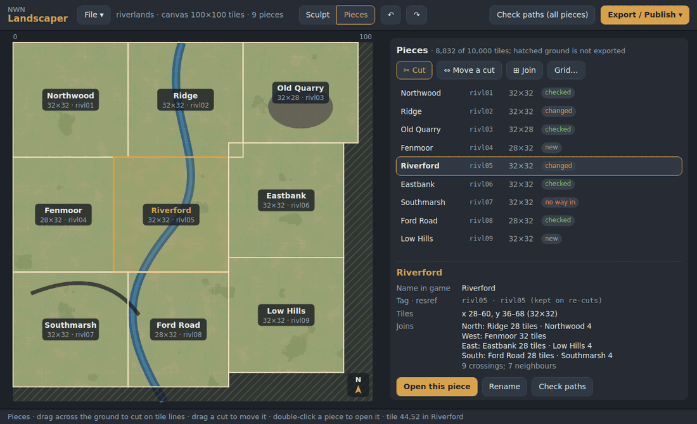
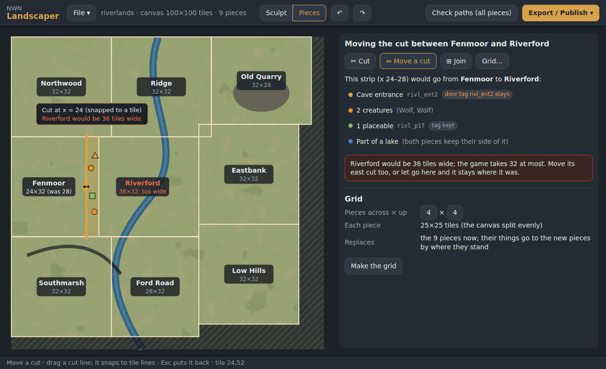
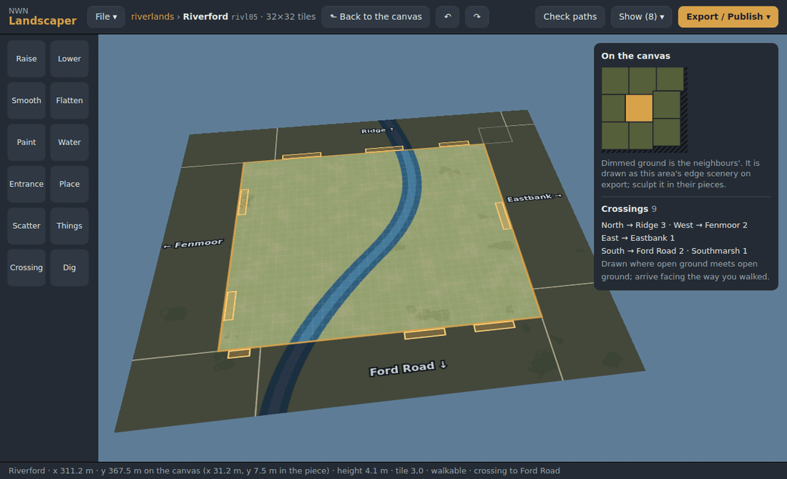
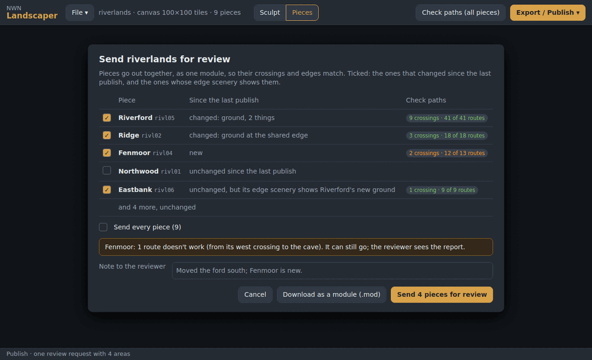

# Design: cut into pieces

Status: design, not built. Written 2026-11-25 for the maintainer's review before any code.

A builder sets up one big canvas (100 by 100 tiles, say), sculpts and paints it as one landscape, then cuts it into rectangles.
Each rectangle, a *piece*, becomes its own NWN area of at most 32 by 32 tiles, the game's limit. Players walk from piece to piece
through area transitions along the cuts.

Words used here:

- **Canvas:** the whole landscape the builder works on, larger than one area.
- **Piece:** one rectangle of the canvas that becomes one area.
- **Cut:** a line between two pieces, always on a tile line.
- **Gap:** canvas ground that no piece covers. It is never exported as an area, but its ground still shows in the pieces' edge
  scenery.
- **Crossing:** a matched pair of an area transition trigger in one piece and the waypoint it leads to in the neighbouring piece.
- **Halo:** the ring of neighbouring ground (and objects) that an exported piece carries for its edges, but never builds tiles from.

## The short version

- **Canvas size:** up to 128 by 128 tiles (16 full pieces), edited through a window: the open piece and a ring around it at full
  detail, the rest at a quarter of the detail. Undo keeps only the changed region, saves send only changed blocks of the canvas,
  the browser's copy moves to IndexedDB, and the GPU gets only the changed range of each buffer.
- **Pieces** are free rectangles on tile lines, 3 to 32 tiles a side, never overlapping. Gaps are allowed. A **Grid** button makes
  a regular grid to start from.
- **Seams** match because both pieces share the sample row on the cut and each exported piece carries a halo of its neighbours'
  ground. Its edge shows that real ground (the boundary tiles reach out over it), not a copy of its own edge, if a spike in the game
  client confirms the client draws it (spike S2). Otherwise the edge stays what the Landscaper draws today, which already matches
  at the cut.
- **Crossings** are made by the export, along every stretch of a cut where open ground meets open ground: a transition trigger
  at most 2 tiles long on each side, leading to a waypoint 4 m inside the neighbour, facing the way the player walked.
- **Identity:** each piece has a number given once and never reused, and a name (its resref prefix) that stays when the cuts move.
  Entrance, object and thing tags use the canvas's name and canvas-wide numbers, so a re-cut never renames a door.
- **Files:** one canvas folder: a small header and the ground in fixed 16 by 16 tile blocks. Pieces are rectangles in the header;
  the export cuts them out.
- **Publish:** the pieces that changed, plus the ones whose edges or crossings show those changes, go out together as one
  `publish-module` request.
- **Import** of existing neighbouring areas onto one canvas comes later. Starting a canvas from one Landscaper area is in the first
  build.

## What the code shows today

The editor is [nwn-landscaper-web](https://github.com/plenarius/nwn-landscaper-web) at `main` 51a6213, and the engine is this
repository at `master` 5c9e1cf. Paths starting `js/`, `css/` or `index.html` are the editor's; the rest are this repository's.

### One area, 3 to 32 tiles, one at a time

- The engine refuses any other size: `if !(3..=32).contains(&tiles) || !(3..=32).contains(&tiles_y)` (`src/heightmap.rs:234`).
  The editor enforces the same range only when a new area is made: `Math.min(32, Math.max(3, ...))` (`js/newarea.js:149`).
  Nothing resizes, crops or extends an existing area.
- The page holds exactly one area: `let area = null;` (`js/app.js:77`), swapped by `setArea` (`js/app.js:514`).
- The grid is 16 samples a tile plus one, 0.625 m apart (`js/area.js:14`, `js/area.js:48`). A 32 by 32 area is 513 by 513 samples;
  the engine's chasm list is capped at that (`MAX_CHASM_RUNS = 513 * 513`, `src/heightmap.rs:492`).
- The area's `name` (1 to 9 characters) prefixes every resref (`src/heightmap.rs:228`), and the tileset and hak are named after it
  (`tileset_name`, `hak_name`, `src/generator.rs:59`, `src/generator.rs:64`).
- Several areas only meet in a shared `module`: each area records the module it is exported into (`js/area.js:95`), and Publish
  offers "whole module" when more than one exported area shares it (`js/publish.js:140`).

### The costs the issue lists

- **Undo** copies the whole area before every stroke: `h: this.heights.slice(), m: this.materials.slice(), ...` plus every list
  (`js/area.js:401`), 40 steps (`js/area.js:468`). Undoing scans every sample to find what to redraw (`js/area.js:506`).
- **Save** sends the whole area as JSON with base64 heights (`js/area.js:525`, `heights: toBase64(...)` at `js/area.js:530`) by
  `PUT /api/save` (`js/save.js:202`), 800 ms after every change (`js/save.js:55`).
- **The browser copy** after a failed save goes to `localStorage` (`js/save.js:140`); a full store only gives a message
  (`js/save.js:224`). There is no IndexedDB.
- **The GPU** gets one mesh with a vertex a sample: `new THREE.PlaneGeometry(sizeX, sizeY, nx - 1, ny - 1)` (`js/view.js:320`).
  A stroke frame writes new values only inside a dirty rectangle (`js/view.js:699`), then flags whole attributes and the material
  texture for upload (`js/view.js:722`). The repository never sets an update range, so three.js r186 uploads each flagged buffer
  whole. The code's own notes: "a whole redraw took 86 ms a Dig frame on a 32×32 cave" (`js/view.js:670`).
- **Check paths** sends the whole area (`js/export.js:49`) and the live check reruns it 1.5 s after each edit (`js/live.js:21`).

### Edges

- The game client draws 5 cells of scenery beyond each side, each cell the model `<tileset>_edge.2da` gives the boundary tile
  beside it, and **the same model at all 5 depths** (`src/generator/edge.rs:4`, from
  research on the client). So one row of edge models can't show 50 m of varied ground: whatever it holds repeats every 10 m.
- The Landscaper makes each strip cell from "the boundary's profile (heights, painted textures, water) carried straight outward, the
  same at every depth" (`src/generator/edge.rs:10`, `strip_model` at `src/generator/edge.rs:186`). It is extruded, not mirrored.
- The editor draws the same thing, 50 m out (`buildSkirt`, `js/view.js:1453`). Only an imported area's picture is mirrored past the
  border (`js/view.js:97`, and `src/generator/edge.rs:239` in the engine).

### Tile levels

- Each tile's level is the mean height of its own ground in 5 m steps, leaving chasm depths out (`tile_level`,
  `src/generator/terrain.rs:152`; `TRANSITION: f32 = 5.0` at `src/generator/terrain.rs:147`). It reads nothing outside the tile.
- Edge strips sit at their boundary tile's level (`let base = tile_level(tx, ty) as f32 * TRANSITION;`,
  `src/generator/edge.rs:189`).

### Entrances, things and transitions

- An entrance has an id given once and never reused (`src/heightmap.rs:36`, `js/area.js:68`). Its door's tag is
  `<area>_ent<id>` (`door_tag`, `src/generator/entrance.rs:211`), and its `link` becomes the door's `LinkedTo` with
  `LinkedToFlags` 1 (`src/generator/entrance.rs:240`).
- The editor already has a Transition thing: a trigger with `Type: 1` (`js/things.js:17`), with `LinkedTo` and `LinkedToFlags`
  fields (`js/thingprops.js:119`) and a picker for another area's waypoints (`js/thingprops.js:822`).
- Things without a blueprint are tagged `` `${prefix}_${a.name}_${id}` `` (`js/things.js:593`), placeables `<area>_p<id>`
  (`js/place.js:110`). Both carry the area's name, so moving them to another area renames them today.
- Objects may stand up to 10 m outside the area (`MARGIN`, `src/heightmap.rs:347`).

### Publishing several areas

- The editor sends one area to `/api/publish`, or the whole module to `/api/publish-module` (`js/publish.js:19`).
- The review service's `POST /api/v1/areas/publish-module` takes a list of areas with a module and a hak zip for each, and opens
  one set of pull requests ([REVIEW-SERVICE.md](REVIEW-SERVICE.md), "publish-module"). The dev trial takes the same form.

### Heights beyond the edge

- Heights and normals past the edge are clamped to the edge samples (`Heightmap::at` and `normal`, `src/heightmap.rs:613`), so
  slopes and shading on an area's outer samples are one-sided today.

### One area at a time on the engine

- The loaded area is process-wide state (`CURRENT`, `src/heightmap.rs:192`), and heavy jobs (check, export, import) take turns
  behind one lock (`job()`, `src/serve.rs:280`). Exporting 16 pieces is 16 exports in a row. The self-hosting guide says "a large
  area can take a minute or more" (`docs/SELF-HOSTING.md:157`).
- A request body is capped at 8 MB for `/api/save`, `/api/export` and `/api/check`, sized for one 32 by 32 area
  (`body_max::AREA`, `src/serve.rs:356`). A 100 by 100 canvas saved whole (20.5 MB) would be refused.
- A team workspace holds at most 100 areas and 5 GB (`src/quota.rs:17`).

### The route check

- `POST /api/check` (`src/serve/export.rs:21`) runs the generator's analysis without building files
  (`src/generator/analyse.rs:168`). It routes between random pairs of points, `(tiles_x() * tiles_y() * 4).clamp(40, 400)` of them
  (`src/generator/analyse.rs:220`), not between entrances or waypoints, and its tables are sized for 32 tiles
  (`MAX_X_TILES`, `src/sim.rs:54`).
- Exports already warn about links that lead nowhere and about an area that "nothing leads into" yet
  (`src/validate.rs:186`, `src/validate.rs:284`).

### Transitions generated today

- None in the generator. The only generated transition triggers are in the developer test pack (`src/devpack.rs:24`). The builder
  guide gives a four-step manual recipe for joining a new area to the world (`docs/BUILDER-WORKFLOW.md:119`).

## Measured: what a bigger area costs today

The editor's `Area` class run in Node 24 on an Intel Core i3-8100 (4 cores, no GPU involved), with a rough start,
a lake and a chasm mask, at four sizes. Undo and save are measured; the GPU column scales the issue's 11.6 MB a frame at 32 by 32
(44 bytes a sample) and was not measured on a GPU. The 32 by 32 row is above the issue's 51 MB and 1.76 MB because this run
also holds a chasm mask.

| Canvas | Samples | One undo step | 40 undo steps | One save (JSON) | `JSON.stringify` | GPU upload a stroke frame | Triangles |
|---|---|---|---|---|---|---|---|
| 32×32 | 263,169 | 1.6 MB | 63 MB | 2.1 MB | 109 ms | 11.6 MB | 0.5 million |
| 64×64 | 1,050,625 | 6.3 MB | 252 MB | 8.4 MB | 423 ms | 46 MB | 2.1 million |
| 100×100 | 2,563,201 | 15.4 MB | 615 MB | 20.5 MB | 987 ms | 113 MB | 5.1 million |
| 128×128 | 4,198,401 | 25.2 MB | 1,008 MB | 33.6 MB | 1,573 ms | 185 MB | 8.4 million |

What these mean, at 100 by 100 with today's code:

- Undo alone would hold 615 MB, and each snapshot costs only 3 ms, so memory is the problem, not time.
- Each autosave would stall the page for about a second, every time the builder pauses for 800 ms.
- The browser copy is over `localStorage`'s 5 to 10 MB already at 64 by 64.
- Every brush frame would upload about 113 MB to the GPU. At 60 frames a second that is 6.8 GB a second, more than most
  integrated GPUs can move. This needs measuring on a real GPU (spike S1).

What stays cheap: flooding water (7 ms at 100 by 100) and fitting chasms (75 ms), both whole-grid passes. The whole-grid passes
the editor runs per stroke can stay whole-grid; only memory, saves and uploads need to change.

## Questions to settle

Each question lists the options with the recommendation first.

**Decided (2026-11-25):** canvas size up to 128 by 128, edited through a window (question 1, the recommendation); free rectangles
on tile lines, 3 to 32 tiles a side, gaps allowed, with a Grid button (question 2); automatic crossings made by the export
(question 5). Spikes S1 to S4 come before any building. The other questions stand at their recommendations until the spikes
report.

**The spikes reported (2026-11-25, "Spike results" below):** question 1's window holds and needs its ranged GPU uploads; question
3 stays at the overhang (3A), which the client's code supports, until one look in the game client; question 5 holds, and each
crossing gets an OnEnter script, since walking into a transition trigger alone moves nobody.

### 1. Canvas size

How large a canvas the editor carries, and what has to change for it.

- **A. Up to 128 by 128 tiles, through a window (recommended).** 128 is four full pieces each way. The open piece and a ring of
  8 tiles around it (48 by 48 tiles at most) are drawn at full detail; the rest of the canvas at a quarter of the detail (one vertex
  every 2.5 m, 1/16 of the vertices). The full-detail mesh is never more than 2.25 times today's largest. Needs all four changes:
  - undo that keeps the changed rectangle's old values and copies a list only when it changed;
  - saves of changed 16 by 16 tile blocks only;
  - the unsaved copy in IndexedDB;
  - GPU uploads of the changed range only (three.js `addUpdateRange`).

  Memory at 128: the grids are about 18 bytes a sample (heights, water level, materials, chasm, work arrays), 76 MB. The material
  texture is 2,049 texels a side, within every GPU's 4,096.
- **B. Up to 100 by 100, the whole canvas drawn at full detail.** The same four changes, without the window. 5.1 million triangles
  every frame; on the maintainer's GPU this may hold, on a builder's laptop probably not. Needs spike S1 before it is promised.
- **C. Up to 64 by 64, today's view.** Only undo and saves change. 4 pieces, 2.1 million triangles. Smallest build, but it doesn't
  reach the 100 by 100 the request names.

The four changes help today's 32 by 32 areas too (63 MB of undo, 11.6 MB a frame), so they come first in the build and ship on
their own.

### 2. The pieces

- **A. Free rectangles on tile lines, gaps allowed (recommended).** A piece is any rectangle of whole tiles, 3 to 32 a side, that
  doesn't overlap another. Ground no piece covers is a gap: drawn hatched, never exported, still shown in neighbours' edges, which
  makes a gap a cheap backdrop (a mountain range nobody walks into). **Grid...** fills the canvas with an even grid (4 by 4 pieces
  of 25 by 25, say) to start from; after that each cut moves on its own.
- **B. A regular grid only.** Simpler to build and explain, but a river or a ridge can't decide where a cut goes, and a 100-tile
  canvas has to be 4 pieces of 25 or leave a strip.
- **C. Any shape.** Not possible: an NWN area is a rectangle of tiles.

Cuts stay on tile lines because tiles are the game's unit: a piece's size, its tile levels and its tileset are all per tile.

### 3. Seams

How heights, paint, water, chasms, objects and edge scenery behave across a cut.

**Ground and paint** match by construction. A cut on tile line *k* is sample column 16*k*. Both pieces include that column (an area is
16 samples a tile plus one), so both have the same heights and paint on the cut.

**Normals and lighting** need the halo. Today a sample on the area's edge has no neighbour outside, so its slope and baked shade are
one-sided. The exported piece carries a halo, 5 tiles (50 m, 80 samples) of the canvas on every side that has canvas beyond it. The
engine reads the halo for edge scenery (below), normals, baked shadows (a neighbour's hill shades this piece), chasm rims and
cave ceilings, and never builds tiles from it. The header gains `halo` (how many samples) and the height and paint files grow by
that ring. An area without a halo reads as today.

**Water** is a list of bodies, each flooded from one seed sample (`src/heightmap.rs:17`). A body seeded in one piece can flood into
the next. The export floods on the canvas, then gives each piece one seed in each part of the flood inside it. Flooding inside the
piece from that seed reaches the same samples (each part is joined inside the piece by construction), so both sides of a cut hold
the same water at the same level.

**Chasms** go across as their mask. The rim (the height a chasm sample drops 20 m under) is fitted from the nearest open sample,
which near a cut may be across it. The engine fits rims with the halo in view, so both pieces give the seam the same rim.

**Objects and things** belong to the piece their origin (or, for a trigger, its whole outline) stands in:

- A placeable whose footprint crosses a cut is drawn only in its own piece, and its walkmesh blocks only there. A solid object
  within 2 m of a cut gets a warning ("Players on the Ridge side can walk through this rock").
- A trigger or encounter outline that crosses a cut is refused at export with its name, as an outline outside an area is today.
- A cave entrance whose dug-out cave crosses a cut is refused the same way.
- Creatures, waypoints and sounds go by their position.

**Edge scenery.** Three ways to show a neighbour's real ground beyond a piece's edge:

- **A. The boundary tiles reach out over the halo (recommended, if spike S2 passes).** Each boundary tile's model gains the
  neighbour's real ground out to 50 m beyond the edge, the depth the client's own edge scenery covers, at a quarter of the detail
  (a vertex every 2.5 m): no walkmesh, only the look. The corner tiles also cover their corner block. The edge strip and corner
  models on those sides become empty. They can't stay underneath: the client repeats one strip model at every depth, so a strip
  that carries the boundary profile outward would poke through wherever the neighbour's ground falls away. Spike S2 has to show
  that the client draws geometry outside a tile's own cell, lights it, and doesn't cull it when the tile's centre is off screen.
  The client's code says it does (see "Spike results", S2): a tile mesh is culled by its own box, and the scene covers 5 cells
  beyond the area, so the overhang stays within 50 m. What is left is the look in the game client.
- **B. The edge strip from the neighbour's first 10 m, repeated 5 deep.** Matches near the cut, then repeats every 10 m: a hump 4 m
  past the cut becomes five humps. Fits the client's one-model-per-row rule without a spike, but looks wrong in most ground.
- **C. Keep today's extruded profile.** Already continuous at the cut, since the profile there is the shared column, but flat
  beyond. This is what every piece gets for free, and the fallback if spike S2 fails.

Edges on the canvas's own border, and on gaps, follow the same rule: a gap is canvas ground, so option A shows it.

**A single area gets the same edge scenery (2026-11-26).** An area on its own has no neighbour to show, so it gains a 50 m band
around it, stored as its halo: sculpted and painted like the area, never walked, never built into tiles. A first fill carries the
area's own ground outward, so an area looks right past its edge before anyone touches the band. Every area, old or new, then shows
real ground past its edge, whether or not it is ever part of a canvas.

**Edge trials (2026-11-25).** A throwaway trial for the maintainer to walk in the game client: a 30 by 30 tile landscape (hills,
a river and a road crossing the cuts, the texture mix, baked trees) cut into 10 by 10 pieces, its centre piece exported once per
treatment, each also with a 90 m fog clip, and the uncut landscape for reference. The overhang there is the halo's own tiles at
full detail, grafted into the boundary tiles. Seen in the game client (software rendering, off screen) and in nwn-bake renders:

- **The overhang (A) matches the uncut landscape** within 50 m: ground, paint, water and trees carry on across the cut, lit like
  the tile beside them, with no seam. It ends in a hard line against the background, which is the area's fog colour; at the
  exported 45 m fog clip the client's distance haze hides that line from a low camera, not from a high one.
- **A fade** (the overhang's materials drawn by a copy of the tile shader that mixes towards `fogColor` from 25 to 50 m past the
  area) turns that line into haze. A real build would pass the area's size to the shader per material.
- **3B (the first 10 m repeated 5 deep) is worse than today's edge**: stepped ridges with slivers of sky between the copies,
  stepped water, a sawtooth skyline. Drop it.
- **The neighbour's trees in the overhang** read as the real landscape does; without them a wooded neighbour looks bare.
- **Cost at full detail** for a 10 by 10 piece: 246,000 triangles past the edge (2.5 times the piece's own) and 68 MB more hak
  (every halo tile's baked texture and shadow map). The quarter-detail overhang above, with a small baked texture, is the one to
  build; its look still needs one more trial.

**Decided (2026-11-25): F**, the overhang with the neighbour's trees and the fade to the fog colour. Next, the same at a quarter
of the detail with a small baked texture, built and looked at once before step 2.

**Quarter-detail trial (2026-11-25, module cc_edgeq).** For one 10 by 10 piece: F 281,000 triangles past the edge and 74 MB more
hak; G (a vertex every 2.5 m, 128 px baked texture per tile) 40,000 triangles and 8 MB, of which the trees are 30,000. G matches F
and R on hills, corners and roads seen from above. It showed in two places: white slivers of water along the far bank (the coarser
bank no longer hides the water behind it), and a shallower dip where a road crosses a crest on the skyline. S, which keeps 0.5 m
cells where a shore runs, fixes the shores for 5,700 triangles more. A 64 px texture is blurry from a high camera. Small textures
must be the 512 px bake shrunk down (small bakes now filter from the library's smaller mip levels, #41), and the water past the
cut uses the export's shoreline. **Decided for step 2 (2026-11-25): G at 128 px with full detail along shores and roads.** Trees
as two crossed pictures from 25 m out are on trial next (variant T).

### 4. Tile levels and path nodes

- **Tile levels need nothing new.** A tile's level is the mean height of its own ground (`src/generator/terrain.rs:152`). A cut on
  tile lines keeps every tile whole, so each tile has the same level in its piece as on the canvas. Heights stay in canvas metres
  in every piece, so a player who crosses arrives at the same height they left.
- **Path nodes need nothing new either.** The game's tile-to-tile planner uses a fixed layout per path node letter, with exits
  1, 2.5, 5, 7.5 and 9 m along each side (`src/pathnode.rs:4`). The generator picks each tile's layout to agree with its
  neighbours, and the area's border counts as "harmless" (`None => s += 1`, `src/pathnode.rs:381`), so a piece's edge tiles are
  free to pick any layout. Players cross by the trigger, not by a path node, so nothing has to agree across a cut.
- **One thing to watch:** the generator marks walkable faces that touch a tile's border but belong to no exit of its layout as
  not walkable (`unowned_border_faces`, `src/generator/plan.rs:517`). A crossing found from the heights can land on such a face.
  Each piece's export checks its crossings against its generated walkmesh and shifts or drops the ones that do, with a warning.
- The route check gains crossings as fixed places a route starts and ends, beside its random pairs (question 5).

### 5. Joining the pieces

How a player walks from one piece to the next.

- **A. Crossings made by the export (recommended).** For each cut, the export walks the shared sample column and finds every
  stretch where the ground is walkable on both sides of it: not steeper than the walkable slope, not water deeper than 0.5 m, not
  chasm, not blocked by a solid object. Stretches come from the canvas's ground; each piece's export then checks its triggers
  and arrival waypoints against its generated walkmesh (question 4) and reports a crossing that lands on ground the plan made
  unwalkable. Each stretch becomes one or more crossings, at most 2 tiles (20 m) long each, so a player
  arrives within 10 m of where they left. A crossing is:
  - in each piece, a transition trigger (`Type` 1) 1.5 m deep along the cut, inside the piece;
  - its target, a waypoint in the other piece 4 m in from the cut (past that piece's own trigger, so nobody is sent straight back),
    in front of the middle of the stretch, facing away from the cut. A player who leaves northward arrives on the south side of the
    next piece facing north: the sides and the facing match;
  - `LinkedTo` the waypoint's tag and `LinkedToFlags` 2 (waypoint);
  - a small OnEnter script the export adds: walking into a transition trigger only runs its OnEnter script; the game moves a
    player only when they click it (spike S3). The script sends a player to the trigger's target, as the game's own click
    script does; a click still works as on any transition.

  Tags come from the crossing's place on the canvas, not from the pieces: the trigger `<canvas>_x<i>_<j><d>`, its waypoint
  `<canvas>_w<i>_<j><d>`, where (*i*, *j*) is the stretch's middle sample on the canvas and *d* the direction of travel
  (`n`, `s`, `e`, `w`). A 7-character canvas name gives tags of 19 characters, within the game's 32. While a cut doesn't move,
  its crossings keep their tags across every export, so a script that names one keeps working.

  The builder can turn a stretch off (a cliff that should not be a way through) or add one by hand with the existing Transition
  thing. Crossings show in the piece view (mock-up 3) and are counted in the pieces list.
- **B. Doors.** A door needs a door model and a frame to stand in. Out in open country it would be a door standing in a field. Doors
  stay for cave entrances, as now.
- **C. Nothing automatic.** The builder places Transition things by hand with the existing tool. Fine for two pieces, but 9 pieces
  have 12 cuts and dozens of stretches, and each moves when a cut moves.

**The route check across pieces.** Each piece is checked as today, with its random pairs, plus routes between every pair of its
crossings and entrances (new: today's check routes only between random points). Then the canvas check joins the pieces into
one graph, a node a crossing or entrance and an edge a working route or a crossing pair, and reports:

- a piece with no way in from the others ("no way in", mock-up 1);
- a crossing whose arrival waypoint stands where no route reaches;
- for a published canvas, the pieces a player can't reach from the module's way in, if the builder names one.

The whole canvas check runs per piece, so a change re-checks only the pieces it touched and their neighbours.

Spike S3 answered the first of two questions from the code and a server run: walking into a transition trigger moves nobody
unless its OnEnter script does, hence the script above. Whether 16 small triggers along one side behave in the client (highlight
clutter, the transition cursor) still needs a look in the game.

### 6. Identity

Each piece needs a name (its resref prefix), an in-game name and a tag, and they should survive re-cuts and edits.

- **A. A number per piece, given once, and tags from the canvas (recommended).**
  - Each piece gets a number when it is made (1, 2, 3...) from a canvas counter that only goes up, like entrance ids. Its name
    defaults to `<canvas><number>` with two digits (`rivl05`); the canvas name is 1 to 7 characters so the default fits in 9. The
    builder may rename it (1 to 9 characters, unique in the module); the area's tag defaults to the name and its in-game name is
    free text, both in the area's settings as today.
  - Moving a cut changes a piece's rectangle, never its number or name. Splitting a piece keeps the number on the half with more
    of its old tiles and gives the other half a new one. Joining keeps the larger piece's number.
  - Entrance, object and thing numbers become canvas-wide, and their tags use the canvas's name: `rivl_ent2`, `rivl_p17`,
    `TRG_rivl_31`. The header of an exported piece gains `tagPrefix` (the canvas name), which `door_tag` and the thing and
    placeable tags use in place of the area's name. So a door whose entrance a re-cut moves into another piece keeps its tag, and
    every `link` to it still works.
- **B. Names from the position (`rivl_x2_y1`).** Readable on a grid, but moving or splitting a piece renames it and every resref.
- **C. Names typed by the builder, nothing else stable.** A re-cut leaves the builder to fix names and tags by hand.

A piece renamed after it was published is, to the module, a new area and an old one to remove, as renaming an area is today. The
publish dialog says so.

### 7. Re-cutting after work started

What happens when a cut moves, a piece splits, or two join, after the builder placed things.

- **A. Everything follows its position and keeps its tags (recommended).** Before a cut moves, the editor lists what changes
  piece (mock-up 2): entrances, objects, things, and parts of lakes and chasms. Nothing is renamed, since tags are canvas-wide
  (question 6). A move that would make a piece wider than 32 tiles, or narrower than 3, is refused while dragging, with the reason.
  Things that end up in a gap stay on the canvas but are not exported, and the pieces list warns about them. Every cut change is
  one undo step.

  For a piece that was published, its area's coordinates shift with its south-west corner. Tags and waypoints still resolve;
  a script with a location written in numbers would not, and the publish dialog warns when a published piece's corner moved.
- **B. Refuse a cut move that would move anything.** Safe, but forces the builder to clear a strip before every adjustment.
- **C. Ask about each thing.** Precise, but a cut through a forest asks about 200 trees.

Removing a published piece doesn't remove its area from the module. The publish dialog lists it as "no longer on the canvas"; the
reviewer decides.

### 8. Saving and files

- **A. One canvas folder, its ground in fixed blocks (recommended).**

  ```text
  <workspace>/canvases/rivl/
    canvas.json        name, size, pieces, counters, palette, water, entrances, objects, things, settings per piece
    blocks/b03_02.f32  heights of the 16 by 16 tiles block at (3, 2): 257 by 257 samples
    blocks/b03_02.mat  its paint
    blocks/b03_02.chm  its chasm mask, when it has any
  ```

  Blocks are fixed (they never move with the cuts), so a save sends the header, which is small, and only the blocks a stroke
  touched: a brush at 100 by 100 touches 1 to 4 of the 49 blocks. Neighbouring blocks repeat their shared sample row, as pieces do,
  so each block is a complete grid. Each block carries its version, and the save names the version it changed (`base`), as area
  saves do today, so two tabs can't overwrite each other. Pieces are only rectangles in `canvas.json`; the export cuts each one out
  into the area format this engine reads, with its halo and `tagPrefix`, so the generator, the route check and the packagers keep
  working on single areas as they do now.
- **B. One file per piece, the canvas an index.** Each piece is a normal area. But a gap has nowhere to live, and every cut move
  rewrites two pieces' files and renumbers their samples.
- **C. One file for the canvas.** Today's format, larger: 20.5 MB a save at 100 by 100, a second of stall each time.

**Built (step 3, 2026-11-27):** each block is one file, `blocks/b03_02.blk`, holding its heights, paint and chasm mask and ending
with a check sum, rather than three files: a save replaces one file in one step, while three could be left half replaced by a
crash. A block's version is that check sum. A block that was never saved has no file and is flat ground at the header's
`ground` height. A save is refused when it would leave two blocks different on the row they share, so a stroke that changes a
shared row saves both blocks together; a canvas save may carry every block of a 128 by 128 canvas (34 MB), not 8 MB. The
format and the routes are in `src/canvas.rs` and `src/serve/canvases.rs`.

On the team server a canvas is one more kind of item in the user's workspace, next to areas, with the same assignment and
read-only rules. The editor's unsaved blocks wait in IndexedDB, keyed by canvas, block and base version.

What changes on the engine for this:

- A save of a block is 257 by 257 samples, 0.33 MB of heights and paint, well within the 8 MB body cap; the cap stays.
- A canvas counts against the workspace's quota by its size on disk, and as one item, not as one per piece.
- The export cuts a piece out into today's area files (`exports/<piece>.json`, `.f32`, `.materials`), so everything after it
  is unchanged.

### 9. Export and Publish

- **Export all** builds every piece into one module named after the canvas (the module field already exists), one area each, with
  the crossings. **Export this piece** rebuilds one; its crossings still point at waypoints in the neighbours, which the earlier full
  export made. The export of one piece checks that the neighbours were exported since their last cut change, and says which to
  export if not.
- **Publish** (mock-up 4) sends one `publish-module` request. Ticked by default:
  - pieces changed since the last publish;
  - pieces whose halo holds changed ground, since their edge scenery shows it;
  - pieces whose crossings changed, since their waypoints or triggers moved.

  The builder can tick more or **Send every piece**. A route check runs on the ticked pieces first and shows in the dialog; failures
  don't block sending, as today.
- **Package** (no review service) gives one `.mod` with every piece, and the hak with every piece's tileset.
- **Dev trial** takes the whole canvas, through the same `publish-module` form.

What the review service gets is unchanged: a list of areas with their files. No change to the review service is needed.

### 10. Import

Loading existing neighbouring areas onto one canvas.

- **A. Later (recommended).** The first build can start a canvas from **one** Landscaper area: the area becomes piece 1 and the
  canvas grows around it. The canvas takes the area's name, so its entrance, object and thing tags stay as they were. Importing
  several existing areas side by side (the builder places each on the canvas, then blends the seams by hand) comes after, once
  pieces have been used: it needs a placement step, and seams made separately never match without hand work.
- **B. In the first build.** Brings existing regions in sooner, but adds the placement tool and seam blending to a build that is
  already the largest the Landscaper has had.

### 11. The editor's interface

- **A. A Pieces mode on the canvas, and an Open piece view (recommended).**
  - **Pieces mode** (mock-up 1) shows the canvas from above. Drag across the ground to cut out a piece; drag a cut to move it
    (both sides move); **Join** merges two pieces that make a rectangle; **Grid...** makes an even grid. Each piece shows its
    name and size. The side panel lists the pieces with their state (new, changed, checked, no way in), and the selected piece's
    neighbours and crossings. Sizes over 32 turn red while dragging, and the drag stops there.
  - **Sculpt mode on the canvas** draws all of it at a quarter of the detail for broad shaping with large brushes: ridges, the
    river's course, where the lake sits. The ground underneath keeps full detail.
  - **Open piece** (mock-up 3) shows one piece at full detail with an 8-tile ring of its neighbours, dimmed, editable, so a brush
    crosses a cut without the builder thinking about it. A small map of the canvas marks the piece. The title reads
    `riverlands › Riverford`, and **Back to the canvas** returns. The status line gives the position on the canvas and in the
    piece.
- **B. One view, pieces as overlays.** No mode switch, but the whole canvas at full detail every frame, which question 1 rules out
  for most GPUs.
- **C. Tabs, one area per tab.** Closest to today's editor, but a stroke can't cross a cut and the builder loses the one landscape.

#### Mock-ups

Drawn as HTML and screenshots, not the editor; the ground is noise.

1. The pieces overview: 9 pieces on a 100 by 100 canvas, a hatched gap, the selected piece's neighbours.

   

2. Moving a cut: the strip that changes piece, what it holds, and the 32-tile limit.

   

3. One piece open: its neighbours' ground dimmed around it, the crossings along its sides, a small map of the canvas.

   

4. Publishing: the changed pieces and the ones whose edges show them go out as one request.

   

## The flow, as a builder sees it

1. **New → Canvas.** Name `rivl`, 100 by 100 tiles, rolling hills. Or **File → Make a canvas from this area**.
2. **Sculpt** the whole canvas: drag a ridge across the north, carve the river from north to south, drop a lake in the east. Paint
   broad areas.
3. **Pieces → Grid... 3 by 3**, then move cuts: the one between Fenmoor and Riverford goes west of the ford, so the ford sits in
   one piece. The lake is left in a gap to the east, seen from Eastbank's edge but never walked.
4. **Open Riverford.** Paint the ford's stones, place the inn, add a cave entrance. A brush near the north cut shapes both pieces'
   ground. The crossings along the cuts appear as the ground allows.
5. **Check paths (all pieces).** Southmarsh shows "no way in": the marsh is too deep at the cut. Lower the water, check again.
6. **Publish.** Riverford, the two pieces that share its changed edges, and the new Fenmoor go out as one review request.
7. Later, **move a cut** to give Ridge more room. The editor lists the cave and two trees that change piece. Their tags stay.
   Publish sends the two pieces whose rectangles moved and their neighbours.

## Risks

- **Spike S2 fails in the client** (the overhang looks wrong: unlit, popping, or fogged differently): edges stay extruded.
  Playable and continuous at the cut, but the "real neighbour ground" part of the request isn't met. Option 3B is no better.
  The code reading (spike results) makes this unlikely, but it has not been seen in the game yet.
- **Every crossing is a load screen.** Each piece is its own area, so crossing loads the next one, as any transition does.
  Nothing in the design can hide that; small pieces mean more crossings.
- **Many crossings** clutter the transition highlight along an open edge. Merging stretches (fewer, longer crossings, arrival
  farther from where the player left) is the lever; the 2-tile maximum may become 4.
- **Published areas shift** when their pieces' corners move, which breaks scripts that store locations as numbers. The publish
  dialog warns; nothing can prevent it.
- **Build size.** This is the largest change the editor has had: a new data model under every tool. The build order below keeps
  each step shippable and lets the first one (the four cost fixes) help today's areas even if the rest stops.
- **Export time.** The engine builds one area at a time (`job()`, `src/serve.rs:280`). Spike S4 measured about 2.5 minutes for a
  32 by 32 piece on a 4-core desktop, so a 16-piece canvas takes about 40 minutes the first time there. Exports after that rebuild
  only the pieces that changed and their neighbours (question 9).
- **Tag prefixes.** Canvas-wide `tagPrefix` tags differ from the per-area tags builders know. Two canvases with the same name in
  one module would collide; the engine refuses a canvas whose name is already an area or canvas in the module.
- **Memory on small machines.** 76 MB of grids at 128 by 128, plus the GPU's full-detail window, is fine on a desktop and tight on
  a tablet. The canvas size can be capped per server.

## Spikes before building

| Spike | Question | Who | Agent time | Maintainer |
|---|---|---|---|---|
| S1 | Frame time and memory of a 48 by 48 full-detail window plus a quarter-detail 128 by 128 overview, and of option 1B's whole 100 by 100 mesh, while sculpting. A standalone page built from today's view code. | Agent builds, the maintainer runs it on a desktop GPU | 3 h | 15 min |
| S2 | Does the client draw, light and keep (not cull) boundary tile geometry 50 m beyond the area's edge? A 4 by 4 area with overhanging boundary tiles and empty edge models. | Agent builds, the maintainer looks in the game client | 3 h | 20 min |
| S3 | Does walking into an area transition trigger move a player, or only a click? Does a side of 16 triggers, 2 tiles each, behave (highlight, cursor, arrival)? Server decompile first, then a 2-area module. | Agent, then the maintainer in the game client | 2 h | 20 min |
| S4 | Generation time and memory of one 32 by 32 piece with a 5-tile halo, and of a 16-piece export, on the build machine. | Agent | 1 h | none |

## Spike results (2026-11-25)

Throwaway code only, kept outside this repository. Client and server findings are from the game's own binaries (build
8193.37-17, Linux); addresses are the files' own (objdump), and each says whether it was read in the code, run, or is still
inferred. Machine: the maintainer's desktop, an Intel Core i3-8100 (4 cores) with a GeForce GTX 1050 (2 GB), which was also
running his desktop, a game client and a stream while the numbers were taken.

### S1: the editor's frame cost on a GPU

A page built from today's `js/view.js`, `js/area.js` and `js/tools.js` (`main` 51a6213), with a made-up landscape and texture
array like the library's (8 layers, 512 a side). A Raise stroke of 8 m goes round a circle, one stamp a frame, as the editor's loop
runs it. Headless Chromium on the GPU (`ANGLE (NVIDIA GeForce GTX 1050, OpenGL 4.5)`, not SwiftShader), 1600 by 900 pixels.
"Whole" uploads as today; "range" sends only the changed rows of each buffer and of the paint texture (option 1A's fourth change).

| Case | Triangles | Idle frame | Sculpt frame, whole (median / p95) | Upload a frame, whole | Sculpt frame, range | Upload, range | GPU time, whole / range | GPU memory | JS heap | Real fps, whole / range |
|---|---|---|---|---|---|---|---|---|---|---|
| Today's 32×32 | 0.53 M | 4.4 ms | 10.3 / 13.2 ms | 12.7 MB | 5.4 / 9.5 ms | 0.74 MB | 3.6 / 2.3 ms | 33 MB | 45 MB | 60 / 60 |
| 1A: 48×48 window + 128×128 at a quarter | 1.63 M | 8.8 ms | 21.0 / 29.7 ms | 31.6 MB | 9.8 / 20.7 ms | 1.15 MB | 15.5 / 6.6 ms | 78 MB | 95 MB | 60 / 60 |
| 1A's canvas sculpt: 128×128 at a quarter | 0.52 M | 5.2 ms | 8.4 / 12.6 ms | 6.3 MB | 5.7 / 9.5 ms | 0.37 MB | 3.0 / 2.9 ms | 31 MB | 66 MB | 60 / 60 |
| 1B: whole 100×100 at full detail | 5.13 M | 14.0 ms | 53.1 / 74.2 ms | 123 MB | 15.5 / 30.0 ms | 2.31 MB | 45.5 / 8.5 ms | 219 MB | 248 MB | 20 / 60 |

GPU memory is what the page allocated in buffers and textures (counted at each WebGL call), not the driver's figure. Opening the
100 by 100 case took 6.7 s.

- **Question 1: the recommendation (1A) holds**, and its fourth change, uploads of the changed range only, is required, not a
  nicety. Without it the window still drew 60 frames a second here, but each frame cost 21 ms of work when waited for (30 ms at
  the 95th percentile): no headroom on this card, none at all on a slower one. With it, 1A sculpts at 10 ms on an entry-level
  card from 2016. ("Sculpt frame" waits for the GPU to finish; "real fps" is the editor's own loop, which overlaps the two.)
- **1B is possible on this card with ranged uploads** (15.5 ms), but it holds 219 MB on the GPU and 248 MB of page memory,
  idles at 14 ms a frame, and a laptop's integrated GPU has less of both. It stays the alternative, not the plan.
- The issue's figure of 11.6 MB a stroke frame at 32 by 32 is confirmed (12.7 MB measured), so step 1 of the build helps today's
  areas as much as the design said: about half the frame time and a seventeenth of the upload.
- A one-click copy of the page is kept for the maintainer to run in his own browser, which is the check this headless run cannot
  make (a real screen, a real compositor).

### S2: how the client draws edges, and the overhang

The client's code (`nwmain-linux`) settles most of it:

- **Which model goes where.** Already known: each border cell's key is the boundary tile's corners and edge, never the cell's
  depth, so one model repeats 5 deep. A model per boundary position is possible (this engine already writes a unique edge type
  per boundary tile); **a model per ring is not**, whatever the files say.
- **Culling.** Every mesh of a tile is filed in the scene's BSP by its own bounding box, and each frame a mesh is dropped only when
  that box is wholly outside one of the camera's planes (`PartOutside(PartTriMesh*)`, 0x47a130). So **geometry outside a tile's
  own 10 m cell is drawn whenever it is on screen**, whatever happens to the cell.
- **Reach.** The scene's BSP covers the area and 5 cells around it (`Scene::InitBSP(W, H, 5, ...)`, called at 0x70e7da). A mesh
  reaching further falls into a border node whose test is approximate: beyond 50 m it may be culled early (inferred). The
  overhang's 50 m is inside.
- **Edge models lose everything but meshes.** The 4th argument of `Scene::SpawnTile`, 1 for edge models, makes
  `ProcessStaticParts` delete every part that is not a mesh (0x470abc-0x470af1): lights, emitters, the rest. An area tile keeps
  them. So edge scenery can never carry a light or a particle effect; an overhang, being part of an area tile, can.
- **Lights.** The area's tile light colours reach area tiles only (`CNWCTile::SetMainLightColor` calls `Scene::SetTileLights`; the
  border loader never does). An overhang is lit by what lights its own tile (inferred: same tile, same lights).
- **Copies never stack.** Each border cell is its own position; models overlap only where an area tile's mesh reaches into a cell
  that also gets an edge model. Hence the empty edge rows on the sides an overhang covers.
- **Switches.** Edge models appear only with the player's edge-tile option on and the area's border not disabled (an area flag
  the server sends; read at 0x710353). An overhang is area-tile geometry, so it shows even to a player who turned edge tiles off
  (inferred: the switch only skips the border loader).
- **Fog.** How far the client draws is the area's fog clip distance (inferred, not traced). The Landscaper's areas use 45 m, so a
  50 m overhang is about all a player sees anyway.

**The options for a known neighbour, best first:**

1. **The overhang (option 3A), on every side with canvas beyond it; today's extruded edge on the canvas's outer border.**
   Real ground out to 50 m at a quarter of the detail, corners included, lit and culled with its tile. Cost for a 32 by 32 piece:
   about 24,000 more triangles over 124 boundary tiles, about 1.5 MB more models in the hak and 0.7 MB fewer edge models (the
   test's 50 m strip added 10 KB to a boundary tile, 55 KB with a corner block); no new files, no extra load time to speak of. Risks:
   its paint has to come from the halo (bake the halo's paint and shade into the boundary tile's texture, or give the overhang
   its own texture); it has no walkmesh, shadows or minimap (scenery only); a piece with overhang on all four sides can switch its
   border off (`TileBrdrDisabled`) instead of emptying edge rows.
2. **A mix of 3A and 3B:** the overhang for the first ring or two, edge models beyond. Not possible as such: every ring of a row
   gets the same model, so an edge model beyond an overhang repeats under it. Only "overhang 50 m, nothing beyond" works.
3. **3B, per-position edge models from the neighbour's first 10 m:** possible without a spike, but repeats every 10 m.
4. **3C, today's extruded profile:** the fallback, and the canvas's outer border.
5. **Placeables standing on the boundary tiles, carrying the neighbour's ground:** drawn and culled by their own box too, but they
   count as objects (server traffic, object lists), are lit as objects not as tiles, and add nothing the overhang lacks.

The 4 by 4 test (west side 50 m of overhang, east side 100 m, north and south as today, fog clip 150 m) loads on a server and
renders as intended; what remains is one look in the game client: is the overhang drawn, lit like its tile, and kept when its
tile leaves the screen, and does the 100 m side fail past 50 m?

### S3: walking into a crossing

From the server's code (`nwserver-linux`) and a run of a two-area test module on a bare server:

- **Walking in only runs OnEnter.** Entering a trigger signals event 0xc; `CNWSTrigger::EventHandler` (0x5e3380) runs the
  trigger's OnEnter script (or its trap) and nothing else. **A transition fires on event 0x1e**, which the walk sends only when
  the trigger is what the creature was told to walk to (a click) and it is in use range; that runs OnClick, or the game's
  `nw_g0_transition` when there is none.
- **The click script works on enter.** Both events store the creature in the same field, and `GetEnteringObject` returns it for a
  trigger, so `GetClickingObject` (which the game documents as the same) works in OnEnter. In the server run, a creature walking
  into a trigger whose OnEnter is `nw_g0_transition` arrived in the other area at the waypoint; one walking into a trigger with no
  OnEnter stood in it and stayed.
- **Arrival facing.** Jumping to a waypoint takes the waypoint's orientation (`CNWSCreature::AIActionJumpToObject`, 0x4b28b0);
  the run arrived facing east at an east-facing waypoint. So "facing the way the player walked" is the waypoint's facing.
- **Depth.** Creatures reached 0.35 m from the area's edge, well inside a 1.5 m trigger.

**Question 5: the recommendation (automatic crossings) holds, with one addition:** each crossing trigger gets a small OnEnter
script that sends a player to the target, or walking across a cut does nothing. A click keeps working as on any transition.
Still for the game client: the look of 16 triggers side by side (highlight, cursor), and the feel of the load screen at each
crossing.

### S4: export time and memory

`landscaper export` on rolling ground with a lake and four textures, on the 4-core desktop, one run at a time:

| Area | Wall time | CPU time | Peak memory | Notes |
|---|---|---|---|---|
| 32×32 | 131-144 s | 390 s | 2.6 GB | two runs; about 90 % of the per-tile work is the texture bake, 7 % the shadow map |
| 42×42 (a 32×32 piece's 5-tile halo, built as tiles) | 256 s to the hak, about 270 s whole | 670 s | 1.5 GB to the hak | needs the 32-tile limit raised in this engine and in Moonglow's area writer; the minimap step refused 42, so its memory is missing |
| `check` 32×32 / 42×42 | 8.9 s / 20.5 s | | 0.35 / 0.6 GB | |

A second 42 by 42 run took 393 s with the machine busy with other work; the runs of 16 in a row were stopped there. Each
export is its own process and uses every core, so a row of exports adds up: **16 pieces take about 40 minutes** (16 ×
2.5 min) the first time on this desktop. Building the halo as tiles would make it 72 minutes; the design reads the halo
without building it, which adds mostly shadow-map work (33 s of CPU time at 32 by 32, 61 s at 42 by 42), so a few seconds a
piece.

What this changes: question 9's rule (re-export only changed pieces and their neighbours) matters more than the design said. A
piece whose only change is in its halo should not rebake every tile: only its boundary tiles' shade changes, so the bake of the
others can be kept (a per-tile cache keyed by the tile's inputs). That is a step-4 detail, not a new question. Peak memory of
2.6 GB a piece means exports stay one at a time on a small server.

## Build order

Each step is one pull request in each repository it touches, shippable alone. Agent time is wall-clock for a coding agent;
the maintainer's time is review and testing. "Client" marks a check in the game client.

| # | Step | Repository | Agent | Maintainer | Client |
|---|---|---|---|---|---|
| 0 | Spikes S1 to S4 | both | 9 h | 1 h | S2, S3 |
| 1 | Today's areas, cheaper: undo of changed rectangles, IndexedDB copy, GPU uploads of changed ranges | web | 5 h | 30 min | no |
| 2 | Area format: `halo` and `tagPrefix`; normals, shade, chasm rims and ceilings read the halo; edge scenery from the halo (G, full detail along shores and roads) | engine | 6 h | 45 min | 15 min: one area with a halo, its edges |
| 2b | The band around a single area: the editor shows, sculpts and paints the halo; a first fill carries the ground outward | web + engine | 5 h | 30 min | 10 min: an old area with its band |
| 3 | Canvas storage: `canvases/<name>/` with blocks and versions, load and save of changed blocks, team workspaces and assignments | engine | 7 h | 45 min | no |
| 4 | Cutting on the engine: pieces, water seeds, things by position, crossings with their tags, per-piece and whole-canvas route check, export of all pieces into one module | engine | 10 h | 1 h | 20 min: walk across three pieces |
| 5 | Editor canvas model: block-backed grids, region undo across blocks, block saves, the canvas sculpt view at a quarter of the detail | web | 10 h | 45 min | no |
| 6 | Pieces mode and Open piece: cut, move, join, grid, rename, the "what moves" list, the pieces list, the small map | web | 8 h | 1 h | no |
| 7 | Publish, package and dev trial for a canvas, the changed-pieces ticks | web + engine | 4 h | 30 min | 20 min: the published module |
| 8 | Make a canvas from an area; docs (BUILDER-WORKFLOW, TEAM-SERVER) and the changelog | both | 3 h | 20 min | no |

About 67 hours of agent time and 7 hours of the maintainer's, of which about 1.7 hours in the client. Steps 1 and 2 can run in parallel;
step 5 needs step 3, and step 6 needs steps 4 and 5.

Later, not in this build: importing several existing areas onto one canvas; neighbours' objects drawn in edge scenery; an
optional crossing script that keeps the player's exact offset along the cut.

## What this design could not check

- The GPU figures in "Measured" were scaled; spike S1 measured them on one desktop card, headless. A laptop's integrated GPU is
  still unmeasured.
- The overhang (S2) and the crossings (S3) are settled in the code and on a server, but not yet seen in the game client: the
  overhang's look, lighting and culling on screen, and 16 triggers side by side.
- The memory per sample at 128 by 128 is the sum of the editor's typed arrays, not a browser measurement.
