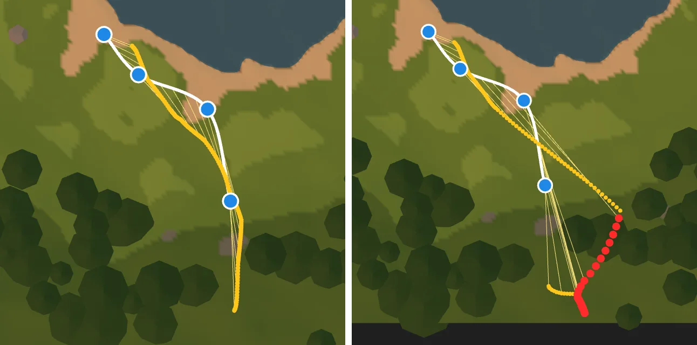
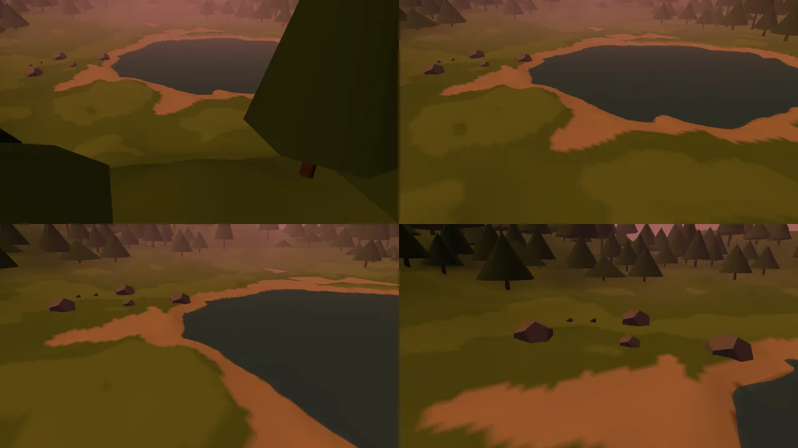
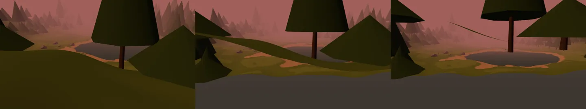

# Design: the director's line

Status: design, not built. Written 2026-11-27 for the maintainer's review before any code. The spike behind it is on the branch
[`spike/director-line`](https://github.com/plenarius/nwn-landscaper/tree/spike/director-line) (not for merge).

The maintainer asked for "a tool to create a directors line that gets passed to the director and produces the in game video".
[nwn-director](https://github.com/plenarius/nwn-director) already films long, smooth camera moves over an area in the real game
client: a *flight*, planned as keyframes in a JSON file. Today those files are written by hand, checked with a script outside the
editor, and filmed by hand. This design puts the line into the editor: drawn on the map, previewed in the 3D view on the path the
director will fly, checked as it is drawn, and sent to the director, with the video coming back to the editor.

Words used here:

- **Line:** a director's line, what the builder draws: keys, timing, ease, time of day. One area can have several.
- **Key:** one keyframe of a line: a time, a point on the ground, and how the camera looks at it from there.
- **Carrier:** the invisible creature the director makes walk the line; the game's camera follows it.
- **Pivot:** the point the camera turns about, a set height over the carrier. It is the middle of the picture.
- **Plan:** the director's flight file (nwn-director's README, "Flights"), what the export writes.
- **Look:** a time of day, sky, light and weather for a shot (nwn-director's `looks.json`).
- **Film kit:** what the director needs to film a line: the export's module and haks, and the plan.

## The short version

- **A Film tool** (key `V`) beside Things. Click the ground to add keys; drag a key, or press `K` in the 3D view to take the key
  from the view's own camera: frame the shot with the mouse, and the key reads where it looks from. A timeline under the view holds
  the keys' times, the ease and the time of day (nightfall, or one or more looks).
- **The stored line is the director's own flight format**, without `area` and with an `id`, in a `flights` list in the area file.
  The export only adds the area's resref, so the director reads it with no change. The spike converted the five hand-written plans
  into the area file and back with nothing lost (identical JSON), at 280 to 460 bytes a line.
- **The preview flies the director's plan, not the keys.** The editor runs a port of the director's planner (`plan_flight`) and of
  flightcheck.py's camera model: the carrier's eased walk, and the camera turning at the game's measured rates. On the five
  hand-written plans the port gives the same legs and camera moves, and poses within 10<sup>-13</sup> m. So the preview shows what
  the director will do, including where the camera arrives a few degrees short of a key (3° in the dunes plan, 6° in the cave).
- **Clearance checks run as you draw** (3 to 13 ms a line): camera in the ground, a tree, a wall or outside the area, the carrier
  on ground too steep, in water or into an object, and every limit that would stop the director. The port flags exactly what
  flightcheck.py flags (36, 12 and 23 issues on three broken plans). The line turns red where it fails.
- **What can't match:** the game's lighting and fog, grass, water, particles, creatures that spawn, the looks' weather and mist,
  and the game's field of view until it is measured. The motion can: path, pacing and camera turns are the director's own.
- **Handoff, in three steps:** download the plan (works with today's director); then **Film** on a builder's own machine where the
  engine runs the director; then a filming queue behind the team server, through new optional calls of the review service, with
  a worker on a machine that has a GPU and the game. Where that worker runs and who pays is the maintainer's choice (question 5).
- **Changes to nwn-director are small:** looks written into the plan (so a plan carries its own), looks that only set the time,
  a `daybreak` twin of `nightfall`, a `plan` command whose output the editor's tests compare with, stills of a flight's keys on the
  CPU, and a worker for the queue.
- **Cost:** about 60 hours of agent time and 7 of the maintainer's for all of it; the first useful release (draw, preview, check,
  download the plan) is about 30 hours.

## What the code shows today

The director is nwn-director at `main` d5129b5; the editor is [nwn-landscaper-web](https://github.com/plenarius/nwn-landscaper-web)
at `main` a99733a; the engine is this repository at `master` 0f15ed6. Paths starting `js/` are the editor's, `director.py` the
director's.

- **A flight** is checked by `load_flight` (`director.py:319`) and planned by `plan_flight` (`director.py:511`): a Catmull-Rom curve
  through the keys' points, each stretch at its own steady speed, changes of speed blended over 4 s, the start and end eased over
  `ease` seconds. The carrier walks it in legs of `step` seconds, paced by movement speed effects (0.06 to 21.9 m/s). The camera
  gets one `SetCameraFacing` per key, at the whole-number transition speed that gets it to the next key's direction, pitch and
  distance in time, started in three rising speeds over `ramp` seconds. A move that arrives early stops and holds.
- **Where the camera is** follows from the carrier: `pivot` metres over it, then `distance` back along the heading at `pitch`
  (1 looks straight down, 89 is level). A key's `height` is `pivot + distance × cos(pitch)` over the ground under the carrier.
- **Time of day:** a flight films at 10:00 and clear weather, or in a look (`looks`), or with `nightfall` seconds in
  (`flight_clock`, `director.py:499`: the client turns an area to night only as the clock runs into it). Looks need a `light` (the
  area copy's sun and moon colours, `load_looks`, `director.py:591`). The hand-written plans use a looks file of their own whose
  skies are rows 32 to 37 of `skyboxes.2da`: the Landscaper sky pack's rows in that export.
- **flightcheck.py** (outside both repositories) plans the flight with the director's own code, simulates the camera every half
  second over the area file's heights and objects, and lists where it fails. Object sizes come from a table measured once from the
  engine's `/api/model`.
- **The editor's tools** are a list (`js/tools.js:10`); `selectTool` and `updatePanels` (`js/app.js:121`) show one panel each. The
  Things tool already draws outlines on the ground: click corners, Enter; drag one, Shift+click takes it out, Alt+click on an edge
  adds one (`js/things.js:420`). The line follows the same rules.
- **The area file** is the editor's JSON (`toJSON`, `js/area.js:777`; `fromJSON`, `:810`); undo brings back the fields in
  `UNDO_FIELDS` (`js/area.js:42`). Publishing sends only the module's `.are`, `.git` and `.gic` (REVIEW-SERVICE.md), so nothing of
  the area file's own reaches the module. A canvas keeps its own fields in a free JSON header (`src/serve/canvases.rs`).
- **The 3D view** has a perspective camera (50° vertical) on orbit controls round a target (`js/view.js:219`), lights the scene from
  the area's sun or moon colours (`setAtmosphere`, `:314`), and fogs it as the game's camera sees it (`:390`). An orbit round a
  target is how the game's camera works too, so a key and the view's camera convert both ways.
- **Export to NWN** writes the area's module and haks into the user folder (handbook, Export), which is what the director films.

## What the spike did

On [`spike/director-line`](https://github.com/plenarius/nwn-landscaper/tree/spike/director-line), `research/director-line/`:

- `flight.js`: `plan_flight`, flightcheck.py's camera simulation and its checks, ported to JavaScript (330 lines, no imports).
- A parity test against the director: the five hand-written plans (vale, canyon, dunes, pass, cave) over their Landscaper areas,
  planned by both, then the poses every half second compared.
- A round trip: each plan into the area file's `flights` and back out as the export; and each key into the 3D view's orbit camera
  (position and target) and back.
- A rough preview: the area's heights, paint and objects drawn with three.js (trees as cones, rocks as stones, the area's dusk light
  and fog), from the camera the director will fly, and from above with the line on it.

| Plan | Legs, camera moves | Poses every half second | Check: issues, lowest clearance | Plan and check |
|---|---|---|---|---|
| vale | identical | within 1.4 × 10<sup>-14</sup> m | 0, 2.5 m (both) | 11 ms |
| canyon | identical | within 2.8 × 10<sup>-14</sup> m | 0, 17.6 m (both) | 6 ms |
| dunes | identical | within 2.8 × 10<sup>-14</sup> m | 0, 5.1 m (both) | 5 ms |
| pass | identical | within 2.8 × 10<sup>-14</sup> m | 0, 13.2 m (both) | 4 ms |
| cave | identical | within 3.6 × 10<sup>-15</sup> m | 0, 2.0 m (both) | 3 ms |
| vale, a key lowered and levelled | | | 36 (both) | 13 ms |
| dunes, a key lowered and levelled | | | 12 (both) | 6 ms |
| cave, a key raised | | | 23 (both) | 3 ms |

Times are Node on the burst server, one line, plan and check together.

### The line from above



Left, the hand-written vale plan: the carrier's path through the four keys (white, blue dots), the camera's path (yellow), and every
four seconds a line from the camera to the pivot it looks at. Right, the second key at 9 m and pitch 84: the camera swings back
into the trees and under the hillside, and the check marks those half seconds red. North is up; each picture is framed on its line.

### From the camera



The spike's shapes are placeholders (the editor draws the real models and textures), but the motion is the director's. The first
frame shows something the check passes: the camera starts between two tree crowns, outside the check's margins, close enough
that the preview is worth a look before filming.



### Keys don't always land

The director picks whole-number camera speeds, and a move that is too slow for speed 1 or not quite reachable arrives late or
early. In the hand-written plans the camera is 3.1° short of a key's heading in the dunes plan and 6.3° short in the cave. The
canyon plan keeps one heading for 52 s, so its camera stands still for 38 s while the carrier walks: a dolly, as intended. A preview
that eased smoothly from key to key would hide all of this; the ported planner shows it, and the timeline can mark where the camera
holds or falls short.

## Drawing the line

### On the map

- **The Film tool** (`V`, free today) lists the area's lines in its panel: name, length, duration, the check's state. **New line**
  starts one; clicking the ground adds keys at the end, a second apart by default (retimed below). Enter or a click on the last key
  ends it.
- **What the map shows:** the carrier's curve on the ground, each key as a numbered dot, a camera glyph over each key (where the
  camera stands, at its height, with a short line to the pivot), and the camera's whole path in the air as the planner computes it.
- **Editing:** drag a key's dot to move the point the camera looks at; drag the camera glyph to move the camera round it (heading
  and distance; with Shift, height). Shift+click takes a key out, Alt+click on the curve adds one, as for Things' outlines. Each
  edit is one undo step.
- **Key from view (`K`):** frame the shot in the 3D view with the mouse, then press `K`. The view's orbit target becomes the key's
  point (on the ground, the line's pivot over it), its distance, pitch and heading become the key's. Snapped to the director's limits
  (distance 1 to 40 m, pitch 1 to 89). The spike's round trip from a key to the view's camera and back is exact (10<sup>-14</sup>).

### Per key

The panel's key table: time, height (or distance), pitch, and how the camera turns: a **heading**, a **point to look at** (a dot
on the map, dragged), or **along the path** (none of them, the director's default). These are the director's own fields
(`height`/`distance`, `heading`/`lookAt`), so nothing is converted. A key keeps its mode: a key taken from the view gets a heading.

### Timing and ease

- **The timeline** under the view: keys as ticks along the flight's seconds, dragged to retime. Between ticks it shows the carrier's
  speed and the camera's transition speed, and marks stretches where the camera holds or arrives short.
- **Even pace** respaces the keys' times by distance along the curve so the carrier moves at one speed, the length kept.
- **The line's settings:** length (the last key's time), `ease` (3 s by default, at most half the length), `pivot` (2 m; higher makes
  an aerial), and under More: `step` and `ramp`.

### Time of day

The director decides what time the area shows, so the line offers the director's choices and the preview lights them:

- **As the director films** (default): 10:00, clear: the area's day light.
- **Nightfall at a time:** a marker on the timeline; the preview fades from the area's day light to its night light there. The area
  must cycle day and night; with a look, the look's time wins (the director drops `nightfall`).
- **Daybreak at a time** (new in the director, below): the twin, night into dawn.
- **Looks:** one or more; the line is filmed once in each. The panel offers the director's stock looks (`golden-hour`, `misty-dawn`,
  `moonlit`, `storm`) and looks made from the area's Sky & fog presets: a look's `light` has the same fields as a preset's sun
  (ambient, diffuse, fog colour and amount, shadows, view distance), so the preview lights it the way it lights the area. Rain,
  snow, wind, lightning, mist and the moon light are named on the preview, not drawn.

A look's sky is a Landscaper sky id in the editor, as the area's is; the export turns it into the `skyboxes.2da` row of that same
export, so a plan and its module always agree (the hand-written looks name rows 32 to 37 by hand).

## The preview

**Play** (Space) in the Film tool flies the view's camera along the line: each frame takes the carrier's point from the planned
legs, the camera's direction, pitch and distance from the simulated moves, and looks at the pivot. A scrub bar follows the
timeline; the view shows a 16:9 frame (the director films 1920 by 1080), and the area's light and fog as the time of day sets them.

How close it gets:

- **Exact:** the plan. The editor and the director compute the same legs and camera moves (the spike: identical, both ways).
- **Close:** the carrier's path. The creature walks straight between leg ends, at the paces the plan sets; the game smooths its walk.
  A carrier that meets a placeable walks round it, which the preview can't show, so the check flags a carrier path into an object.
- **Close, measured roughly:** the camera's turns. The turn rate (0.23 × n<sup>1.5</sup> degrees a second) was measured steady; tilt
  and zoom rates are rough (README, Flights), so a tilt or zoom may finish a second or so off. Step 4 measures it: the same
  line recorded from the preview and filmed by the director, compared by motion.py's per-frame image motion.
- **Unknown until measured:** the game's field of view. The client has no setting for it; step 4 measures it from one still and
  the preview uses it.

What can't match: the game's lighting (its tile lights, enhanced lighting and shadows), the shape of its fog, its sky and the fade
of the sky at dawn and dusk, grass, the water shader, particles (baked emitters draw only in the game), creatures the director's
encounters spawn, a look's weather, mist placeables, lightning and moon light, and screen effects. The preview is for motion and
framing; the game's look comes from the film, or more cheaply from flight stills (director change 5).

## Checks while drawing

The ported checks run after each edit, throttled to the frame rate (a line takes 3 to 13 ms):

- **Stops the director** (red, export refused): a key time not rising or not starting at 0, pitch outside 1 to 89, a camera
  distance outside 1 to 40 m (a height under the pivot is one), the carrier faster than 21.9 m/s, `ease` over half the flight,
  nightfall outside the flight, a name the director won't take. The same rules as `load_flight` and `plan_flight`,
  with their messages.
- **Spoils the shot** (red on the line, export allowed): the camera under 1 m over the ground or water, inside an object, in or
  over a cave wall, outside the area; the carrier on ground too steep to walk, in water, or into an object. flightcheck.py's rules,
  every half second.
- **Worth a look** (orange): the camera holds or arrives short of a key by more than 2°; a move too slow to ramp; for more than a
  second something stands between the camera and the pivot (a ray through the view's own meshes). The last is new: flightcheck.py
  has no line of sight.

Two things improve on flightcheck.py because the editor knows more: object sizes come from the models the view draws, not a
table, and a cave's walls come from the area's roof and clearance, not a guess from the ground's heights. The issue list in the panel
names each problem with its time; a click puts the preview there.

## Where the line is stored

**In the area file**, as `flights`: a list, so an area has as many lines as the builder wants.

```json
{
  "flights": [
    { "id": 1, "name": "vale-dusk-to-night", "pivot": 5, "ease": 4, "nightfall": 46,
      "keys": [ { "t": 0, "at": [86, 26], "height": 16, "pitch": 60, "heading": 92 },
                { "t": 26, "at": [82, 42], "height": 13, "pitch": 63, "heading": 105 } ] }
  ]
}
```

- **Undo, save, copies:** `flights` joins `UNDO_FIELDS`; it saves and loads with the area, in the browser and on the engine, and a
  copy of the area takes its lines.
- **Never in the game:** export and publish ignore it.
- **Canvases:** the canvas header keeps the lines; a line belongs to the piece its keys are in, and one that crosses a cut can't be
  exported (the director films one area).
- **Moving ground:** a line keeps its points when the ground changes under it; the checks say when an edit spoils it.

## The handoff to the director

The export writes the plan: the line, `area` set to the exported area's resref, its looks written in (director change 1) with
their skies as rows of the same export. A film kit is that plan beside the export it belongs to (its export id). Three ways to
film it, built in this order:

### 1. Download the plan

**Download plan** saves `<area>-<line>.json`. With an exported area in the game's folder, today's director films it:
`director.py film modules/<area>.mod --flight <area>-<line>.json --character <a .bic>`. On a team server the builder downloads the
area's package as well. Nothing to set up on the Landscaper's side.

### 2. Film on the builder's own machine

The engine runs the director itself when its Settings name `director.py` and a character for the cameraman. **Film** exports the
area if it changed, writes the plan, and runs the director on the module in the user folder, its log streamed to the panel as the
export's is. The video lands in the Landscaper's data folder under `films/<area>/<line>/`, and the panel plays it beside the line,
at the timeline's time.

The director's own needs apply: Linux, Docker, the game and its CD key (not playing on that key while it films), and VirtualGL to
film off screen (else on the desktop). Builders on Windows or macOS can't film locally; they use the plan download or the queue.

### 3. A filming queue

A team server's builders have no game client there, the team server has no GPU, and a CD key on it would be shared by everyone.
So the team server hands film kits to the review service, which films them elsewhere and hands the video back. New optional calls
in REVIEW-SERVICE.md, in the style of Try on dev (each refusal a `detail` sentence the editor shows):

| Call | What |
|---|---|
| `POST /api/v1/films` | `user`, `area`, `export` (its id), `plan`. Answer: `{ "id", "position" }`. The service fetches the export through the team server's existing service routes (Fetching exports) and checks the id |
| `GET /api/v1/films?user=<user>` | The builder's films: `queued`, `filming`, `done` or `failed` (with a `detail`), and the queue's length |
| `GET /api/v1/films/<id>/video` | The mp4. The team server keeps it in the builder's workspace (`films/`) and serves it to the editor |
| `DELETE /api/v1/films/<id>` | Cancels a queued film |

The service keeps the queue; a **worker** on a machine with a GPU, the game, the module's haks and a CD key asks it for the next job
(outbound only, no open port), fetches the kit, runs the director and sends the video back. One CD key films one line at a time:
about 4 to 6 minutes a film (the server and module start, the client logs in, 70 to 80 s of flight; estimated from the director's
waits, not measured here), so 10 to 15 films an hour a key. A second key doubles that.

For Layonara, the service is layonara-ops-api and the worker is a script in nwn-director. Where the worker runs is question 5.

## Changes to nwn-director

1. **Looks inside the plan.** A `looks` entry may be a look object (the keys of a looks file) as well as an id, so a plan carries
   its own looks and needs no `--looks` file. Small.
2. **Looks that only set the time.** `light` becomes optional: without it the shot is filmed in the area itself, no copy. "This
   area at dusk" is then a look. Small.
3. **`daybreak`**, the twin of `nightfall`: enter at night, the clock set to run into dawn that many seconds in (the dawn sky shows
   only as the clock runs into it, as for a dawn look). Small; one check in the client.
4. **`director.py plan FLIGHT`** prints the planned shot (legs, camera moves) as JSON, with a planner version. The editor's tests
   keep its output for a few plans as fixtures and compare the port with it, so a change to the planner fails the editor's tests
   until the port follows. Small.
5. **Flight stills:** `--stills N` takes flights: a still at each key's pose (or N along the flight), drawn on the CPU as spots'
   stills are. The game's light, fog and sky at the key frames, on any Linux machine with no GPU (a few minutes on 4 cores).
   Medium.
6. **A worker for the queue:** asks the service for a job, fetches the kit, films, sends the video. Medium.
7. **The plan beside the video** (`<name>.json`, with the director's version), so the editor plays a film in step with its line.
   Small.

Not needed: a new reader. The export is the director's flight format already.

## Questions to settle

Each question gives the recommendation first and the options not chosen after it.

### 1. Store the line in the area file

**Recommended: yes, as `flights`, several per area.** It saves, undoes and copies with the area for free, and a line only makes
sense over its own ground.

Considered and not chosen:

- **A file beside the area** (`<area>.flights.json`): new routes to save and list it on the engine and the team server, its own undo,
  and two files to keep in step when an area is copied or renamed.
- **Only in the export:** the builder couldn't come back and change a line.

### 2. The stored form is the director's flight format

**Recommended: yes, the plan without `area`, plus `id`.** The export is a copy, the director needs no new reader, and the
hand-written plans import as they are.

Considered and not chosen:

- **An editor format** (camera positions and targets) translated at export: two formats that drift, and a lossy round trip for
  keys that look along the path or at a point.

### 3. The preview simulates the director

**Recommended: the ported planner, kept equal by the director's `plan` fixtures.** What you see is what gets filmed, including the
camera holding or falling short of a key.

Considered and not chosen:

- **Smooth interpolation between keys:** simpler, and wrong by the director's quirks (6° in the cave plan), which are what a builder
  needs to see.
- **The engine plans, the editor asks:** one copy of the planner in Rust, but a round trip per drag, and no preview in the browser
  demo.

### 4. Time of day: the director's choices

**Recommended: default, nightfall, daybreak, and looks, with looks made from the area's own presets.** Each is something the
director can film; the preview lights each from data the editor has.

Considered and not chosen:

- **A free time of day per key** (dawn at 10 s, noon at 40 s): the game's clock only runs forward at the module's pace (2 minutes
  an hour by default), and the client switches day and night only as the clock runs into them, so the director can't film it.

### 5. Where filming runs, and who pays

The maintainer's choice. **Recommended: steps 1 and 2 first (no cost), then the queue with the maintainer's own GPU machine as its
only worker; rent a GPU server only if builders wait too long.**

| Where the worker runs | Cost | For | Against |
|---|---|---|---|
| **The maintainer's own GPU machine** (the GTX 1050 the director was measured on) | none | films at 30 fps already; set up | films only while it is on and its CD key is free; the maintainer's desktop does the work |
| **A rented GPU server**, Hetzner GEX44 (RTX 4000 SFF Ada) | about €232 a month and €114 setup, excluding VAT ([Hetzner's price adjustment](https://docs.hetzner.com/general/infrastructure-and-availability/price-adjustment/)) | always on; Docker and VirtualGL as on the maintainer's machine | a fixed monthly cost for a few films a week |
| **An on-demand GPU** (RunPod RTX A4000) | about $0.17 to $0.25 an hour, billed by the second ([RunPod](https://www.runpod.io/gpu-models/rtx-a4000)) | pennies a film | containers: the director's server runs in Docker, which a pod can't (a server without Docker is more director work); the game and haks copied in at each start |
| **The team server itself** | none | no queue | no GPU, no game client, and a shared CD key in a public-facing container |

Who pays: the project, whichever is chosen; a builder can't. A daily cap per builder (as for fetching areas) keeps it bounded.

### 6. Who may film

**Recommended: every builder, one film in the queue at a time and three a day; admins without a cap.** Showing an area moving is
part of reviewing it.

Considered and not chosen:

- **Admins only:** builders would ask an admin for each film.

### 7. How long films are kept

**Recommended: the newest film per line and look, in the builder's workspace; older ones deleted when a new one arrives.** A film of
80 s at 1080p is tens of megabytes.

Considered and not chosen:

- **Every film:** workspaces grow with every retake.

## Risks

- **The planner changes.** The director's planner is young (two pull requests). Its `plan` fixtures make the editor's tests fail on
  any change, so the port can't drift silently; the cost is a port update with each planner change.
- **The rates are rough.** Tilt and zoom rates were measured roughly on one GPU. A wrong rate makes the preview's camera finish a move
  early or late; step 4's comparison measures it, and the rates are one table in each repository.
- **Flights are Linux only.** The director runs on Linux; local filming leaves Windows and macOS builders to the queue.
- **One CD key.** The queue's worker uses one key; while it films, that key can't log in elsewhere (headless test clients queue
  behind it).
- **Camera through objects.** The director turns camera collision off for flights; a line the check passes can still graze a crown
  (the vale's first frame). The preview shows it; the check's margins can grow if films show more.
- **The editor's model of the ground.** The check reads the area's heights; the game's walkmesh comes from the same heights, but an
  object's own walkmesh can lift or block the carrier where the editor sees open ground.

## Build order

Each step is one pull request in each repository it touches, shippable alone. Agent time is wall-clock for a coding agent; the
maintainer's time is review and testing. "Client" marks a check in the game client.

| # | Step | Repository | Agent | Maintainer | Client |
|---|---|---|---|---|---|
| 0 | Spike: the planner and checks in JavaScript, parity with the director, round trip, rough preview. **Done** (`spike/director-line`) | engine | 2 h | 20 min (this design) | no |
| 1 | `director.py plan`; the editor's `js/flight.js` with fixture tests against it | director, web | 3 h | 20 min | no |
| 2 | The Film tool: lines in the area file, undo, canvas header; keys on the map, the panel, the timeline, Key from view | web | 10 h | 1 h | no |
| 3 | The checks: the ported rules with the view's meshes, the cave roof, line of sight, the director's limits, the issue list | web | 6 h | 30 min | no |
| 4 | The preview: play, scrub, the 16:9 frame, nightfall and looks lit; the game's field of view measured; one line recorded from the preview and filmed, compared by motion.py | web | 6 h | 45 min | 30 min: one film of a known line |
| 5 | Export the plan: resref and sky rows from the export, Download plan, the film kit's export id | engine, web | 4 h | 30 min | no |
| 6 | Director: looks in the plan, time-only looks, `daybreak`, the plan beside the video | director | 4 h | 30 min | 20 min: daybreak and a time-only look |
| 7 | Film on the builder's machine: Settings, the engine runs the director, the log, the video in the panel | engine, web | 6 h | 45 min | 20 min: Film from the editor |
| 8 | Flight stills on the CPU | director | 3 h | 20 min | 15 min |
| 9 | The queue's calls: REVIEW-SERVICE.md, the team server's side, the editor's film list | engine, web | 8 h | 1 h | no |
| 10 | The queue in layonara-ops-api, and the worker | layonara-ops-api, director | 8 h | 1 h | 30 min: a film through the queue |
| 11 | Docs: a handbook page (Film), the changelog | both | 2 h | 20 min | no |

About 60 hours of agent time beyond the spike and 7 hours of the maintainer's, of which about 2 in the client. Steps 1 to 5 are the
first release (draw, check, preview, download the plan: about 29 hours), usable with today's director. Step 2 needs 1; 3 and 4 need
2; 5 needs 2; 7 needs 5 and 6; 10 needs 9 and question 5.

## What this design could not check

- **The game client.** No film or still was taken: the burst server has no CD key. The preview's agreement with a film (rates, field
  of view, the carrier's walk in the game) is step 4's measure.
- **The editor itself.** The spike's preview is a standalone page with placeholder shapes, not the editor's view; the Film tool's
  panel and timeline weren't built.
- **The filming times** in the queue are estimated from the director's waits.
- **Prices** were read from the providers' pages on 2026-11-27.
- **Other areas.** Only the five hand-written plans and their areas were checked.
