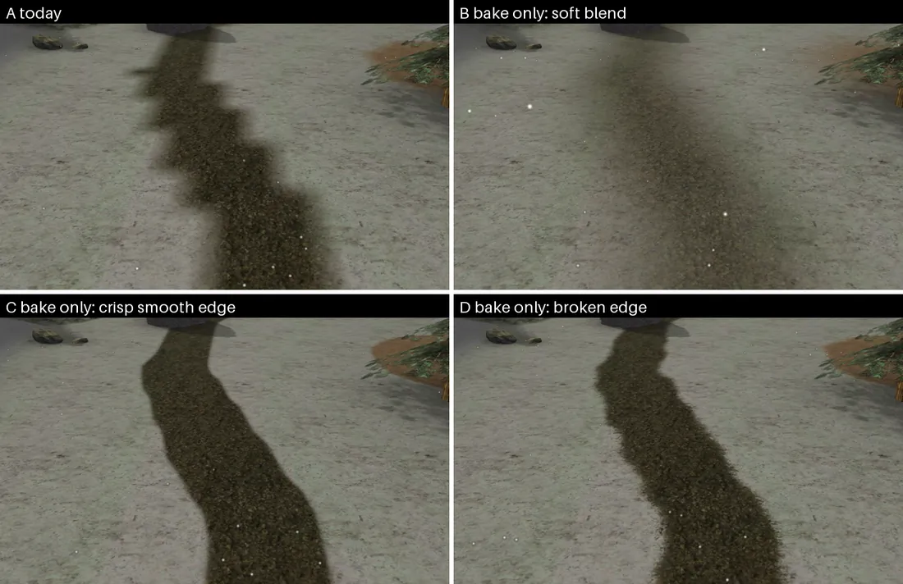
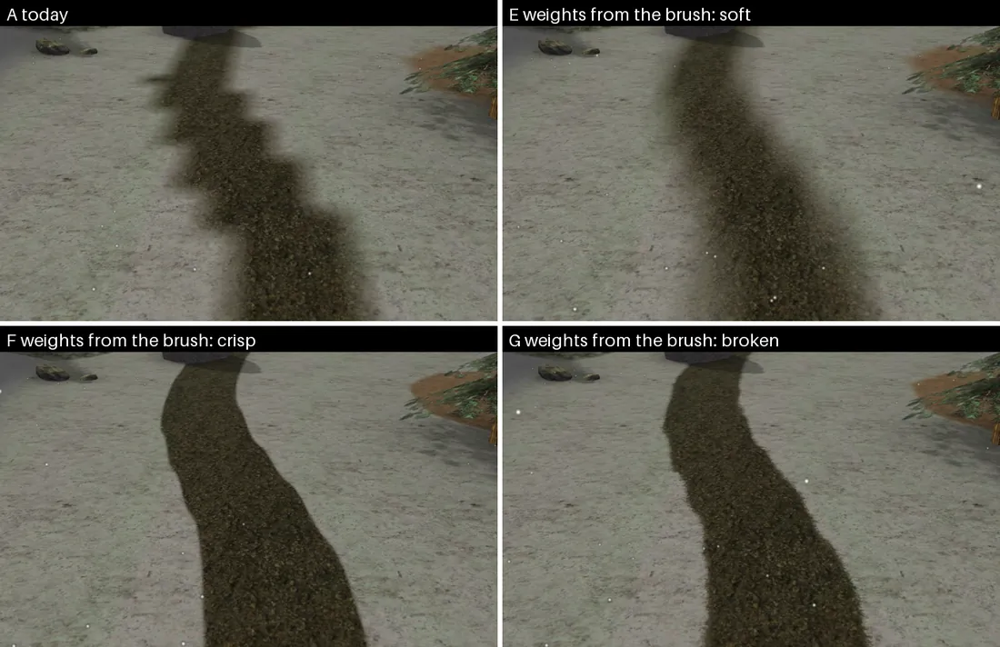
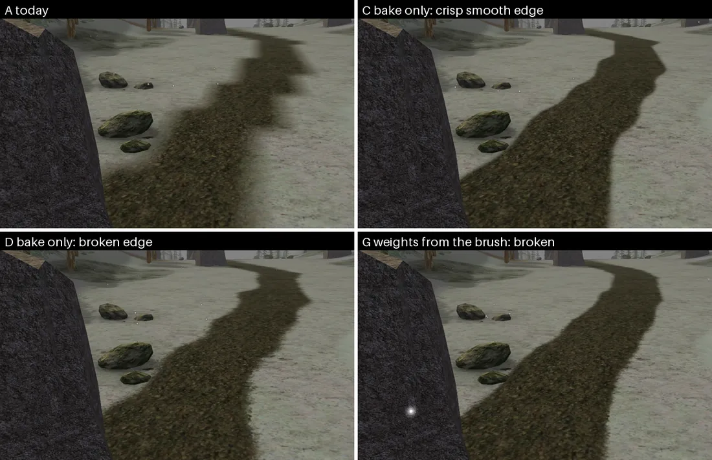
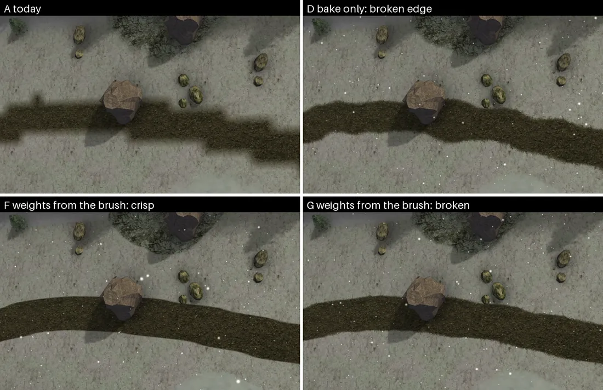
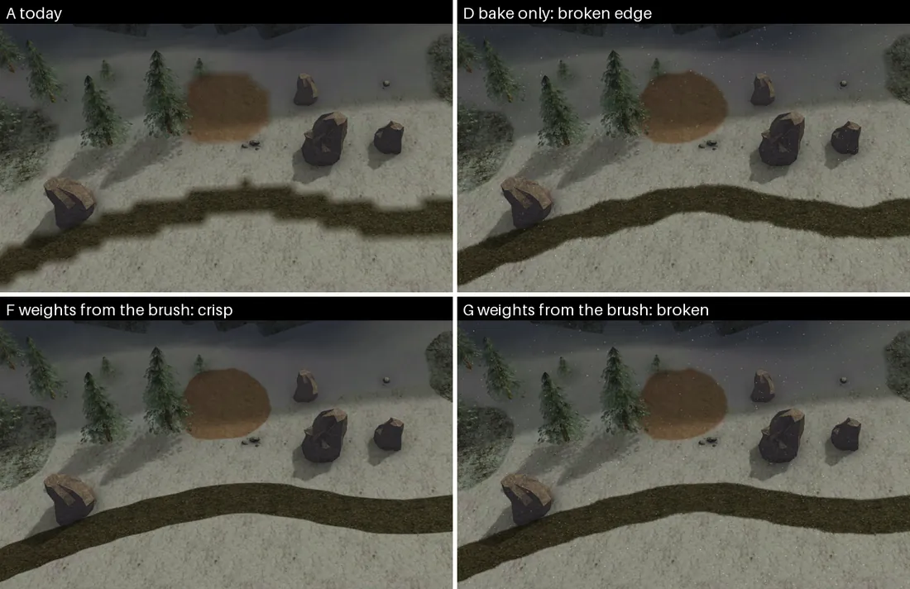
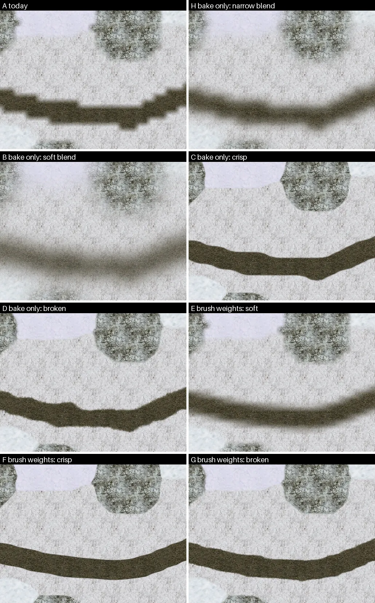
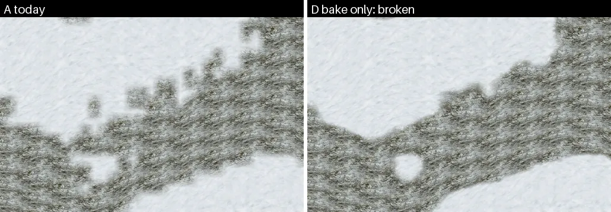
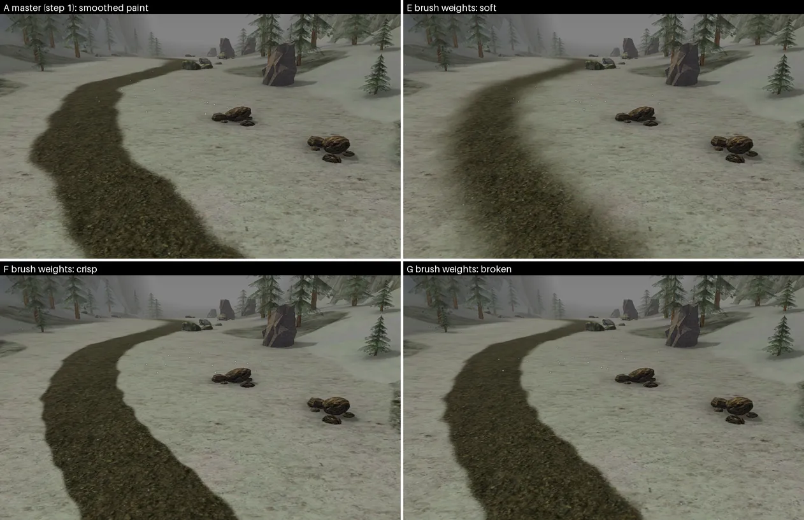

# Design: soft paint

Status: steps 1 and 2 built; step 3 built in the engine (see "Step 3 as built"), its editor side under way. Written
2026-11-27 for the maintainer's review before any code. The spike behind it is on the branch
[`spike/soft-paint`](https://github.com/plenarius/nwn-landscaper/tree/spike/soft-paint) (not for merge).

Painted edges in exported areas look bad in the game. A gravel trail through the snowy pass sample landscape shows a hard
sawtooth all along both sides, one tooth every 0.625 m. Editor issue
[nwn-landscaper-web#93](https://github.com/plenarius/nwn-landscaper-web/issues/93) asks for a real blend between textures. It was
judged to need a change to the area format and the engine. This design measures what each fix costs and how it looks in the game
client, and proposes an order to build it in.

Words used here:

- **Sample:** a point of the area's grid, every 0.625 m. Today each sample holds one texture (its palette index).
- **Bake:** the export's picture of a tile's ground, 512 px over 10 m (2 cm a pixel), written as the tile's own DDS texture.
- **Weight:** how much of a texture a point of ground shows, 0 to 1. Today a sample's texture weighs 1 there and the others 0.
- **Edge style:** how two textures meet once the edge lies where it should: **soft** (a gradient), **crisp** (a sharp line) or
  **broken** (a sharp line ragged by noise and by the textures themselves, gravel poking into snow).

## The short version

- **The game needs no change.** A tile with more than one texture already gets its own baked picture at 2 cm a pixel. The
  sawtooth is the paint's 0.625 m grid, drawn into that picture: the bake reads the four samples around each pixel and blends them
  bilinearly, so each sample's square shows. Everything below changes only what the bake draws (and what the editor shows).
- **Stage 1, no format change: smooth the paint at bake time.** Each texture's samples become a weight field smoothed over about
  1.5 m; a pixel takes the texture weighing most, its edge eased over a few centimetres and broken by noise. In the client this
  removes the sawtooth on the existing trail with no repainting (picture 1, D). Every existing area improves on its next export.
  The edge follows the smoothed grid, not the brush, so it still bends where the grid stepped (picture 3, C), and single-sample
  specks disappear.
- **Stage 2, a format change: weights from the brush.** Each sample also stores a second texture and its weight (2 bytes). The
  paint brush gets a Softness: it writes weights that fall off towards its rim, so the edge's position between samples is known,
  and the bake draws it soft, crisp or broken on the brush's own line (picture 2, F and G). Soft blends a few metres wide come from
  a soft brush, not from blurring everything.
- **Not recommended: a finer paint mask** (4 or 8 points a metre). Weights at 0.625 m already put a crisp edge within a few
  centimetres of the brush's line (F). A mask at 8 a metre is 25 times the paint data: 8.7 MB more in a 32 by 32 tile area's
  file, and about 20 MB more in the editor.
- **Cost:** stage 1 changes no file and adds about 3% to the hak (tiles beside a texture change now get baked too); the spike's
  bake takes 40 to 60% more CPU, mostly avoidable. Stage 2 adds 2 bytes a sample: +154 KB to the snowy pass's 413 KB area file,
  +0.7 MB for the largest area, about 1.6 MB of editor memory.

## What the code shows today

The editor is [nwn-landscaper-web](https://github.com/plenarius/nwn-landscaper-web) at `main` 18856a9, and the engine is this
repository at `master` 41cc571. Paths starting `js/` are the editor's; the rest are this repository's.

- **The area's paint** is one byte a sample, an index into the area's palette (`js/area.js:79`), saved as base64 in the area file
  (`js/area.js:784`) and sent to the export after the heights (`src/serve/export.rs:212`). A canvas block keeps it the same way
  (`src/canvas.rs:32`).
- **The paint brush** is hard-edged: every sample within its core takes the texture (`js/tools.js:98`). The Mix brush's **Soft
  edge** paints fewer patches towards the brush's rim (`js/mix.js:195`), so a stroke's edge breaks into specks a sample or two
  across; each sample still holds one texture.
- **The editor's view** reads the four samples around each point (`js/view.js:122`) and blends their textures bilinearly.
- **The bake** does the same (`src/generator/painter.rs:144`, `corners`; `ground` at `:165`): four samples, bilinear weights,
  each texture drawn from three sides by the slope. Each pixel is the mean of 2 by 2 points (`bake_over`, `:285`). A tile is
  baked when it holds more than one texture (`baked`, `:124`); a tile in one texture draws the library texture itself, in the
  triplanar shader. The bake cache's key reads the samples one beyond the tile (`bake_key`, `:236`).
- **The game** draws a baked tile's walkable ground with its own 512 px texture over the tile's square (`src/generator/tile.rs:108`,
  TXI `clamp 3`, `src/generator/generate.rs:273`). Steep faces take one library texture whole, cut along the paint by
  `src/generator/split.rs` (`tile.rs:114`); soft paint doesn't reach them.

So the editor and the game agree today, and both show the grid. A 0.625 m bilinear ramp on a staircase of samples is the
sawtooth: from the player's camera each step reads as a tooth (picture 1, A).

## What was measured

The snowy pass sample landscape (16 by 14 tiles, six textures), exported each way by the spike and shot in the game client off
screen (Mesa software rendering, so no anti-aliasing or dynamic shadows), from the angle of the maintainer's report, from low on
the trail, from high above it and from a wide view. The trail is a gravel line two to four samples wide. Every picture below was
looked at.

The variants:

| | What the bake reads | Format change |
|---|---|---|
| **A** | Today: four samples, bilinear | none |
| **B** | Each texture's samples smoothed (Gaussian, sigma 0.9 m); the weights as they are: a soft blend | none |
| **H** | As B, sigma 0.45 m | none |
| **C** | Smoothed (sigma 0.6 m); the texture weighing most wins, eased over about 10 cm: crisp | none |
| **D** | As C, each texture's weight moved by noise (features about 1.5 m) and by its own brightness there: broken | none |
| **E** | Weights as a soft round brush would store them: the trail painted again along its own centreline, falling off over 1 m; drawn soft | 2 bytes a sample |
| **F** | E's weights drawn crisp | 2 bytes a sample |
| **G** | E's weights drawn broken | 2 bytes a sample |

E, F and G emulate stage 2: the brush weights were computed outside the editor (`research/soft-paint/brush.py` on the spike
branch), only for the trail; the rest of the area keeps its paint, smoothed as in C.

### From the maintainer's angle

- **A (today)** is the report's picture: square teeth all along both sides.
- **B (soft blend, no format change)** removes the teeth but smears the trail: a trail 1.5 m wide can't carry a 2 m blend. **H**
  (narrower) keeps a ghost of the steps (picture 6). Blurring alone is either too wide or still stepped.
- **C (crisp)** draws a clean edge on a smooth line. **D (broken)** reads as gravel scattered into snow, and hides the bends C still
  has.

- **E, F, G (weights from the brush)** follow the brush's path: no bends at all, soft, crisp or broken as wanted.

### Low on the trail

Close up, C shows where the grid stepped: the edge turns in short straight runs. D softens that, and G (the brush's own line)
has none of it.

### From above

From above, A's staircase is plain even at distance (the wide view, the trail and the brown patch). D, F and G all read as painted
ground.

### The bakes themselves

The baked textures over the same 20 by 16 m, north up:

### What the smoothing loses

Smoothing swallows features a sample or two across. In the snowy pass, 105 of its 255 patches of one texture (mostly the Mix
brush's soft-edge specks) disappear at sigma 0.6 m; 1.4% of its samples change texture. In the lake valley sample, 10 of 40
patches, 0.15% of samples. Above, the rock band's ragged rim becomes one smooth outline with a broken edge. The Mix brush's soft
edge was there to hide the grid; with stage 1 it isn't needed for that, and in stage 2 it writes weights instead of specks.

### Cost

Measured on this burst server (48 cores, other jobs running beside it: times vary by about 20%), the export at 16 threads, two
runs each.

| | Export, wall | Bake, CPU (all threads) | Hak | Area file | Editor memory (32 by 32 tiles) |
|---|---|---|---|---|---|
| A today | 10.4, 13.1 s | 88, 113 s | 72.15 MB | 413 KB | as today |
| C crisp | 12.8, 14.8 s | 124, 144 s | 72.33 MB (+1 tile baked) | unchanged | +0.5 MB (stage 1's view texture) |
| D broken | 16.2, 16.7 s | 161, 173 s | 72.33 MB | unchanged | +0.5 MB |
| F brush weights, crisp | 14.9, 13.7 s | 141, 130 s | 72.33 MB | +154 KB (+37%) | about +1.6 MB |
| Finer mask, 8 a metre (not built) | | | as F | +2.0 MB here, +8.7 MB at 32 by 32 tiles | about +20 MB |

- **Export time.** The spike is unoptimised: at every point it reads every palette entry's field and allocates. A real build
  works out each tile's two strongest textures once and samples a second texture only near an edge; expect 10 to 20% more bake
  time, a second or two on an area this size. The in-browser export (`DESIGN-web-demo.md`) bakes on fewer, slower threads and
  feels it most.
- **Hak.** A tile is baked when any texture reaches into it, so tiles beside a change of texture are baked too. The snowy pass
  already bakes 223 of its 224 tiles (its snow is mottled); the lake valley goes from 144 to 163 baked tiles, 109.2 to 112.5 MB
  (+3%).
- **Area file.** Stage 2's layer is a second palette index and a weight a sample, base64 like the paint: 154 KB for the snowy
  pass, 0.7 MB for 32 by 32 tiles. It is mostly zeros: deflated it is 28 KB here.
- **Two textures a sample are enough.** With brush weights, 1.5% of the snowy pass's samples have a third texture above 5%, at
  most 0.31, where three textures meet; smoothed, 2.2%. Dropping the third there shifts a junction by a few centimetres.
- **Editor memory.** The paint is held three times: the area, the undo base and the GPU's copy (`js/area.js:603`,
  `js/view.js:451`). Two more bytes a sample is 0.5 MB each for the largest area.

## Questions to settle

Each question gives the recommendation first and the options not chosen after it.

### 1. Ship stage 1 on its own first

**Recommended: yes.** It fixes every existing area on its next export with no repainting and no format change, and it is the
code stage 2 needs anyway: stage 2 only replaces where the weights come from. The editor must show the same edges in the same
release, or builders see steps the game no longer has.

Considered and not chosen:

- **Stage 2 only.** Existing areas would keep the sawtooth until repainted with the new brush.
- **Stage 1 only.** Edges keep the grid's bends (C) and soft blends stay impossible on narrow features (B).

### 2. Which edge style the bake uses

**Recommended: broken by default, set per texture.** The texture catalog gets an `edge` (`broken`, `crisp` or `soft`), like its
`surface`: broken for natural ground (D, G), crisp for laid surfaces such as cobbles and floors (C, F), soft for the few that should
read as a wash. Where two textures meet, the softer style of the two wins. No format change.

Considered and not chosen:

- **One style for the whole area** (an Area setting): simpler, but a cobbled road through grass wants both.
- **A style per stroke**, stored per sample: one more byte a sample for a choice builders rarely need.

### 3. Stage 2's format: weights, not a finer mask

**Recommended: a second texture and its weight per sample** (2 bytes), with the brush's Softness deciding how wide a blend is.
F shows weights at 0.625 m place a crisp edge on the brush's line, which is what a finer mask would buy.

Considered and not chosen:

- **A finer mask** (4 or 8 points a metre, one texture each): 6 to 25 times the paint data, crisp edges only, and soft blends
  would still need weights.
- **Three textures a sample** (4 bytes): only where three textures meet, 1 to 2% of samples, and the error there is a few
  centimetres.

### 4. The Mix brush's soft edge

**Recommended: let stage 1 swallow its specks, and in stage 2 make the soft edge write weights.** Its specks were a way to hide
the grid; a broken edge does that better (picture 7).

Considered and not chosen:

- **Keep specks** by smoothing less where the paint is speckled: it brings back the grid there.

## Risks

- **Editor and game drift apart.** Stage 1 is only right if the editor's view draws the same edges. The view would get the same
  data (two strongest textures and the weight, per sample, worked out over a stroke's rectangle), and the same noise and
  brightness rule in its shader. A test compares the editor's colour at a set of points with the bake's.
- **Old areas change look on their next export.** Intended, but a builder who placed objects on the old edge sees the edge move by
  up to half a sample. Thin lines of one sample vanish (question 4).
- **The bake cache.** Its key must cover every sample whose smoothing reaches the tile (about 3 samples beyond it, not 1), and the
  bake's version goes up, so every tile bakes again once.
- **Steep ground** keeps one texture a face (split.rs): a soft edge stops where the ground turns steep. The bank's cut line and
  the water's edge are a separate design.
- **Canvas blocks and imports.** Stage 2's layer must go into a canvas block file (`src/canvas.rs`), the band, copy and paste, and
  undo. An engine older than stage 2 reading a new area ignores the layer and draws hard edges.
- **The spike's noise** is a placeholder (two octaves of value noise). Tuned per texture it may need a third octave or a mask
  picture per texture; that's tuning, not design.

## Build order

Each step is one pull request in each repository it touches, shippable alone. Agent time is wall-clock for a coding agent; the
maintainer's time is review and testing. "Client" marks a check in the game client.

| # | Step | Repository | Agent | Maintainer | Client |
|---|---|---|---|---|---|
| 0 | Spike: smoothed and brush weights at bake time, the client stills above. **Done** (`spike/soft-paint`) | engine | 3 h | 20 min (this design) | no |
| 1 | Bake from weights: each tile's two strongest textures from the smoothed paint, crisp and broken, the catalog's `edge`, the wider bake key, baked-tile margin, minimap, tests | engine | 6 h | 30 min | 15 min: the snowy pass and the lake valley |
| 2 | The editor draws the same: the derived weights per stroke, the shader's crisp and broken edges with the engine's noise, a parity test against the bake | web | 7 h | 30 min | no |
| 3 | Stage 2's layer: a second texture and weight per sample in the area file, the export's body, canvas blocks, band, undo, copy and paste; the bake reads it in place of smoothing where it is set | both | 8 h | 45 min | no |
| 4 | The brush's Softness, the rule for painting over a sample that already holds two textures, the Mix brush's soft edge writing weights | web | 6 h | 45 min | 15 min: a trail painted soft, crisp and broken |
| 5 | Docs: the handbook's Paint page, `docs/TEXTURE-PACKS.md` (`edge`), the changelog | both | 2 h | 20 min | no |

About 29 hours of agent time beyond the spike and 3.5 hours of the maintainer's, of which about 30 minutes in the client. Steps
1 and 2 go together (one release); 3 needs 1; 4 needs 2 and 3.

## Step 3 as built

The engine side of step 3, 2026-11-28. The editor's side (the layer in the editor, the Softness brush) builds to the same
format.

- **The layer.** `blend`: two bytes a sample, the paint's order and grid (halo included): a second palette index, then its
  weight (0 to 255, its share of the sample). Weight 0 is no second texture there, and that sample is smoothed as in step 1. A
  second equal to the paint pins the sample to the paint alone (the brush's fully covered core). Writers keep the heavier
  texture in the paint, so an engine or editor that ignores the layer shows the nearest texture.
- **Where it goes.** The area file and the export's body carry it as base64 (`"blend"`, in the body's JSON, where an older
  engine ignores it); the exported header names a `.blend` file beside the `.materials`; a canvas block holds it after its
  chasm mask (flag 2), and shared rows must match in it too. A layer of all zero weights is no layer: such an area or block has
  today's bytes. An engine older than this one refuses a block that holds a layer, as damaged: the block file has nowhere it
  could skip it.
- **The bake.** Each sample's two textures and the second's share (`soft.rs`, step 2) come from its own weights where it has a
  layer, else from the smoothed paint; the smoothing still reads the paint alone. Everything after (the bilinear mix, the edge
  styles, noise) is step 1's. The bake cache's key already reads those per-sample values, so a changed weight misses it.
- **`soft`** is a third edge style in the catalog: a point with a soft texture among its entries blends them by weight, with
  no noise. The softest style at a point wins: soft, then broken, then crisp.
- **Checked.** The snowy pass without a layer exports byte for byte as master (hak, module, minimap, shadows). With the spike's
  trail weights (a round brush along the trail's centreline, falling off over 1 m, `research/soft-paint/brush.py` on
  `spike/soft-paint`, written as a layer) the client draws the trail as the spike's E, F and G did:

## What this design could not check

- **A real GPU.** The stills come from the client on Mesa's software renderer: no anti-aliasing, no dynamic shadows, its own
  choice of mip level. The baked textures are the same on any GPU; how far away a soft edge melts into the mip levels may differ.
- **The editor's look.** Stage 1's and stage 2's view changes weren't built; their cost is estimated from the view's shader.
- **Brush weights painted by hand.** E, F and G come from a script that painted the trail again along its centreline; a person
  painting with a Softness slider will lay different weights, especially where strokes cross.
- **Other textures and areas.** Only the snowy pass (shot in the client) and the lake valley (bake and hak size) were measured.
