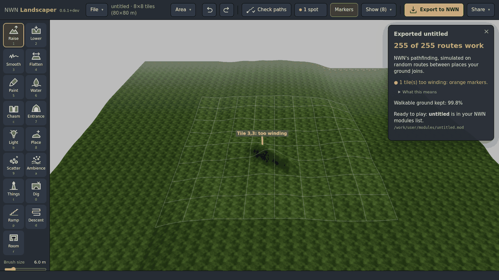

# Design: try the Landscaper in a browser

Status: stage 1 built: steps 3 to 7 done. Written 2026-11-26 from a spike; every question but threads decided the same
day. The page as built (step 4): "The page" below. Changed 2026-11-27: the page carries the game's stock placeables and
shaders ("The stock placeables" below).

A public "try it" page: the editor and its engine both in the visitor's browser, nothing to install and no engine on a server.
Visitors without the game sculpt, paint, check paths and export with art that isn't the game's; visitors with the game point the
page at their own install and get everything the desktop Landscaper offers. Since 2026-11-27 the page serves the game's stock
placeables, their textures and the three shaders an export needs: everyone who uses the Landscaper owns the game.

Words used here:

- **WASI:** a standard set of system calls (files, clock, arguments) for WebAssembly. Rust builds a program for it
  (`wasm32-wasip1`) with its file code unchanged; in the browser a small JavaScript library answers the calls.
- **Service Worker:** a script the browser runs beside a site's pages that can answer the pages' requests itself.
- **Worker:** a script on a thread of its own, started by one page and living as long as that page.
- **OPFS:** the browser's private file storage for a site (Origin Private File System), lasting across visits.
- **Stand-in install:** the few files the engine reads from a game install, made here with none of the game's content.

## The short version

- **The whole engine builds for WASI,** with wasi-sdk (clang with a WebAssembly C library) for its C and C++ (zstd, the NWScript
  compiler, glslang). It needs small changes in three of Moonglow's files, three places in nwn-bake and about ten in the
  engine, all about threads, memory-mapped files and process ids. Only Moonglow's `mg-area` (it draws with wgpu) does not build;
  the engine uses it only to import an area.
- **Proof:** on the spike branches, the editor's own page runs the engine in a Service Worker that answers `/api/...`. Check
  paths and Export both run in headless Chromium with no game files: a path check in 0.3 to 0.6 s, an 8 by 8 export in 2.6 to 3.9
  s, a 32 by 32 export in 43 s. With the game, a WASI export is **byte for byte the same** as the native one.
- **Speed:** a single-threaded native build is 1.1 to 2.8 times faster; the native engine on every core is 3 times faster on the
  largest area. Memory peaks at 390 MB for a 16 by 16 export and 1.2 GB for a 32 by 32.
- **Size:** the engine is 2.0 MB to download with brotli (2.8 MB gzip) after link-time optimisation; the editor adds 1.1 MB. It
  starts in under 0.2 s on this machine once downloaded.
- **Stages:** (1) the editor with the engine, art of our own, saving in the browser, Check paths and Export as a download; (2) the
  visitor's own game folder, read on demand (an export reads 34 MB of the 5.6 GB install); (3) a model pack of the maintainer's
  and community art, so Place and Scatter work without the game; (4) import, and threads.
- **The one thing the game must give:** an export's tile shaders are made at export time from three of the game's shaders. The
  page asked for the game folder at export and read those three files from it; since 2026-11-27 it carries them, with the stock
  placeables, and asks for nothing.
- **Where:** a `/try/` section of the handbook site on GitHub Pages, built by its workflow from a release's wasm. About 5 MB, far
  under Pages' limits.

## What the spike did

The engine is this repository at `master` adc33fc, the editor [nwn-landscaper-web](https://github.com/plenarius/nwn-landscaper-web)
at `main` 05b9089, Moonglow at `ac17ade` and nwn-bake at `v0.7.0`. The spike branches, not for merge:

- [nwn-landscaper `spike/wasm-demo`](https://github.com/plenarius/nwn-landscaper/tree/spike/wasm-demo): the engine's changes,
  `research/wasm-demo/` (the build script, the patches for Moonglow and nwn-bake, the Node runners).
- [nwn-landscaper-web `spike/wasm-demo`](https://github.com/plenarius/nwn-landscaper-web/tree/spike/wasm-demo): `sw.js` and
  `try/` (the engine's host, [browser_wasi_shim](https://github.com/bjorn3/browser_wasi_shim) 0.4.2, the stand-ins).

How it answers the editor: each API request runs the engine once as `landscaper wasi-request`, the HTTP request on its standard
input and the answer on its standard output, through the same `answer()` the server uses (`tiny_http`'s test request builds the
request). The engine's files (the workspace, the texture library, exports) stay in memory between requests. The editor is
unchanged but for one line of `index.html`, which starts the Service Worker before `js/app.js`.

What the pictures show: the editor as the desktop serves it, on a ground texture made for the demo, after sculpting a hill. The
path check (255 of 255 routes, one tile marked too winding) and the export report are the engine's answers, computed in the page.
The export's hak holds 64 tile models, walkmeshes and baked textures, the tileset and the module; the page downloaded them from
the engine's files.

### What compiles

Tried crate by crate, first for `wasm32-unknown-unknown` (the browser target most Rust web code uses), then for `wasm32-wasip1`
with wasi-sdk 34.

| Crate | Browser target, as it is | WASI with wasi-sdk |
|---|---|---|
| `mg-core`, `mg-2da`, `mg-gff`, `mg-image`, `mg-mdl`, `mg-set`, `mg-tlk`, `mg-tiles` | builds | builds |
| `mg-erf` (zstd, C) | no C compiler for the target | builds |
| `mg-resman`, `mg-rules`, `mg-module` | zstd; glslang (C++) | builds with two patches: a read at an offset without `FileExt`, and memory maps replaced by reads |
| `mg-script` (the NWScript compiler, C++) | no C++ library | builds once `strnicmp` is defined for WASI and C++ exceptions are off |
| `mg-area` | wgpu | does not build: wgpu's web code needs a different toolchain. Import only |
| nwn-bake | glslang, zstd | builds; three thread pools run in turn |
| `ureq` (rustls, ring) | `getrandom` has no source of randomness | builds; no sockets at run time |
| `tiny_http` | builds | builds; its server can't listen (no sockets), its request type is used |
| `zip`, `png`, `glam`, `serde_json`, `sha1`, `sha2`, `clap`, `fastrand` | builds | builds |

What then stopped the engine at run time, and the spike's answer:

- **Threads:** `std::thread::spawn` fails. `in_parallel_on` (the generator's pool) and nwn-bake's texture decoding, encoding and
  view drawing run in turn on WASI.
- **Memory maps:** `memmap2` has none on WASI. Moonglow reads a KEY or ERF whole, and a BIF a resource at a time from its table
  (the base game's BIFs are 5 GB, more than a 32-bit memory holds).
- **`File::try_clone`:** WASI has no `dup`. A shared `&File` seeks and reads instead.
- **`std::process::id`:** panics on WASI. Temporary names use 1.
- **Sockets:** none. The texture packs' index (`ureq`) answers "Dns Failed"; the page must fetch it and hand it in.
- **Paths:** nothing to change. The engine's `std::fs` calls work as they are on the shim's files.

### Measured

All on a 48-core AMD EPYC (Milan) server, Node 24 and headless Chromium 131 (Playwright's build). "WASI" is the
`wasm32-wasip1` release build; "Chromium" is the same file in the page's Service Worker on browser_wasi_shim.

| Job | Native, 1 thread | Native, all cores | WASI in Node | Chromium |
|---|---|---|---|---|
| `generate` (the 4 by 4 test area, with the game) | 1.57 s | | 2.35 s | |
| Check paths, 8 by 8 (one hill) | 0.25 to 0.42 s | 0.26 to 0.43 s | 0.46 s | 0.34 to 0.62 s |
| Export, 8 by 8, warm | 0.98 s | 0.86 s | 2.71 s | 2.6 to 3.9 s |
| Export, 16 by 16 (rolling hills; the optimised build below) | | | 9.0 s | |
| Export, 32 by 32 (rolling hills) | 34.5 s | 13.9 s | 38.7 s | 43.1 s |
| A request that reads nothing (`/api/me`, a texture) | 0.4 to 1.6 ms | | 14 ms | 2 to 11 ms |
| A request that reads the game (`/api/placeables`) | 11 ms (92 ms the first time) | | 144 ms | |

- **Same output:** the WASI build's hak, `ls_textures.hak` and module equal the native build's, byte for byte, for the test area
  and the 8 by 8 export (sha256 of each file).
- **Memory:** WebAssembly memory peaked at 87 MB for the 8 by 8 export, 387 MB for the 16 by 16 (Node) and 1,170 MB for the 32
  by 32 (1,228 MB in Node); a 32-bit WebAssembly memory stops at 4 GB.
- **The engine starting in the page:** fetching it 35 to 46 ms from this machine, compiling 13 to 17 ms (Chromium compiles lazily),
  building the demo's five textures into its library 55 to 97 ms. Each request then makes a new instance: the 2 to 11 ms above.
- **Reading the game:** the starter texture library reads 26.8 MB of the 5.6 GB install, an 8 by 8 export 34.3 MB, most of it the
  12.8 MB talk table read whole, twice. The rest are small reads from 60 BIFs.
- **Per request, the game is opened again:** 90 to 144 ms a request with the game, where the native server keeps it open. That's
  the cost of one process per request (question 1).

Sizes of `landscaper.wasm` (MB; gzip at level 9, brotli at 11):

| Build | Raw | gzip | brotli | Speed |
|---|---|---|---|---|
| Release, as the spike built it | 9.98 | 3.15 | 2.19 | as measured above |
| The same through `wasm-opt -O3` | 7.20 | 2.85 | 2.07 | |
| Link-time optimisation, one code unit, symbols stripped | 7.85 | 2.84 | 2.03 | the same: export 2.5 s, check 0.45 s |
| Optimised for size (`opt-level = "s"`) with the above | 5.99 | 2.30 | 1.70 | slower: export 3.4 s, check 0.8 to 1.1 s |
| The same through `wasm-opt -Oz` | 5.21 | 2.25 | 1.71 | |

What the 10 MB holds: 7.4 MB of code, 1.6 MB of function names (gone when stripped), 1.0 MB of data (the particle pack among
it). By crate, the Landscaper's own 1.7 MB, generic code in `core` and `alloc` 1.9 MB, C and C++ 0.4 MB, the network stack (rustls,
ring, ureq) 0.6 MB (useless here), `serde_json` 0.3 MB, Moonglow about 0.6 MB, nwn-bake 0.15 MB (`research/wasm-demo/wasm-crates.py`).

The editor's own files are 3.8 MB, 1.1 MB with gzip. A first visit downloads about 3.1 MB with brotli; at 20 Mbit/s that's about
1.5 s, at 5 Mbit/s about 5 s, before the 0.2 s start.

## The page

Built in step 4, in nwn-landscaper-web: `js/start.js`, `sw.js`, `try/`, and `scripts/try-site.sh`, which makes the page from
the editor's own files, `landscaper.wasm` and `packs/demo`'s listed pictures (each checked against its SHA-256) and refuses any
other file. Step 6 runs it in the docs workflow. The page holds no file of the game: the stand-ins are made in code
(`try/standins.js`), and are the spike's byte for byte.

- **Start:** `js/start.js` reads `try/site.json`, which only that script writes; from `landscaper serve` or the desktop app the
  engine answers 404 and the editor starts as before. With it, the page takes a lock (one tab at a time: a second one says so
  and waits), starts the Service Worker and its own Worker, and the Worker compiles the engine and reads the data folder from
  OPFS. Then the editor starts.
- **Requests:** the Service Worker hands each `/api/...` and `textures/...` request to the page that made it, the page to its
  Worker, the Worker to the engine (`landscaper wasi-request /io/request /io/answer`, its answer in a file of its own). The
  Service Worker keeps nothing, so a browser stopping it when idle loses nothing.
- **Saving (question 3), changed in one point:** the engine's data folder is copied from OPFS into memory at the start, and
  what a request changed is written back to OPFS before its answer goes out. Not `SyncOPFSFile` as decided: OPFS makes a file
  only with an asynchronous call, which the engine can't wait for in the middle of a write, and the engine saves by writing a
  temporary file and renaming it over the old one. The engine is the same either way. Exports stay in memory (they are
  downloads), so OPFS holds areas, deleted areas and the texture library: 34 MB after the first visit.
- **The texture library:** the first visit builds it from the demo pack's pictures (decoded to PNG in the Worker, then
  `textures init --pictures`) and keeps it in OPFS with the pack's SHA-256; a later visit reads it back, and a new pack builds
  it again.
- **Links:** `?area=<address>` opens an area file of the site's own (the showcase's Open in Landscaper; `AREA_ORIGINS` in the
  editor's `js/webdemo.js` lists the origins allowed, for a library of shared areas later). An area of that name already here
  is kept: the visitor opens theirs, or the link's under a free name. `try/site.json`'s `areaLinks` says the page can.
- **File:** Download area (the area's JSON) and Open area from a file (asks before replacing an area of its name). Export
  downloads `<area>.zip`: `modules/<module>.mod`, the haks of `hak/`, and a README on where they go and why the area draws
  wrong in the game until it is exported with the game's shaders. The files are stored, not compressed: compressing 15 MB took
  1 s and the zip never leaves the machine.
- **Texts:** where the desktop names `landscaper serve`, a path on disk or the modules list, the page says what it does instead
  (the export's report names the zip; the "No engine" line says the engine couldn't start in this browser). Help has the
  engine's source at its tag. Texture packs (the engine can't reach the Internet yet) and Publish (a package for a team) are
  hidden; the panels that need the game say so (step 5).

Measured in headless Chromium 131 on the 48-core server, the page served from the same machine (so no download time):

| | First visit | Repeat visit |
|---|---|---|
| The engine ready | 2.8 to 3.1 s: 2.3 to 2.4 s building the texture library, 0.5 s writing it to OPFS | 0.33 to 0.44 s, 0.24 to 0.3 s of it reading 34 MB from OPFS |
| The editor settled (its last start-up answer) | 3.8 to 4.2 s | 1.4 to 1.7 s |

| Job (8 by 8) | In the page |
|---|---|
| Check paths | 0.29 to 0.43 s |
| Export, the engine's part | 1.9 to 2.3 s; 3.3 to 5.6 s the first time in a visit (it builds the texture library's hak) |
| Export, from the click to the download | 2.7 to 7.1 s; the zip itself 60 to 90 ms |
| A request that reads nothing | 2 to 5 ms, and what it changed written to OPFS |

### The site and the game folder (steps 6 and 7)

- **`/try/` on the handbook site:** the docs workflow runs `scripts/try-page.sh` after MkDocs: the newest release's
  `landscaper-wasm.zip` and the editor at that tag; until a release has the zip, it builds the engine itself (about 2 minutes
  with the wasm job's cache) with the editor's `main`. A version tag's Release run starts the docs workflow again, so a release
  reaches the page. The page needs no header Pages can't send: no threads, so no cross-origin isolation; Pages serves `.wasm`
  as `application/wasm`. The site with `/try/` is 23 MB, the page 14 MB of it.
- **The shaders from the game folder (question 5):** at Export the page reads `fslit`, `vslit` and `inc_lighting` from the
  visitor's keys and archives (`nwn_retail.key` over `nwn_base.key`, as Moonglow's resource manager does; the same bytes as
  neverwinter.nim's), reading the key's index (2.5 MB) and about 20 KB of shaders, and puts them in the engine's `override`
  in memory: the shared hak's tile shaders are then made from them, its stamp noticing the change. Chromium remembers the
  folder's handle in IndexedDB (no file of the game); Firefox and Safari choose it each visit in an upload field.

### The stock placeables (2026-11-27)

The page carries the game's stock placeables, so an area made on the desktop (trees such as `tnp_tree_t11`, rocks) draws,
blocks paths and exports in the page as there, and Place and Scatter work without the game. Before, the path check failed on
the first model it couldn't read ("Live: error") and the view drew nothing for them.

- **What:** `landscaper demo-stock DIR` (`src/demostock.rs`) writes, from an install with no haks, every placeable model of
  `placeables.2da` that the game has (1,268), its walkmesh and its textures as the game has them (579), `placeables.2da`,
  `surfacemat.2da` (which faces of a walkmesh block), the three shaders, and the answers of `/api/placeables` and
  `/api/placeable-groups`: 2,841 files, 195 MB, the largest 3 MB.
- **Where from:** Actions has no game, so the folder is made once on a computer with it, zipped, and attached to the
  `demo-stock` release; `scripts/try-page.sh` downloads it into the page's `try/stock/` (or makes it, given `NWN_ROOT`). Made
  again when the game's placeables change.
- **In the page:** the Worker puts the tables and shaders in the engine's `override` at the start (3 MB), and before each
  request the files it needs: a model's for `/api/model`, a texture for `/api/texture`, every placed model's for a check or an
  export. Each file is fetched once a visit. The two lists are answered from their files. `/api/me` says `stock`, so Place and
  Scatter drop their "needs the game" notice.
- **Models it still lacks** (a hak's, in an area from a team): the engine no longer fails on a model it can't read. The object
  blocks nothing and is left out of the tiles, and the check's report names those models (`missing_models`). The editor draws
  each as a translucent box, says so in one line over the view per area, and Live stays green or amber. A placeable in object
  mode is still written to the module, from a blueprint the engine makes when the game has none.

### To try in Firefox and Safari

Headless Chromium is the only browser this page ran in. In a current Firefox and Safari (macOS, and an iPhone or iPad if one
is at hand), on the page step 6 publishes, or one made with `scripts/try-site.sh` and served locally:

1. The first visit: the start card, then the editor with the demo's grass. How long it took.
2. Sculpt a hill, paint a strip of another texture, Check paths: the report and its markers.
3. Reload: the area is still there, as it was. Close the browser, open the page again: still there, and the start is quicker.
4. File, Download area; then File, Open area from a file with it (renamed, or answer Replace).
5. Export: the page asks for the game folder (choose it: an upload field in these browsers, which says it uploads but
   doesn't); `<area>.zip` downloads and opens (a module, two haks, the README), and the report has no warning. Export again
   choosing "Export without them": the warning is back.
6. A second tab of the page: it says it waits, and starts when the first is closed.
7. Safari only: a private window (OPFS may be missing there: the page should still work, without keeping the area).
8. New area at 24 by 24: it asks first.

## What needs the game

Everything the engine reads from an install, what it's for, and what stands in for it in the demo. "Made here" means the spike
wrote it; none of it is the game's.

| From the game | Used for | Without the game |
|---|---|---|
| `data/nwn_base.key` and `lang/en/data/dialog.tlk` | the engine refuses an install without them | an empty key and an empty talk table, made here |
| The starter textures (51 of `starter_textures.json`) | the texture library, the editor's default ids | the demo's own ground textures under the default ids (the spike's are procedural noise) |
| `fslit`, `vslit`, `inc_lighting` (`.shd`) | the export's tile shaders (`src/shared.rs`, made from the install by design) | the game's own, with the page's stock placeables; without them, from the visitor's game folder at export (question 5) |
| Nine palettes (`creaturepal.itp` and the rest) | the module's custom palettes | empty palettes, made here |
| `environment.2da` | the module's lighting scheme | one row of light colours, made here |
| `placeables.2da` and the placeables' models | Place, Scatter, baked objects | the game's stock placeables, fetched a model at a time ("The stock placeables"); a model not among them draws as a box and blocks nothing |
| Blueprints, `genericdoors.2da`, music, ambient sound, load screens, `skyboxes.2da` | Things, doors, Area settings' lists | empty lists; hidden or explained |
| `nwscript.nss` | the script editor's compiler | none; the Scripts panel stays off |
| Sky models | the Sky & fog panel's lists (a sky pack needs the maintainer's own skies) | none; the preset's colours still show |
| The tilesets (`.set`, tile models) | importing an existing area | not in the demo: import also needs `mg-area` (stage 4) |

The particle pack (`packs/particles`) is the Landscaper's own and is built into the engine, so ambience works in the demo.

## Questions to settle

Each gives the decision first and the options not chosen after it.

**Decided (2026-11-26):** the engine as it is behind the editor's unchanged interface (question 1), in a Worker with the Service
Worker only passing requests (question 2), areas on OPFS with Download and Open (question 3); community art used by the
community's norm, the game's own files never served (question 4; changed 2026-11-27: the stock placeables and shaders
are); Export asks for the game folder (question 5); `/try/` on the
handbook site (question 6); the wasm built in CI (question 8); Moonglow's fixes kept on a patched copy of the maintainer's fork,
nothing sent upstream (question 9). Threads (question 7) wait for stage 4.

### 1. How the engine answers the editor

**Decided: the engine as it is, one WASI program, the editor's HTTP API kept.** The spike shows it works with the editor
unchanged: one engine, one API, one set of tests. Stage 1 keeps one run per request (2 to 11 ms with no game). Stage 2 turns the
engine into a long-lived instance that keeps the game open between requests: the program exports one function, "answer this
request", instead of `main` (a WASI reactor), about 4 hours.

Considered and not chosen:

- **Refactor the routes into a library** called from JavaScript (wasm-bindgen). The routes and the server (4,300 lines in
  `src/serve.rs` and `src/serve/`) take `tiny_http`'s request type; each would take a plain request and answer instead, and the
  editor would call functions instead of `fetch`. About 3 days, and a second interface to keep in step with the server's, for no
  measured gain over the reactor.
- **One instance and blocking calls** (the engine waits for the next request): needs shared memory between threads, which needs
  headers GitHub Pages can't send (question 7).

### 2. Where the engine runs

**Decided: in a Worker the page starts, with the Service Worker only passing requests to it.** The spike ran the engine in
the Service Worker itself, which was quickest, but:

- **A browser may stop an idle Service Worker** (Chromium after about 30 s) and the engine's files in memory with it. Under
  Playwright it kept them 70 s; a real browser may not.
- **Reading the visitor's game folder** needs `FileReaderSync`, which a Worker has and a Service Worker doesn't.
- **One engine per tab:** two tabs on one Service Worker would share one workspace.

The Service Worker stays, because the editor loads textures and previews by URL (``, three.js's loader), which only a
Service Worker can answer; it hands each request to its page's Worker. About 3 hours more than the spike.

Considered and not chosen: **no Service Worker, and api() calling the Worker directly.** Every picture URL in the editor would have
to become a blob URL first: a change across many files of the editor.

### 3. Where saved areas live

**Decided: the engine's workspace on OPFS.** browser_wasi_shim reads and writes OPFS files directly from a Worker
(`SyncOPFSFile`), so the engine's own save, `.bak` and texture library code works unchanged and lasts across visits. The page asks
for persistent storage (`navigator.storage.persist()`) where the browser decides alone (Chromium, Safari; Firefox would ask the
visitor, so it isn't asked), so the browser doesn't clear it under pressure, and File offers **Download
area** (the `.json`) and **Open area** from a file, since storage in the browser is never a backup. Exports are downloads: the hak,
`ls_textures.hak` and the module, in one zip.

Considered and not chosen:

- **IndexedDB:** asynchronous, so the engine's synchronous file calls would need a copy in memory and a write-back after each
  request. More code, and an export's 80 MB hak copied twice.
- **Memory only, as in the spike:** lost on reload.

### 4. Art for visitors without the game

**Decided: a demo texture pack of the maintainer's own, CC0 and NWN community art, the stand-ins built by a script, and the panels
that need the game saying so.** The texture pack format (`docs/TEXTURE-PACKS.md`) already carries everything the library needs;
the demo installs it at start under the editor's default ids (`grassMedium`, `dirt`, `rock`, `rockCliff`, `wallFieldstone` and the
others in `EDITOR_DEFAULTS`). Community art follows the NWN community's norm: what was shared for the community is used, its
author is credited where known, and it comes down if anyone asks. Since 2026-11-27 the page also carries the game's stock
placeables and shaders ("The stock placeables").

Considered and not chosen: **the procedural textures of the spike.** Good enough to prove it, not to show the Landscaper off.

### 5. Export without the game

**Decided: Export asks for the game folder once, and reads the three shaders from it.** About 100 KB from an install the
visitor must own to play the area anyway. Chromium remembers the folder (File System Access); Firefox and Safari pick it each
visit through a folder upload field (`webkitdirectory`), which reads nothing until asked (its prompt says "upload", though
nothing leaves the machine). Without a folder the export still
downloads, with a line saying it needs the game's shaders before it can be played.

Considered and not chosen:

- **Shaders of our own,** written from scratch against the game's include files (which every player has): no folder needed. The
  Landscaper's shaders are Beamdog's with a few lines changed; a rewrite from nothing must match the game's lighting, and needs
  checking in the client on every graphics setting. Worth it only if the demo's export without the game matters.
- **Placeholders, as in the spike:** an area that draws wrong.

### 6. Hosting

**Decided: `/try/` on the handbook site** (`plenarius.github.io/nwn-landscaper/try/`, not there yet). The docs workflow downloads the
release's `landscaper-wasm.zip` and the editor at the same tag, and copies them under `site/try/` before uploading the site. One
site, one deploy, the handbook a click away.

- **Pages' limits:** a site of at most 1 GB, a deploy of at most 10 minutes, and a soft limit of 100 GB of traffic a month: about
  30,000 first visits at 3.1 MB.
- **What Pages can't do:** set headers. No `Content-Encoding` of our choosing, no cache rules, no cross-origin isolation headers.
  Whether Pages compresses `.wasm` was not checked; at worst a visit downloads the engine's raw 7.9 MB.
- **Caching:** Pages sends every file with `Cache-Control: max-age=600` and an ETag, so a browser asks for each again after ten
  minutes, and its HTTP cache may drop a 7 MB file. The page keeps the engine and the stock files in Cache Storage
  (the editor's `try/kept.js`), each in a cache named by its SHA-256 in `try/site.json` (`engineSha256`, `stockSha256`): a
  repeat visit asks the network for neither, and a new hash fetches the new files and deletes the old cache. The engine is kept
  only when its SHA-256 is right, and is still compiled from a streamed answer, so Chromium keeps its compiled code too. The
  editor's own files stay on the HTTP cache, so a release's editor is never stale.

Considered and not chosen: **a Pages repository of its own** (`nwn-landscaper-try`): a second site and deploy for the same files.

### 7. Threads

**Left for stage 4; recommended: not before then.** One thread costs little on small areas (the 8 by 8 export: 0.98 s native on one thread,
0.86 s on all). Only a 32 by 32 export gains (43 s against 14 s). Threads in WebAssembly need `SharedArrayBuffer`, which needs
the page served with cross-origin isolation headers; Pages can't send them, but the Service Worker can add them to every answer it
serves (the coi-serviceworker technique). Then a `wasm32-wasip1-threads` build with a thread pool in the shim.

### 8. Building the wasm

**Decided: a `wasm` job in CI, as cleanmodels does,** and the release attaching `landscaper-wasm.zip` beside the other
downloads. The job installs wasi-sdk and the `wasm32-wasip1` target and builds with link-time optimisation, stripped. A size
check fails it above 3 MB with brotli. What WASI can't do (threads, a process id, `mg-area`, TLS for `ureq`) is left out by
target; the Rust feature `web` adds what only the browser needs (`landscaper wasi-request`, placeholder shaders with no game
folder). Built that way in step 3 (#71): 7.0 MB, 1.8 MB with brotli, its export still byte for byte the native one.

### 9. Moonglow and nwn-bake

**Decided: a patched copy of Moonglow, on a branch of the maintainer's fork (`plenarius/moonglow-toolset`), and the fixes in an
nwn-bake release.** Nothing goes to Moonglow's original repository. The branch is the pinned Moonglow commit plus the WASI fixes,
which leave native code as it is; only the wasm build uses it, through a `[patch]` in a Cargo configuration file of its own, so
native builds keep the pinned Moonglow and `MOONGLOW.md`'s bump stays as it is. A Moonglow bump moves the branch to the new
commit with the fixes on top.

## Stages

### Stage 1: sculpt, paint, check, download

The editor with the engine in a Worker, OPFS saving, the demo texture pack and stand-ins, Check paths, Export as a zip with the
game folder asked for the shaders. Area settings' lists, Things, Place, Scatter, Scripts and Import show what they need. Areas up
to 16 by 16 by default (390 MB), so a phone's memory copes; 32 by 32 (1.2 GB) asks first. Text that names `landscaper serve` or a path on disk
(the "No engine" notice, "Ready to play: … is in your NWN modules list", `/work/user/modules/...` in the export report) says what
the page does instead.

### Stage 2: your own game

The visitor picks their game folder once; the engine reads it on demand from the Worker (`FileReaderSync` on the picked files),
so the starter textures, placeables, blueprints, doors, music, skies and scripts all come from it, nothing leaves the browser,
and nothing read is cached by the page. The long-lived engine (question 1) keeps the game open. Chromium remembers the folder
across visits.

### Stage 3: the model pack

Placeables and plants of the maintainer's own and community art (credited, taken down on request), checked by cleanmodels, with their
own `placeables.2da` rows, so Place, Scatter and baked objects work without the game. A sky pack of the Landscaper's own
generated skies with it. Reuses the texture pack's checks and install.

### Stage 4: import and threads

`mg-area` without its drawing (a Moonglow change), so an area imported from a module works in the page; threads as in question 7.

## Risks

- **The game's files on the site:** since 2026-11-27 the page carries the stock placeables and shaders on purpose. The site
  build still takes only listed files (the editor, the wasm, the demo pack's pictures, and the `demo-stock` folder).
- **Memory on small devices:** 1.2 GB for a 32 by 32 export. In the browser an area over 16 by 16 asks first, with the memory
  its export needs; an export that runs out is reported as "too big for this browser" (not provoked in a test: Chromium on
  this server had the memory).
- **Browser support:** OPFS from a Worker is in current Chromium, Firefox and Safari; the folder picker only in Chromium (the
  upload field elsewhere). Only headless Chromium was tried.
- **The Service Worker's updates:** a new `sw.js` takes over the next load. It only passes requests on, and the page and its
  engine load together (`try/site.json` is fetched without the cache), so a stale Service Worker can't pair an old page with a
  new engine.
- **Licences:** serving the wasm publicly distributes the engine (GPL-3.0): the page links to its source at the tag. The wasm also
  holds wasi-sdk's C and C++ libraries (Apache-2.0 with the LLVM exception, MIT), which `cargo-about` doesn't see; the licence page
  lists them by hand. browser_wasi_shim is MIT or Apache-2.0.
- **The demo's exports in the game:** an export without the game's shaders draws wrong. The download says so (question 5).

## Build order

Each step is one pull request in each repository it touches, shippable alone. Agent time is wall-clock for a coding agent; the
maintainer's time is review and testing.

| # | Step | Repository | Agent | Maintainer |
|---|---|---|---|---|
| 0 | Spike: what builds, the engine behind the editor in a Service Worker, measured. **Done** | engine, web | 4 h (took 1, with this design) | 20 min |
| 1 | Moonglow's patched copy: lazy BIF reads and read fallbacks on WASI, `strnicmp`, on a branch of the maintainer's fork | Moonglow (fork) | 3 h | 20 min |
| 2 | nwn-bake: its thread pools run in turn on WASI; a release (the maintainer cuts it) | nwn-bake | 2 h | 15 min |
| 3 | The engine's WASI build: its Cargo configuration taking the patched Moonglow and nwn-bake, the `web` feature (the browser's entry point; no threads, TLS or import on WASI), `wasi-request` with its answer on its own stream, threads, process id; the CI `wasm` job and its size check; `landscaper-wasm.zip` in the release | engine | 6 h | 45 min |
| 4 | The page: the engine in a Worker, the Service Worker passing requests, OPFS, Download and Open area, export as a zip, the texts that name a server or a disk path. **Done** | web | 8 h (took 2) | 45 min, plus 30 min in Firefox and Safari |
| 5 | Demo assets: the texture pack (the maintainer's and CC0), the stand-ins made by a script, panels that need the game saying so | engine, web | 4 h | 30 min, choosing textures |
| 6 | The site: `/try/` built by the docs workflow from the release, a handbook page "Try it in your browser". **Done** | engine | 3 h (took 1) | 20 min |
| 7 | Export's shaders from the visitor's game folder (picker and upload field), and the 16 by 16 size cap. **Done** | web, engine | 4 h (took 1) | 20 min, plus 15 min in the game: a downloaded area |
| 8 | Your own game: the folder read on demand, the long-lived engine, Place, Scatter, Things and Scripts from it | web, engine | 8 h | 45 min |
| 9 | The model pack: placeables and plants, checked, credited, with rows; a sky pack of generated skies | engine (`packs/`) | 8 h | 1 h |
| 10 | Import in the page (`mg-area` without its drawing) | Moonglow, engine | 4 h | 20 min |
| 11 | Threads: cross-origin isolation from the Service Worker, the threads build | web, engine | 8 h | 30 min |

Stage 1 is steps 1 to 7: about 30 hours of agent time and 4 hours of the maintainer's. All eleven: about 58 hours and 6.5 hours.
Steps 1, 2 and 5 can start at once; 3 needs 1 and 2; 4 needs 3; 6 needs 3 and 4; 7 and 8 need 4.

**Work outside the hours above:** gathering the model pack's art and its credits; choosing the demo's textures.

## What this design could not check

- **Other browsers:** only headless Chromium ran the page. Firefox and Safari, and phones, weren't tried: "To try in Firefox
  and Safari" lists what to.
- **The game folder in a page:** the export's shaders were read from a copy of the game's keys and archives in headless
  Chromium, through the upload field and a stand-in for the folder picker (headless Chromium can't show it), and remembered
  across a reload. The real picker in Chrome and Edge wasn't clicked through.
- **A real network:** the page loaded from this machine; Pages' compression of `.wasm` and the load time over the Internet are
  estimates from sizes.
- **An idle Service Worker in a real browser:** Playwright kept it alive.
- **The OPFS workspace:** checked in step 4, in headless Chromium only (areas kept across reloads and a new browser).
- **A page loaded with the cache bypassed** (Shift and reload): the page asks the Service Worker to take it over; not tried,
  as Playwright can't load a page that way.
- **The client:** no export from the page was loaded in the game. The same export built natively is byte for byte the WASI one,
  so only the no-game export's placeholder shaders are new, and they are known to draw wrong.
