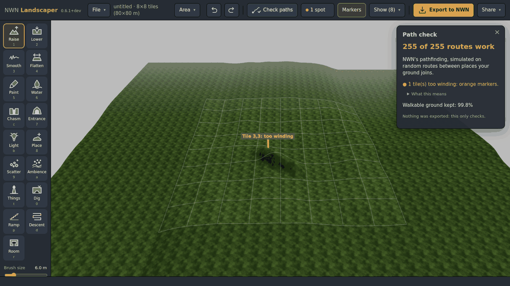

# Design: try the Landscaper in a browser

Status: design, not built. Written 2026-11-26 from a spike, for the maintainer's review before any code; no question decided yet.

A public "try it" page: the editor and its engine both in the visitor's browser, nothing to install and no engine on a server.
Visitors without the game sculpt, paint, check paths and export with art that isn't the game's; visitors with the game point the
page at their own install and get everything the desktop Landscaper offers. The page must never serve the game's own files.

Words used here:

- **WASI:** a standard set of system calls (files, clock, arguments) for WebAssembly. Rust builds a program for it
  (`wasm32-wasip1`) with its file code unchanged; in the browser a small JavaScript library answers the calls.
- **Service Worker:** a script the browser runs beside a site's pages that can answer the pages' requests itself.
- **Worker:** a script on a thread of its own, started by one page and living as long as that page.
- **OPFS:** the browser's private file storage for a site (Origin Private File System), lasting across visits.
- **Stand-in install:** the few files the engine reads from a game install, made here with none of the game's content.

## The short version

- **The whole engine builds for WASI,** with wasi-sdk (clang with a WebAssembly C library) for its C and C++ (zstd, the NWScript
  compiler, glslang). It needs small changes in three of Moonglow's files, three places in nwn-bake and about ten in the
  engine, all about threads, memory-mapped files and process ids. Only Moonglow's `mg-area` (it draws with wgpu) does not build;
  the engine uses it only to import an area.
- **Proof:** on the spike branches, the editor's own page runs the engine in a Service Worker that answers `/api/...`. Check
  paths and Export both run in headless Chromium with no game files: a path check in 0.3 to 0.6 s, an 8 by 8 export in 2.6 to 3.9
  s, a 32 by 32 export in 43 s. With the game, a WASI export is **byte for byte the same** as the native one.
- **Speed:** a single-threaded native build is 1.1 to 2.8 times faster; the native engine on every core is 3 times faster on the
  largest area. Memory peaks at 390 MB for a 16 by 16 export and 1.2 GB for a 32 by 32.
- **Size:** the engine is 2.0 MB to download with brotli (2.8 MB gzip) after link-time optimisation; the editor adds 1.1 MB. It
  starts in under 0.2 s on this machine once downloaded.
- **Stages:** (1) the editor with the engine, art of our own, saving in the browser, Check paths and Export as a download; (2) the
  visitor's own game folder, read on demand (an export reads 34 MB of the 5.6 GB install); (3) a model pack of the maintainer's
  and community art, so Place and Scatter work without the game; (4) import, and threads.
- **The one thing the game must give:** an export's tile shaders are made at export time from three of the game's shaders, so none
  of Beamdog's is ever shipped. A no-game export is not playable as it is, but whoever plays it has the game: the page asks for
  the game folder at export and reads those three files from it.
- **Where:** a `/try/` section of the handbook site on GitHub Pages, built by its workflow from a release's wasm. About 5 MB, far
  under Pages' limits.

## What the spike did

The engine is this repository at `master` ef618f1, the editor [nwn-landscaper-web](https://github.com/plenarius/nwn-landscaper-web)
at `main` 05b9089, Moonglow at `ac17ade` and nwn-bake at `v0.7.0`. The spike branches, not for merge:

- [nwn-landscaper `spike/wasm-demo`](https://github.com/plenarius/nwn-landscaper/tree/spike/wasm-demo): the engine's changes,
  `research/wasm-demo/` (the build script, the patches for Moonglow and nwn-bake, the Node runners).
- [nwn-landscaper-web `spike/wasm-demo`](https://github.com/plenarius/nwn-landscaper-web/tree/spike/wasm-demo): `sw.js` and
  `try/` (the engine's host, [browser_wasi_shim](https://github.com/bjorn3/browser_wasi_shim) 0.4.2, the stand-ins).

How it answers the editor: each API request runs the engine once as `landscaper wasi-request`, the HTTP request on its standard
input and the answer on its standard output, through the same `answer()` the server uses (`tiny_http`'s test request builds the
request). The engine's files (the workspace, the texture library, exports) stay in memory between requests. The editor is
unchanged but for one line of `index.html`, which starts the Service Worker before `js/app.js`.

What the pictures show: the editor as the desktop serves it, on a ground texture made for the demo, after sculpting a hill. The
path check (255 of 255 routes, one tile marked too winding) and the export report are the engine's answers, computed in the page.
The export's hak holds 64 tile models, walkmeshes and baked textures, the tileset and the module; the page downloaded them from
the engine's files.

### What compiles

Tried crate by crate, first for `wasm32-unknown-unknown` (the browser target most Rust web code uses), then for `wasm32-wasip1`
with wasi-sdk 34.

| Crate | Browser target, as it is | WASI with wasi-sdk |
|---|---|---|
| `mg-core`, `mg-2da`, `mg-gff`, `mg-image`, `mg-mdl`, `mg-set`, `mg-tlk`, `mg-tiles` | builds | builds |
| `mg-erf` (zstd, C) | no C compiler for the target | builds |
| `mg-resman`, `mg-rules`, `mg-module` | zstd; glslang (C++) | builds with two patches: a read at an offset without `FileExt`, and memory maps replaced by reads |
| `mg-script` (the NWScript compiler, C++) | no C++ library | builds once `strnicmp` is defined for WASI and C++ exceptions are off |
| `mg-area` | wgpu | does not build: wgpu's web code needs a different toolchain. Import only |
| nwn-bake | glslang, zstd | builds; three thread pools run in turn |
| `ureq` (rustls, ring) | `getrandom` has no source of randomness | builds; no sockets at run time |
| `tiny_http` | builds | builds; its server can't listen (no sockets), its request type is used |
| `zip`, `png`, `glam`, `serde_json`, `sha1`, `sha2`, `clap`, `fastrand` | builds | builds |

What then stopped the engine at run time, and the spike's answer:

- **Threads:** `std::thread::spawn` fails. `in_parallel_on` (the generator's pool) and nwn-bake's texture decoding, encoding and
  view drawing run in turn on WASI.
- **Memory maps:** `memmap2` has none on WASI. Moonglow reads a KEY or ERF whole, and a BIF a resource at a time from its table
  (the base game's BIFs are 5 GB, more than a 32-bit memory holds).
- **`File::try_clone`:** WASI has no `dup`. A shared `&File` seeks and reads instead.
- **`std::process::id`:** panics on WASI. Temporary names use 1.
- **Sockets:** none. The texture packs' index (`ureq`) answers "Dns Failed"; the page must fetch it and hand it in.
- **Paths:** nothing to change. The engine's `std::fs` calls work as they are on the shim's files.

### Measured

All on a 48-core AMD EPYC (Milan) server, Node 24 and headless Chromium 131 (Playwright's build). "WASI" is the
`wasm32-wasip1` release build; "Chromium" is the same file in the page's Service Worker on browser_wasi_shim.

| Job | Native, 1 thread | Native, all cores | WASI in Node | Chromium |
|---|---|---|---|---|
| `generate` (the 4 by 4 test area, with the game) | 1.57 s | | 2.35 s | |
| Check paths, 8 by 8 (one hill) | 0.25 to 0.42 s | 0.26 to 0.43 s | 0.46 s | 0.34 to 0.62 s |
| Export, 8 by 8, warm | 0.98 s | 0.86 s | 2.71 s | 2.6 to 3.9 s |
| Export, 16 by 16 (rolling hills; the optimised build below) | | | 9.0 s | |
| Export, 32 by 32 (rolling hills) | 34.5 s | 13.9 s | 38.7 s | 43.1 s |
| A request that reads nothing (`/api/me`, a texture) | 0.4 to 1.6 ms | | 14 ms | 2 to 11 ms |
| A request that reads the game (`/api/placeables`) | 11 ms (92 ms the first time) | | 144 ms | |

- **Same output:** the WASI build's hak, `ls_textures.hak` and module equal the native build's, byte for byte, for the test area
  and the 8 by 8 export (sha256 of each file).
- **Memory:** WebAssembly memory peaked at 87 MB for the 8 by 8 export, 387 MB for the 16 by 16 (Node) and 1,170 MB for the 32
  by 32 (1,228 MB in Node); a 32-bit WebAssembly memory stops at 4 GB.
- **The engine starting in the page:** fetching it 35 to 46 ms from this machine, compiling 13 to 17 ms (Chromium compiles lazily),
  building the demo's five textures into its library 55 to 97 ms. Each request then makes a new instance: the 2 to 11 ms above.
- **Reading the game:** the starter texture library reads 26.8 MB of the 5.6 GB install, an 8 by 8 export 34.3 MB, most of it the
  12.8 MB talk table read whole, twice. The rest are small reads from 60 BIFs.
- **Per request, the game is opened again:** 90 to 144 ms a request with the game, where the native server keeps it open. That's
  the cost of one process per request (question 1).

Sizes of `landscaper.wasm` (MB; gzip at level 9, brotli at 11):

| Build | Raw | gzip | brotli | Speed |
|---|---|---|---|---|
| Release, as the spike built it | 9.98 | 3.15 | 2.19 | as measured above |
| The same through `wasm-opt -O3` | 7.20 | 2.85 | 2.07 | |
| Link-time optimisation, one code unit, symbols stripped | 7.85 | 2.84 | 2.03 | the same: export 2.5 s, check 0.45 s |
| Optimised for size (`opt-level = "s"`) with the above | 5.99 | 2.30 | 1.70 | slower: export 3.4 s, check 0.8 to 1.1 s |
| The same through `wasm-opt -Oz` | 5.21 | 2.25 | 1.71 | |

What the 10 MB holds: 7.4 MB of code, 1.6 MB of function names (gone when stripped), 1.0 MB of data (the particle pack among
it). By crate, the Landscaper's own 1.7 MB, generic code in `core` and `alloc` 1.9 MB, C and C++ 0.4 MB, the network stack (rustls,
ring, ureq) 0.6 MB (useless here), `serde_json` 0.3 MB, Moonglow about 0.6 MB, nwn-bake 0.15 MB (`research/wasm-demo/wasm-crates.py`).

The editor's own files are 3.8 MB, 1.1 MB with gzip. A first visit downloads about 3.1 MB with brotli; at 20 Mbit/s that's about
1.5 s, at 5 Mbit/s about 5 s, before the 0.2 s start.

## What needs the game

Everything the engine reads from an install, what it's for, and what stands in for it in the demo. "Made here" means the spike
wrote it; none of it is the game's.

| From the game | Used for | Without the game |
|---|---|---|
| `data/nwn_base.key` and `lang/en/data/dialog.tlk` | the engine refuses an install without them | an empty key and an empty talk table, made here |
| The starter textures (51 of `starter_textures.json`) | the texture library, the editor's default ids | the demo's own ground textures under the default ids (the spike's are procedural noise) |
| `fslit`, `vslit`, `inc_lighting` (`.shd`) | the export's tile shaders (`src/shared.rs`, made from the install by design) | none: placeholders, so the export is not playable. From the visitor's game folder at export (question 5) |
| Nine palettes (`creaturepal.itp` and the rest) | the module's custom palettes | empty palettes, made here |
| `environment.2da` | the module's lighting scheme | one row of light colours, made here |
| `placeables.2da` and the placeables' models | Place, Scatter, baked objects | none: the panels fail ("placeables.2da not found"). The model pack (stage 3) |
| Blueprints, `genericdoors.2da`, music, ambient sound, load screens, `skyboxes.2da` | Things, doors, Area settings' lists | empty lists; hidden or explained |
| `nwscript.nss` | the script editor's compiler | none; the Scripts panel stays off |
| Sky models | the Sky & fog panel's lists (a sky pack needs the maintainer's own skies) | none; the preset's colours still show |
| The tilesets (`.set`, tile models) | importing an existing area | not in the demo: import also needs `mg-area` (stage 4) |

The particle pack (`packs/particles`) is the Landscaper's own and is built into the engine, so ambience works in the demo.

## Questions to settle

Each gives the recommendation first and the options not chosen after it.

### 1. How the engine answers the editor

**Recommended: the engine as it is, one WASI program, the editor's HTTP API kept.** The spike shows it works with the editor
unchanged: one engine, one API, one set of tests. Stage 1 keeps one run per request (2 to 11 ms with no game). Stage 2 turns the
engine into a long-lived instance that keeps the game open between requests: the program exports one function, "answer this
request", instead of `main` (a WASI reactor), about 4 hours.

Considered and not chosen:

- **Refactor the routes into a library** called from JavaScript (wasm-bindgen). The routes and the server (4,300 lines in
  `src/serve.rs` and `src/serve/`) take `tiny_http`'s request type; each would take a plain request and answer instead, and the
  editor would call functions instead of `fetch`. About 3 days, and a second interface to keep in step with the server's, for no
  measured gain over the reactor.
- **One instance and blocking calls** (the engine waits for the next request): needs shared memory between threads, which needs
  headers GitHub Pages can't send (question 7).

### 2. Where the engine runs

**Recommended: in a Worker the page starts, with the Service Worker only passing requests to it.** The spike ran the engine in
the Service Worker itself, which was quickest, but:

- **A browser may stop an idle Service Worker** (Chromium after about 30 s) and the engine's files in memory with it. Under
  Playwright it kept them 70 s; a real browser may not.
- **Reading the visitor's game folder** needs `FileReaderSync`, which a Worker has and a Service Worker doesn't.
- **One engine per tab:** two tabs on one Service Worker would share one workspace.

The Service Worker stays, because the editor loads textures and previews by URL (``, three.js's loader), which only a
Service Worker can answer; it hands each request to its page's Worker. About 3 hours more than the spike.

Considered and not chosen: **no Service Worker, and api() calling the Worker directly.** Every picture URL in the editor would have
to become a blob URL first: a change across many files of the editor.

### 3. Where saved areas live

**Recommended: the engine's workspace on OPFS.** browser_wasi_shim reads and writes OPFS files directly from a Worker
(`SyncOPFSFile`), so the engine's own save, `.bak` and texture library code works unchanged and lasts across visits. The page asks
for persistent storage (`navigator.storage.persist()`), so the browser doesn't clear it under pressure, and File offers **Download
area** (the `.json`) and **Open area** from a file, since storage in the browser is never a backup. Exports are downloads: the hak,
`ls_textures.hak` and the module, in one zip.

Considered and not chosen:

- **IndexedDB:** asynchronous, so the engine's synchronous file calls would need a copy in memory and a write-back after each
  request. More code, and an export's 80 MB hak copied twice.
- **Memory only, as in the spike:** lost on reload.

### 4. Art for visitors without the game

**Recommended: a demo texture pack of the maintainer's own and CC0 textures, the stand-ins built by a script, and the panels that
need the game saying so.** The texture pack format (`docs/TEXTURE-PACKS.md`) already carries everything the library needs; the
demo installs it at start under the editor's default ids (`grassMedium`, `dirt`, `rock`, `rockCliff`, `wallFieldstone` and the
others in `EDITOR_DEFAULTS`). CC0 photo textures (ambientCG, Poly Haven) need no permission. Community art from the Vault needs
each author's permission in writing to go in a public pack, so it waits for the model pack (stage 3).

Considered and not chosen: **the procedural textures of the spike.** Good enough to prove it, not to show the Landscaper off.

### 5. Export without the game

**Recommended: Export asks for the game folder once, and reads the three shaders from it.** About 100 KB from an install the
visitor must own to play the area anyway. Chromium remembers the folder (File System Access); Firefox and Safari pick it each
visit through a folder upload field (`webkitdirectory`), which reads nothing until asked (its prompt says "upload", though
nothing leaves the machine). Without a folder the export still
downloads, with a line saying it needs the game's shaders before it can be played.

Considered and not chosen:

- **Shaders of our own,** written from scratch against the game's include files (which every player has): no folder needed. The
  Landscaper's shaders are Beamdog's with a few lines changed; a rewrite from nothing must match the game's lighting, and needs
  checking in the client on every graphics setting. Worth it only if the demo's export without the game matters.
- **Placeholders, as in the spike:** an area that draws wrong.

### 6. Hosting

**Recommended: `/try/` on the handbook site** (`plenarius.github.io/nwn-landscaper/try/`, not there yet). The docs workflow downloads the
release's `landscaper-wasm.zip` and the editor at the same tag, and copies them under `site/try/` before uploading the site. One
site, one deploy, the handbook a click away.

- **Pages' limits:** a site of at most 1 GB, a deploy of at most 10 minutes, and a soft limit of 100 GB of traffic a month: about
  30,000 first visits at 3.1 MB.
- **What Pages can't do:** set headers. No `Content-Encoding` of our choosing, no cache rules, no cross-origin isolation headers.
  Whether Pages compresses `.wasm` was not checked; at worst a visit downloads the engine's raw 7.9 MB.

Considered and not chosen: **a Pages repository of its own** (`nwn-landscaper-try`): a second site and deploy for the same files.

### 7. Threads

**Recommended: not before stage 4.** One thread costs little on small areas (the 8 by 8 export: 0.98 s native on one thread,
0.86 s on all). Only a 32 by 32 export gains (43 s against 14 s). Threads in WebAssembly need `SharedArrayBuffer`, which needs
the page served with cross-origin isolation headers; Pages can't send them, but the Service Worker can add them to every answer it
serves (the coi-serviceworker technique). Then a `wasm32-wasip1-threads` build with a thread pool in the shim.

### 8. Building the wasm

**Recommended: a `wasm` job in CI, as cleanmodels does,** and the release attaching `landscaper-wasm.zip` beside the other
downloads. The job installs wasi-sdk and the `wasm32-wasip1` target and builds with link-time optimisation, stripped. A size
check fails it above 3 MB with brotli. A Rust feature `web` (on for the WASI target) leaves out the network, the team server and
import, rather than `cfg` lines in many files.

### 9. Moonglow and nwn-bake

**Recommended: the changes go to Moonglow upstream and into an nwn-bake release,** then the Landscaper takes them by the usual
bump (`MOONGLOW.md`). Moonglow is another maintainer's repository: its changes are small and keep its native code as it is, but
its maintainer decides. If they decline, the Landscaper points `[patch]` at a fork until they do.

## Stages

### Stage 1: sculpt, paint, check, download

The editor with the engine in a Worker, OPFS saving, the demo texture pack and stand-ins, Check paths, Export as a zip with the
game folder asked for the shaders. Area settings' lists, Things, Place, Scatter, Scripts and Import show what they need. Areas up
to 16 by 16 by default (390 MB), so a phone's memory copes; 32 by 32 (1.2 GB) asks first. Text that names `landscaper serve` or a path on disk
(the "No engine" notice, "Ready to play: … is in your NWN modules list", `/work/user/modules/...` in the export report) says what
the page does instead.

### Stage 2: your own game

The visitor picks their game folder once; the engine reads it on demand from the Worker (`FileReaderSync` on the picked files),
so the starter textures, placeables, blueprints, doors, music, skies and scripts all come from it, nothing leaves the browser,
and nothing read is cached by the page. The long-lived engine (question 1) keeps the game open. Chromium remembers the folder
across visits.

### Stage 3: the model pack

Placeables and plants of the maintainer's own and community art (with written permission), checked by cleanmodels, with their
own `placeables.2da` rows, so Place, Scatter and baked objects work without the game. A sky pack of the Landscaper's own
generated skies with it. Reuses the texture pack's checks and install.

### Stage 4: import and threads

`mg-area` without its drawing (a Moonglow change), so an area imported from a module works in the page; threads as in question 7.

## Risks

- **The game's files reaching the site.** The site build allows only listed files (the editor, the wasm, the demo pack, the
  stand-ins) and fails on anything else; the stand-ins are made by a script, not copied.
- **Memory on small devices:** 1.2 GB for a 32 by 32 export. Stage 1 caps the default size; a failed allocation is caught and
  reported as "too big for this browser".
- **Browser support:** OPFS from a Worker is in current Chromium, Firefox and Safari; the folder picker only in Chromium (the
  upload field elsewhere). Only headless Chromium was tried.
- **The Service Worker's updates:** a new `sw.js` takes over the next load; a stale page with a new engine could disagree on the
  API. The engine's version is in `/api/me`, and the page reloads when they differ.
- **Licences:** serving the wasm publicly distributes the engine (GPL-3.0): the page links to its source at the tag. The wasm also
  holds wasi-sdk's C and C++ libraries (Apache-2.0 with the LLVM exception, MIT), which `cargo-about` doesn't see; the licence page
  lists them by hand. browser_wasi_shim is MIT or Apache-2.0.
- **The demo's exports in the game:** an export without the game's shaders draws wrong. The download says so (question 5).

## Build order

Each step is one pull request in each repository it touches, shippable alone. Agent time is wall-clock for a coding agent; the
maintainer's time is review and testing.

| # | Step | Repository | Agent | Maintainer |
|---|---|---|---|---|
| 0 | Spike: what builds, the engine behind the editor in a Service Worker, measured. **Done** | engine, web | 4 h (took 1, with this design) | 20 min |
| 1 | Moonglow: lazy BIF reads and read fallbacks on WASI, `strnicmp`; a pull request upstream | Moonglow | 3 h | 20 min |
| 2 | nwn-bake: its thread pools run in turn on WASI; a release | nwn-bake | 2 h | 15 min |
| 3 | The engine's WASI build: the `web` feature (no network, team server or import), `wasi-request` with its answer on its own stream, threads, process id; the CI `wasm` job and its size check; `landscaper-wasm.zip` in the release | engine | 6 h | 45 min |
| 4 | The page: the engine in a Worker, the Service Worker passing requests, OPFS, Download and Open area, export as a zip, the texts that name a server or a disk path | web | 8 h | 45 min, plus 30 min in Firefox and Safari |
| 5 | Demo assets: the texture pack (the maintainer's and CC0), the stand-ins made by a script, panels that need the game saying so | engine, web | 4 h | 30 min, choosing textures |
| 6 | The site: `/try/` built by the docs workflow from the release, a handbook page "Try it in your browser" | engine | 3 h | 20 min |
| 7 | Export's shaders from the visitor's game folder (picker and upload field) | web, engine | 4 h | 20 min, plus 15 min in the game: a downloaded area |
| 8 | Your own game: the folder read on demand, the long-lived engine, Place, Scatter, Things and Scripts from it | web, engine | 8 h | 45 min |
| 9 | The model pack: placeables and plants, checked, with rows; a sky pack of generated skies | engine (`packs/`) | 8 h | 1 h, plus permissions |
| 10 | Import in the page (`mg-area` without its drawing) | Moonglow, engine | 4 h | 20 min |
| 11 | Threads: cross-origin isolation from the Service Worker, the threads build | web, engine | 8 h | 30 min |

Stage 1 is steps 1 to 7: about 30 hours of agent time and 4 hours of the maintainer's. All eleven: about 58 hours and 6.5 hours.
Steps 1, 2 and 5 can start at once; 3 needs 1 and 2; 4 needs 3; 6 needs 3 and 4; 7 and 8 need 4.

**Work outside the hours above:** gathering the model pack's art and its authors' permission; choosing the demo's textures.

## What this design could not check

- **Other browsers:** only headless Chromium ran the page. Firefox and Safari, and phones, weren't tried.
- **The game folder in a page:** the WASI build reading a real install was run in Node, not in a browser through a folder picker.
- **A real network:** the page loaded from this machine; Pages' compression of `.wasm` and the load time over the Internet are
  estimates from sizes.
- **An idle Service Worker in a real browser:** Playwright kept it alive.
- **The OPFS workspace:** the spike kept the engine's files in memory.
- **The client:** no export from the page was loaded in the game. The same export built natively is byte for byte the WASI one,
  so only the no-game export's placeholder shaders are new, and they are known to draw wrong.
