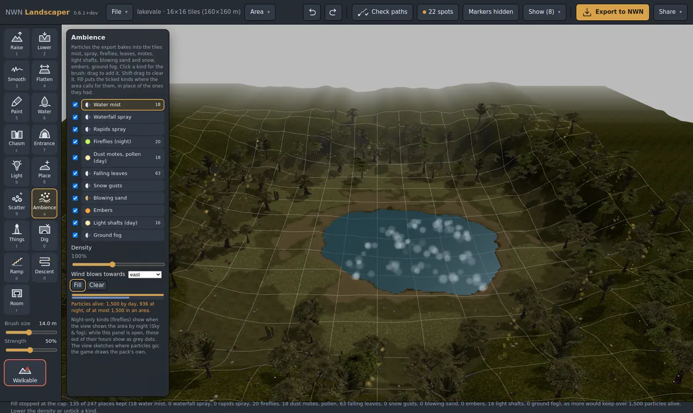

# Ambience

**Ambience** (`a`) places particles: water mist, waterfall and rapids spray, fireflies, dust motes and pollen, falling leaves,
light shafts, snow gusts, blowing sand, embers and ground fog. The export bakes them into the tiles, so they cost the game no
objects and need no `placeables.2da` rows.

## Fill the area

1. Pick **Ambience** (`a`).
2. Tick the kinds you want.
3. Click **Fill**. It puts the ticked kinds where the area calls for them, in place of the ones they had:
   - mist on water, more where the water is wide;
   - spray where water drops;
   - leaves under trees;
   - fireflies on grass within 10 m of water;
   - motes and light shafts in gaps in the trees and at cave mouths;
   - sand on dune crests, snow on ridges, ground fog in hollows.

The status line says how many of each kind Fill placed; Undo takes them back. **Clear** takes the ticked kinds' placements away.

## Brush more or fewer

Click a kind to choose it for the brush, then drag to add it. Shift-drag clears it. **Density** sets how close the brush puts
them. **Wind blows towards** turns the kinds that blow (snow, sand) and leans the light shafts.

## The particle cap

The panel counts the particles the placements keep alive by day (top) and at night (bottom), against the area's cap of 1,500.
Fill and the brush stop at the cap; the count turns to a warning as it gets close.

## Day and night

Some kinds show only at night (fireflies) or only by day. The view sketches the particles as moving points in each kind's
colour. Night-only kinds show when **Sky & fog** shows the area by night (`L`, **Night**; picking a tool closes the panel, and
`A` brings the Ambience panel back with the view still by night); while the Ambience panel is open, kinds out of their hours
show as grey dots.

The view only sketches where the particles go. The game draws the particle pack's own emitters, so look at the result in the game
before you call an area done.

!!! note "The particle pack"
    The kinds come from the particle pack built into the engine. A team can ship its own pack instead
    (`LANDSCAPER_PARTICLES`, see [Configuration](../CONFIGURATION.md)).
