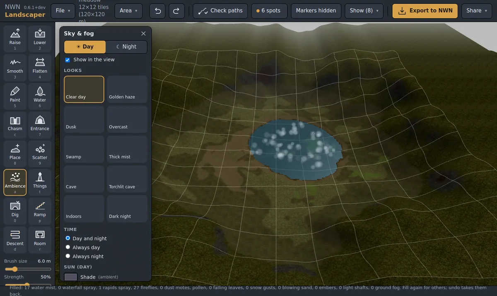

# Atmosphere and skies

An area's look is its light, its fog and its sky, all set in the **Sky & fog** panel: a look sets the light and fog and picks
the sky that suits them.

## Pick a look

**Area > Sky & fog** (`L`), **Looks**: each sets the sun, the moon, the fog and the time of day at once.

| Look | For |
| --- | --- |
| Clear day | open ground in daylight, day and night cycling |
| Golden haze | a low sun, warm light |
| Dawn | early light through haze |
| Dusk | evening light |
| Overcast | grey, even light |
| Swamp | green fog, close in |
| Thick mist | thick white fog |
| Cave, Torchlit cave | under ground, without and with warm light |
| Indoors | interiors |
| Dark night | a night with little moon |

Change any colour after picking one; [Light](light.md) says what each setting does. **View distance** sets how far the fog
lets the camera see.

## Pick a sky

Each look picks its sky: the [Preset skies](../PRESET-SKIES.md) one made for it when that pack is installed, else the game's
nearest. **Sky** in the same panel shows the sky's picture and lists the installed skies and the module's own rows of
`skyboxes.2da`, to pick another; the 3D view draws it around the camera, by day or by night. Under ground there is no sky. The
sample landscapes in *New area* take their look's sky.

## More skies

- **Sky packs** add skies: new rows of `skyboxes.2da` with their models and textures, installed as texture packs are. The export
  puts them in their own hak, `ls_skies.hak`. Setting one up is a job for whoever runs the Landscaper:
  [Sky packs](../SKY-PACKS.md). The first, [Preset skies](../PRESET-SKIES.md), has a sky for each Sky & fog look that shows one,
  made from your own download of Real Skies.
- **Real Skies** replaces the game's five stock skies with photographed panoramas. It is a hak for the module, made by a script
  from your own download: [Real Skies for modules](../REAL-SKIES.md).

## Weather

Rain, snow and wind, like the toolset's Area Properties, are in **Area > Area settings**, with the area's name, tag, scripts,
music and ambient sound.
