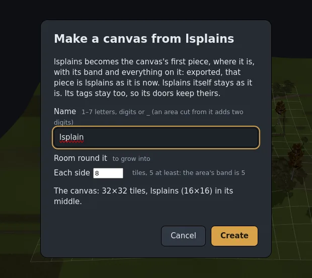

# Canvases

A **canvas** is a landscape larger than one area, up to 128 by 128 tiles. You sculpt and paint it as one, then cut it into
**pieces**: each piece becomes one area of at most 32 by 32 tiles, the game's limit, and players walk from piece to piece
through crossings the export makes along the cuts. [The design](../DESIGN-canvas-cut.md) has the whole plan.

!!! note "Coming next"
    **Export** and **Publish** for a canvas aren't in the editor yet: while a canvas is open, Export, Publish and the area's
    own Check paths are off. Until they come, `landscaper canvas-export <canvas>` exports its pieces from the command line
    (below).

## Make a canvas

1. **File → New canvas…**
2. Give it a name of 1 to 7 lower case letters, digits or `_`. Its pieces are named after it: `rivl01`, `rivl02`... A
   canvas's name can't be an area's: pick another when the engine says it is taken.
3. Set its size in tiles, up to 128 each way, and how its ground starts: gentle hills, rough hills or flat.

**File → Open canvas…** opens one again. To start from an area you already have, see
[Make a canvas from this area](#make-a-canvas-from-this-area) below.

## Make a canvas from this area

The open area, with its band and everything on it, becomes a canvas with room round it to grow. The area itself is left as
it is.

1. Open the area and choose **File → Make a canvas from this area…**.
2. Give the canvas a name. The editor offers the area's name cut to 7 characters (`lsplains` becomes `lsplain`); a name the
   area already has is refused, since the area stays.
3. Set **Room round it**: tiles added on each side, 8 unless you change it, 5 at least. The dialog shows the size it makes: a 16
   by 16 area with 8 tiles of room is a 32 by 32 canvas. A canvas is at most 128 tiles each way.
4. **Create** makes the canvas, saves it, and opens it.

What comes along:

- **The area is the first piece**, named as the area, where it was. Exporting that piece builds the same area: the same terrain
  and paint sample for sample, the same water, objects, things, entrances, ambience, lights, settings and atmosphere, and the
  same route check. Published, it replaces the area.
- **Its band** is the canvas's ground round the piece, as far as the band went (5 tiles). Past the band, its outer edge carries
  on outward; shape it as you like.
- **The soft paint's second texture and its weight**, where the area has them.
- **Its tags.** The canvas keeps the area's name as the start of every tag the engine gives, so the area's doors, objects and
  transitions keep their tags, and a link to one of them still works.
- **Settings and atmosphere** stay with the piece; the canvas keeps them, without the area's tag, for pieces cut later.

A cave or an interior has no band to grow from, so it can't become a canvas. The underlay picture stays with the area.

## Sculpt

The canvas opens in **Sculpt**. Every sculpting and painting tool works on it as on an area, with undo. It is drawn at full
detail round what the camera looks at and at a quarter of the detail beyond; **Full detail near** turns the full detail off for
broad shaping with large brushes. The ground keeps its full detail either way.

Saves send only the parts a change reached: the canvas is kept in blocks of 16 by 16 tiles, and one stroke across a block's
edge sends two blocks. A save that can't reach the engine waits in the browser and goes with the next open. Two tabs can't
overwrite each other: a save names the version of each block it started from, and is refused when another tab saved one of
them since.

## Cut it into pieces

Click **Pieces** in the top bar. The canvas shows from above, with the pieces on it and their list beside it.

- **Cut:** drag across the ground. Over a gap this makes a new piece. Across a piece it splits it: drag right across it, from
  one side past the other, and the larger part keeps the piece's name.
- **Move a cut:** drag a cut line. It snaps to tile lines, and the pieces on both sides follow. An outer edge moves alone,
  leaving a gap behind it. **Esc** puts the cut back.
- **Join:** click a piece, then the one beside it. They must share a whole side.
- **Grid…:** fills the canvas with an even grid, in place of the pieces there. The new pieces keep the names of the old ones
  they cover most of.
- **Make a gap:** takes the selected piece out. Its ground stays on the canvas and still shows in its neighbours' edges, but
  it is never exported.
- **Rename:** the piece's name (its resref prefix, 1 to 9 characters) and its name in the game.

A piece is 3 to 32 tiles a side. A cut or a move that would break that is refused while you drag, and the panel says which
piece and why: "Riverford would be 36 tiles wide; the game takes 32 at most."

While you drag, the panel lists **what moves**: the cave entrances, placeables, creatures and parts of lakes or chasms that
change piece. Their tags don't change: tags start with the canvas's name (or, for a canvas made from an area, that area's),
not the piece's, so a door or a script that names them keeps working. Something left in a gap is kept on the canvas but not
exported; a trigger whose outline a cut runs through is refused at export.

**Undo** and **Redo** in Pieces mode undo each cut change.

## Open a piece

Double-click a piece, or select it and click **Open this piece** (Enter). The piece is drawn at full detail with 8 tiles of its
neighbours round it, dimmed. The dimmed ground is editable: a brush near the cut shapes both pieces, as the canvas is one
landscape. It is also what the piece's edge scenery shows in the game.

The small map at the top right shows the canvas with the open piece lit and its full-detail window; click another piece there
to open it. The crossings along the piece's sides are drawn on the ground once the engine has found them. The status line
gives the place on the canvas and in the piece.

**← Back to the canvas** returns to Pieces mode.

## Check paths

**Check paths** checks the selected piece, and **Check paths (all pieces)** every piece and the canvas as a whole: whether
each piece can be walked into from the start piece through the crossings. A piece with no way in shows **no way in** in the
list.

## Export a canvas

Each piece exports as an area of one module named after the canvas, with 5 tiles of the canvas round it drawn past its edge,
its share of the water, what stands in it, and a transition each way wherever open ground meets open ground along a cut. A
trigger or a cave across a cut is refused by name. The route check then walks the transitions between the pieces.

The editor's Export and Publish for a canvas come next. Until then, `landscaper canvas-export <canvas>` builds every piece,
`landscaper canvas-export <canvas> <piece>...` only those, and `--check` checks them without building.
