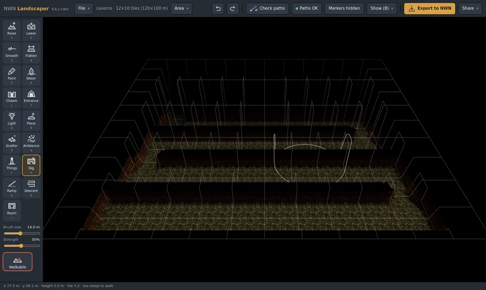

# Caves and interiors

A cave or an interior starts as solid rock. You cut rooms and passages out of it, and what is left is the wall. Start one with
**New area**, *Cave* or *Interior*, or with a sample descent to change.

## Dig passages

**Dig** (`0`) cuts passages and chambers with a round brush, 3 m radius at least.

!!! warning "Passages for the pathfinding"
    Make passages about 6 m wide at least, and run them along the middle of a tile (5 m from its edges). The game's
    pathfinding crosses from one tile to the next only through the middle of an edge; a passage that is narrower or off centre
    is closed to it.

## Cut rooms

**Room** (`r`) cuts a rectangle at the floor height where you start dragging. Rooms snap to 1.25 m and are 5 m a side at least;
rooms that overlap join.

## Ramps and stairs

**Ramp** (`p`): drag from one level to another. The brush size sets the width (6 m at least). It rises to where you let go, or by
the **Rise** you type (negative goes down). Tick **Stairs** and set a **Step height** for steps.

Dig or cut the room first and lay the ramp inside it, a little wider than the passage. A ramp narrower than the passage leaves a
ledge along each wall. **Keep it walkable** eases a slope that is too steep.

## A whole descent

**Descent** (`d`): drag a box over whole tiles. It fills with halls side by side, each a floor lower than the last, joined by a
ramp at alternating ends. Each floor takes two tiles across the box; the halls run along its longer side, four tiles at least.
Set **Floors**, **Drop per floor** (5 m gives a 14 degree ramp over 20 m), the **Ceiling** and the side to start from. One Undo
takes it all back.

## Ceiling height

**Area > Ceiling height** keeps the same headroom over the floor everywhere. Without it the area has one flat roof, so a passage
that descends gets taller walls the lower it goes.

## Limits

- **One floor height per spot.** Floors can't sit on top of each other. For stacked chambers, make one area per level and link
  them with transitions.
- **Long walks.** The game's pathfinder gives up on a click-to-move route after about 260 to 330 m. Walking by hand works; keep
  each hop under about 250 m.
- **Entrance doors** are tagged `<area>_ent<n>`. The number stays with the entrance, so taking another out renames nothing. When
  you take an entrance out, the next export removes its door; doors you placed in the toolset stay.
