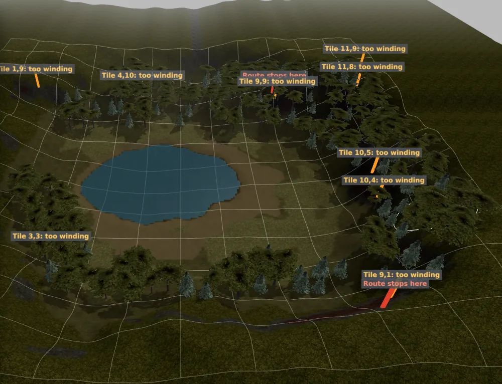
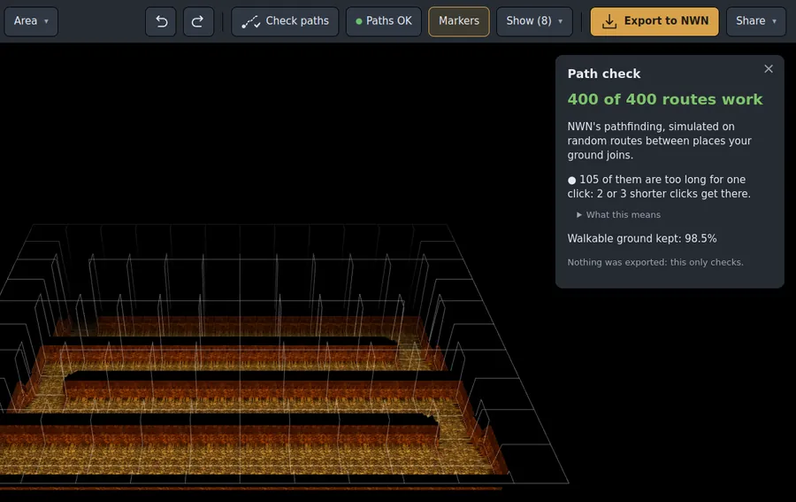

# Export

**Export to NWN** builds the area into the game: its hak into your user folder's `hak/`, its module into `modules/`. Open the
module in the toolset or the game.

## Export an area

1. Click **Export to NWN** in the toolbar.
2. The export builds the tiles, the hak and the module, then checks paths: it sends the game's pathfinding along random routes
   over the area.
3. Read the result on the map:
   - **Red markers:** a route is blocked: it stops short, and shorter clicks don't get there either. Open up the ground between
     the two ends.
   - **Orange markers:** a tile whose walkable ground is too winding for the game's search within a tile. Straighten or widen the
     passage.

A module already there takes only the new tiles. The module before is kept as `<module>.mod.bak`, and a failed export leaves the
module and the hak as they were. `report.json`, beside the module, holds the whole report.

## Routes too long for one click

The game's route search gives up when the way is about 20 tiles (200 m) longer than going straight there, so in a long descent
one click from one end to the other walks a few metres and stops. Two or three shorter clicks get there. The path check tries
those shorter clicks for each route that stops: when they get there, the route counts as working, too long for one click. It is
not blocked and has no marker; the report says how many there are and how many clicks they take.

## Check without exporting

- **Check paths** runs the path check with nothing exported.
- **Live** checks paths after each edit, and its button says how it went: **Paths OK** (green), every route gets there;
  **N spots** (orange), every route gets there but some tiles are too winding or a passage is closed; **N blocked** (red), routes
  that don't get there. Its tooltip counts the routes too long for one click. Click it to turn the live check off or on.
- **Markers** (`M`) shows or hides the markers; the checks go on.

## What stops an export

An object, thing or entrance more than 10 m outside the area, an object scaled outside 0.1 to 5, or an entrance wider or deeper
than the area stops the export, with a message naming it. Move it or take it out, and export again.

## Past the edge in the game

The game draws scenery for 50 m past an area's edge. An outdoor area's export builds that scenery from
[the band round the area](terrain.md#the-band-round-the-area): its ground, its paint and its water, as you shaped them, fading
into the area's fog colour from 25 m out. Trees standing past the edge are drawn there too: their own models within 25 m of
the edge, and farther out as cards, two crossed pictures of the tree. (The editor doesn't place objects in the band yet.) Nothing
past the edge is walked, and the path check sends no route there. Caves and interiors have no band, so their export draws
nothing past the edge.

## What goes into the game

- `<area>.hak`: the area's own tiles, with the scenery, shadows and particles baked in.
- `ls_textures.hak`: the texture library's textures the area paints with, shared by every area.
- `ls_skies.hak`: the installed sky packs' skies, when there are any.
- the module, with the area, its doors, its things and the blueprints, conversations and scripts it uses.

Each entrance's door is tagged `<area>_ent<id>`. On a re-export, the door of an entrance you took out is removed and listed in
the report; doors placed by hand stay.
