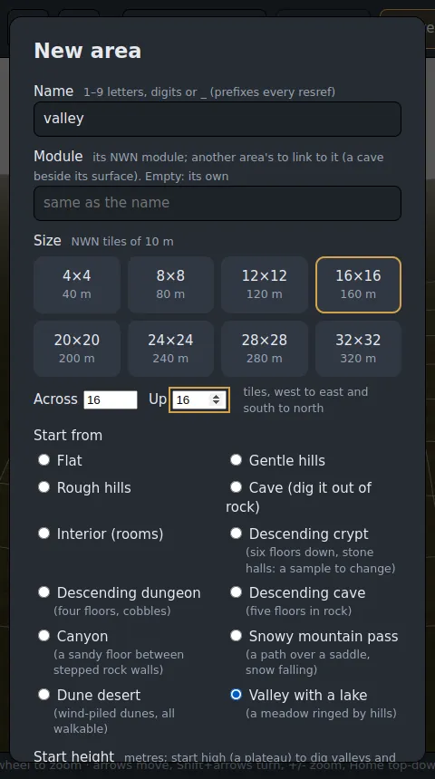

# Getting started

Start the program, make your first area and find your way around the view.

## Start the Landscaper

1. Download the archive for your system from the [releases](https://github.com/plenarius/nwn-landscaper/releases) and unpack it
   anywhere.
2. Start `landscaper.exe` (Windows) or `landscaper` (macOS, Linux). A window shows the game and the user folder it found.
3. Your browser opens the editor at `http://127.0.0.1:8765/`. Close the program's window to stop it.

You need the game itself, Neverwinter Nights: Enhanced Edition. The Landscaper builds its texture library and reads models from
your install the first time it starts. When it can't find the game, `QUICKSTART.txt` in the archive says what to set.

!!! note "No engine, sculpting only"
    When the page says *No engine: sculpting only*, the program isn't running. You can still shape the ground, and the browser
    keeps your area until the engine is back, but textures, import, export and the game's models need the engine.

## Make an area

**File > New area** (`N`) asks for:

- **Name:** 1 to 9 letters, digits or `_`. It starts every resref the area exports.
- **Module:** the game module it goes into. Leave it empty for a module of its own, or name another area's module to link the two
  (a cave beside its surface).
- **Size:** 3 to 32 tiles each way; a tile is 10 m.
- **Start from:** flat ground, gentle or rough hills, a cave or an interior (solid rock to cut rooms from), a sample descending
  crypt, dungeon or cave, or a sample landscape: a canyon, a snowy mountain pass, a dune desert or a valley with a lake. The
  samples come painted, lit and with their weather, and come out different each time.
- **Start height:** start high (a plateau) to dig valleys down into it.

**File > Open** (`O`) opens another of your areas, or imports one: from your module's source, or from a `.mod` or `.erf` you
upload. An imported area keeps its tileset's own textures, and its placeables, creatures, doors and scripts come with it on
export.

The engine saves each change a moment after you make it. There is no Save button; **File > Save version** keeps a named copy in
a team's history.

## Move around

| Do | Mouse | Keys |
| --- | --- | --- |
| Sculpt or paint | left-drag | |
| Turn the view | right-drag | Shift+arrows |
| Move the view | middle-drag | arrows |
| Zoom | wheel | `+` `-` |
| Look straight down | | `Home` |
| Frame the area | | `F` |
| Brush size | | `[` `]` |
| Undo, redo | | Ctrl+Z, Ctrl+Y |

Each tool has a key, shown under its button. The status bar shows the position, height and tile under the cursor, and whether
creatures can walk there. **Walkable** (`W`) tints ground too steep to walk in red, by the rule the export uses.
