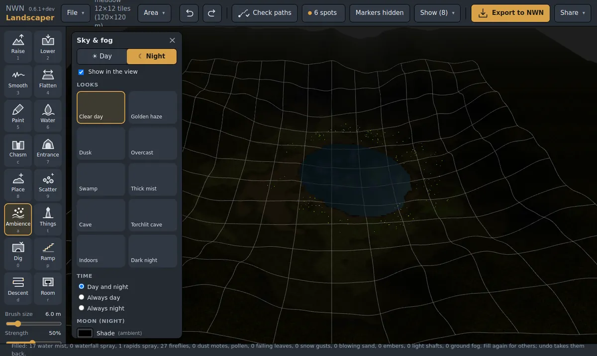
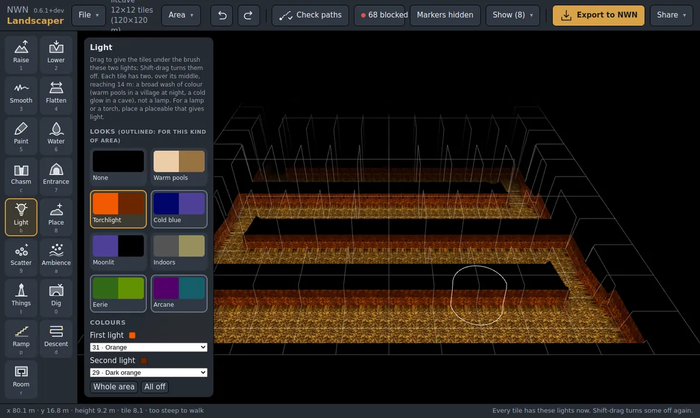

# Light

An area has one sun by day and one moon by night, set in the **Sky & fog** panel (`L`). On top of that, the **Light** tool (`b`)
gives each tile its own two lights: warm pools in a village at night, a cold glow in a cave. Sky & fog lies over the tools'
panels: picking a tool closes it, and `L` opens it again.

## Set the area's light

1. Open **Area > Sky & fog** (`L`).
2. Pick a look from **Looks** (see [Atmosphere and skies](atmosphere.md)), or set the colours yourself.
3. Switch between **Day** and **Night** to set the sun and the moon apart. For each:
   - **Shade (ambient):** the light in shadow.
   - **Light (diffuse):** the light from the sun or the moon.
   - **Fog colour** and **Fog:** its colour and how thick it is.
4. **Time:** *Day and night* cycles with the game's clock; *Always day* and *Always night* hold one.

**Show in the view** draws the area by day or by night, so you see the light the game will use.

## Shadows

- **Shadows** (for the sun and for the moon apart): whether the game casts shadows from that light.
- **Baked shadows:** how dark the shade is that the export bakes into the tiles under scenery (trees, rocks, what you placed or
  scattered). It shades only the sun's or the moon's light: a tile light, a torch or a glowing mesh in a tree's shade keeps its
  full light.

**The sun's side.** The game's sun and moon always shine from the north-east, high up, whatever the hour: a cliff facing south
or west is never in the sun. Such ground takes the area's **Shade** light and some of the sun's or the moon's bounced off the
ground below it, so it reads as rock in shade rather than black. For a sunlit cliff face, face it north or east.

## Paint the tiles' lights

Each tile has two lights, over its middle, reaching 14 m. A tile is 10 m, so this is a broad wash of colour, not a lamp: for a
lamp or a torch, place a placeable that gives light ([Things](things.md)).

1. Pick **Light** (`b`).
2. Pick a look from **Looks**, or set **First light** and **Second light** yourself from the game's 32 tile light colours
   (`lightcolor.2da`). The looks that suit the open area (by day or night, outdoors, under ground, inside) are outlined.
3. Drag over the ground: the tiles under the brush get the two lights. Shift-drag turns them off.

- **Whole area** gives every tile the two lights; **All off** turns every tile's lights off. Each is one Undo.
- The panel counts the tiles lit.
- The view draws the lights on the ground, under the area's light: press `L`, switch **Sky & fog** to **Night** and tick **Show
  in the view** to see them as they will look after dark. Picking a tool closes the panel; the view stays by night.

| Look | Lights |
| --- | --- |
| None | off: outdoors by day the sun is enough |
| Warm pools | lamplight over a village or camp at night |
| Torchlight | firelight: a hall, a lit cave |
| Cold blue | a cold glow deep in a cave |
| Moonlit | a faint blue for open ground at night |
| Indoors | plain light in rooms |
| Eerie | a sickly green: a crypt, a swamp |
| Arcane | purple and aqua: a mage's den |

!!! warning "Day and night"
    The game lights with the tile lights by day too. Outdoors by day, leave them off.

The export writes the colours into the area (the toolset's main lights of each tile). It needs an engine of the same release:
an older one leaves the lights off.

Each tile's two lights hang 5 m over its highest ground (in a cave, over its floor's level), as the game's own tiles hang theirs.
On a cliff the pool lies along the top; the wall below takes a gentle wash, not a bright spot.

## Light from what you bake

A placeable baked into the tiles (with [Scatter or Place](scatter.md)) keeps its glow: a glowing crystal or mushroom still glows
in the tile.
