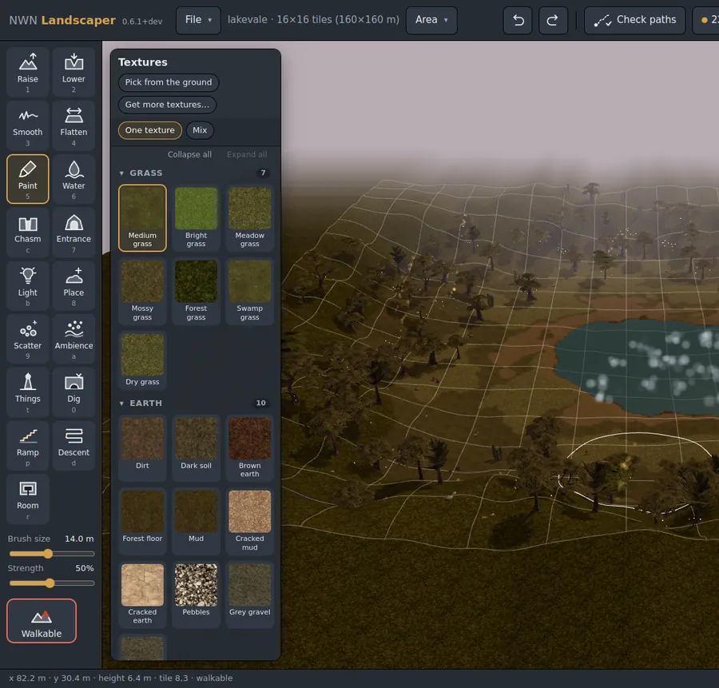
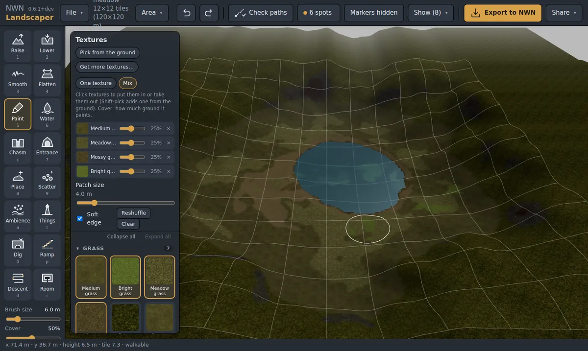

# Paint and the mix brush

Paint the ground with one texture, or with a mix of several in patches, so a meadow isn't one flat green.

## Paint with one texture

1. Pick **Paint** (`5`). The panel lists the texture library by category.
2. Keep **One texture** on and click a texture.
3. Drag over the ground. **Strength** sets how much each stroke covers.

Click a category's heading to fold it away, or use **Collapse all** and **Expand all**. A folded category still shows the
texture you paint with.

## Pick a texture up from the ground

Press `I` (or click **Pick from the ground**, or Alt-click) and click the ground. On ground you painted it picks that texture.
On an imported area it picks the tileset's own texture under the click and adds it to the library, under **Tileset**, the first
time. It then paints like any other texture and goes into your texture hak at export.

## Paint a mix

The mix brush paints a blend of textures in patches: grass with dry patches and dirt, sand with pebbles.

1. Switch the panel to **Mix**, or Shift-click a texture to start one.
2. Click textures to put them in the mix or take them out. Shift-pick from the ground adds the texture under the cursor.
3. Each texture in the mix has a slider: its share of the mix. Set **Patch size**: how large each texture's patches are.
4. Drag over the ground. The strength slider becomes **Cover**: how much of the ground under the brush the mix paints.

- **Soft edge** thins the mix out toward the brush's rim, so a stroke has no hard edge.
- **Reshuffle** lays the patches out anew for the next strokes.
- **Clear** takes every texture out of the mix.

## More textures

**Get more textures** lists the texture packs on offer. See [Texture packs](texture-packs.md).

## Missing textures

An area painted on another library can name textures this one hasn't got. The editor draws them as a magenta checker and says
which, and how much of the ground each covers; Export refuses until they are gone. Click **Add or swap them…**:

- **Add from the game** makes starter textures from your game's files. On a team server only an admin sees it.
- **Swap** paints that texture's ground with one the library has. It suggests one made from the same game texture, else one of the
  same category. Undo takes a swap back.
