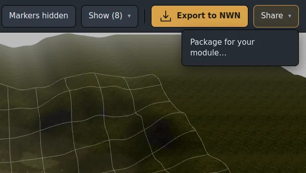

# Publish and teams

Hand an area over to whoever runs the module: as a zip to commit yourself, or as pull requests for review on a team server.
Either way it is what your **last export** built, so export again after any change.

## The checks first

Publishing runs the checks before anything else. Errors stop it:

- an area with no name or tag, or a tag another area has;
- a transition with no destination, or a door or trigger leading to a tag that isn't a door or waypoint in the module;
- a script or conversation that isn't in the module or the game, or a script of yours that doesn't compile.

Warnings are listed and don't stop it: duplicate tags, a door that leads elsewhere, a new area nothing leads into, and the rest
in [The whole path](../BUILDER-WORKFLOW.md#checks-before-it-is-handed-over).

## Package for your module

Without a review service, **Share > Package for your module** builds a zip in the layout of your module's source: the area and tile files, the texture
library (and the skies' hak when the area has one), your new blueprints, conversations and scripts, `module.ifo.json` with the
area added, and a `MANIFEST.md`. Unzip it into your module's repository and commit it. It needs `nwn_gff` from
[neverwinter.nim](https://github.com/niv/neverwinter.nim) on your `PATH`.

## Publish to the team

On a team server with a review service, **Share > Publish to the team** opens pull requests with the same files.

1. Write a **Note for the reviewers** (optional).
2. Tick **Publish the whole module** when you changed more than one area of it (a new area and the neighbour that leads to it).
3. Click **Open the pull requests**. A reworked area's pull request says what changed against the module's copy. The Landscaper
   merges nothing.

**Try on dev**, in the same dialog, puts what this would publish on the team's development server with no restart, to walk it in
the game first. **Keep it longer** holds it there; **Release** puts the server's areas back.

## Working as a team

- Each builder has a workspace on the team server; the texture library and the installed packs are the whole team's.
- **File > Save version** keeps a version of the area in the team's history. Autosave doesn't.
- **File > Activity** (admins) lists who searched, imported and exported what.
- An admin can limit who may import which of the module's areas.

Setting up the server, the sign-in proxy and the review service: [The team server](../TEAM-SERVER.md),
[The review service](../REVIEW-SERVICE.md).
