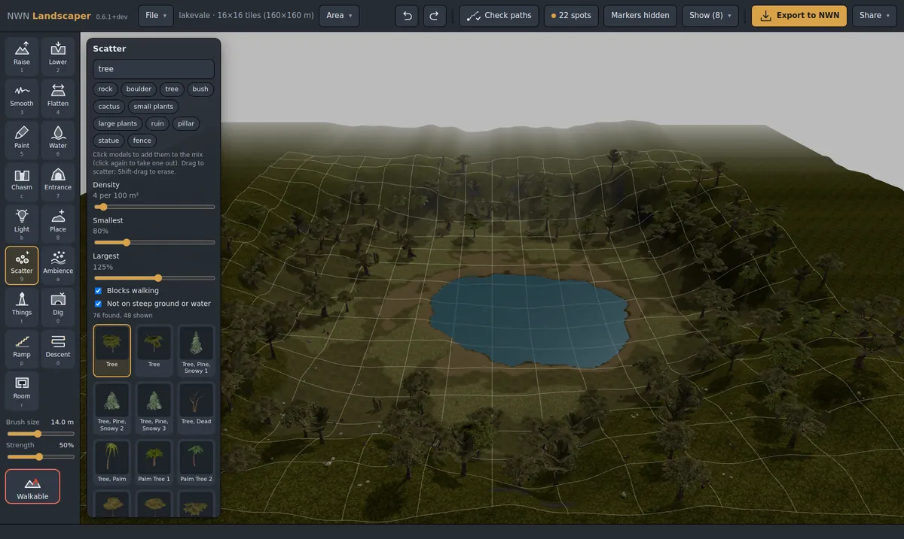

# Scatter and Place

Scenery from the game's models: trees, rocks, bushes, ruins. What you put down is baked into the tiles, so it casts baked shadows
and costs the game no objects.

To see the ground under a forest while you sculpt or paint, untick **Show > Scenery (Place and Scatter)**: the view hides it,
but Place, Scatter and Things still show it, and the area and its export keep it.

## Scatter

**Scatter** (`9`) paints models over the ground.

1. Click models in the panel to add them to the mix; click one again to take it out.
2. Set **Density**, and the **Smallest** and **Largest** size.
3. Drag over the ground to scatter. Shift-drag erases.

- **Blocks walking:** creatures walk round what you scatter.
- **Not on steep ground or water:** keeps trees off cliffs and out of lakes.

## Place

**Place** (`8`) puts one model down where you click; drag to turn it. Shift-click one to remove it. **Size**, **Random turn** and
**Blocks walking** apply to the next one, and so does the mode:

- **Bake into terrain:** scenery, part of the tiles, with baked shadows.
- **Placeable:** a real placeable from the model, to use, open or script in the toolset.

Click a placed model to select it, then:

| Key | Does |
| --- | --- |
| `G` | move (then `X` or `Y` locks an axis) |
| `R` | turn |
| `S` | size |
| `Q`, `E` | turn 15 degrees |
| `Delete` | remove |
| `Esc` | deselect, or cancel a move |

After `G`, `R` or `S`, move the mouse and click, or type a number for an exact value. Ctrl snaps. You can also drag the handles
on the model: the arrows move it, the ring turns it, the corner box sizes it.

## Past the edge

Scatter and Place work on [the band round the area](terrain.md#the-band-round-the-area) too: drag or click past the edge. What
stands there is scenery the game draws beyond the area, its own model within 25 m of the edge and a card (two crossed pictures)
farther out. It casts its shade and never blocks walking. On the band, *Not on steep ground or water* reads the band's slopes and
water, and Shift-drag erases there as inside.

- **Carry the scenery outward** (in the Scatter panel) fills the band with scenery like what stands within 25 m of the area's
  edge: the same models, in about the same density and mix, sized a little apart and turned at random, on dry ground no steeper
  than walkable, thinning a little towards the band's outer rim. A forest's edge goes on as forest and a clearing stays bare.
  Press it again and it tops the band up rather than doubling it. One undo takes it all back.
- **Place** keeps baked scenery within the band's outer edge. A **Placeable** stays inside the area: the game has no objects
  past its edge, so the editor says so and keeps it at the edge.
- Opening an area never adds anything to its band: only these tools do.

!!! tip "Scenery or a placeable"
    Place puts down scenery from a model. For a placeable with settings (a chest that holds items, a lever with a script), use
    [Things](things.md), which places one from its blueprint.
