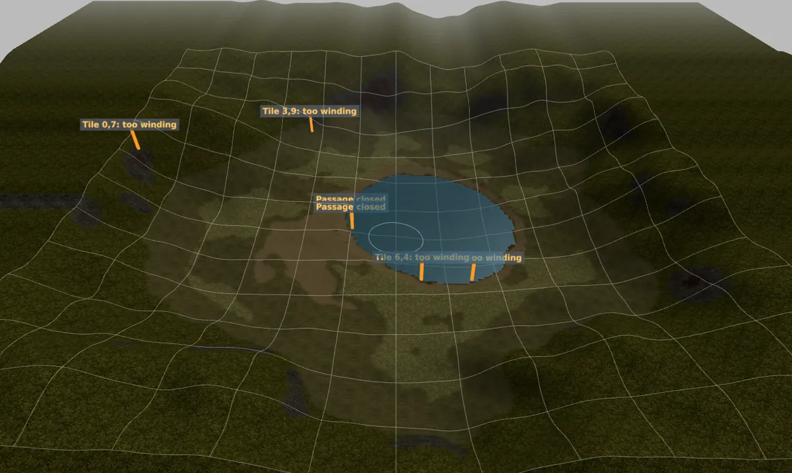
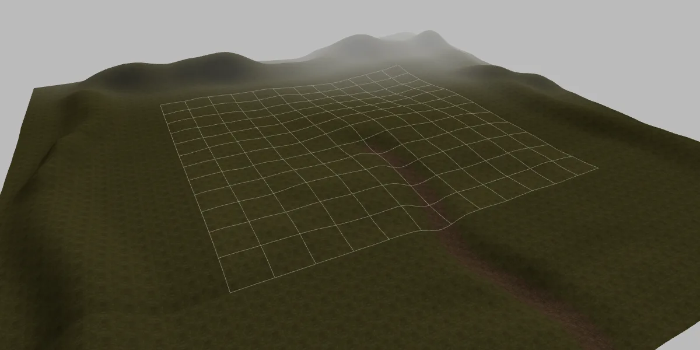

# Terrain

Shape the ground with the sculpting tools, shape the band of ground round the area, then add water, chasms and cave mouths.

## Shape the ground

Pick a tool, set **Brush size** (`[` `]`) and **Strength**, and left-drag over the ground.

- **Raise** (`1`) builds the ground up; **Lower** (`2`) digs it down.
- **Smooth** (`3`) softens bumps and edges.
- **Flatten** (`4`) levels the ground to the height where you first click: drag from a spot at the height you want.

Keep **Walkable** (`W`, in the top bar) on while you work. Red ground is too steep for creatures; the export uses the same rule,
so what is red in the editor is closed to them in the game.

## The band round the area

Every outdoor area has a band of ground 50 m wide round it, past its edge. Nobody walks there and it isn't built into tiles: it is
what the game shows beyond the area's edge, so the hills, the valley or the shore carry on past it as you shape them.

- **Raise, Lower, Smooth, Flatten, Paint and the [mix brush](paint.md#paint-a-mix)** work in it: drag past the edge and the
  brush shapes the band as it shapes the area, across the edge in one stroke. A mix's patches run on across the edge. Undo takes
  it back.
- **Scenery stands in it too:** [Scatter, Place and *Carry the scenery outward*](scatter.md#past-the-edge) put trees, rocks and
  bushes on the band, drawn past the edge in the game and never in the way. Placeables, things, entrances and particles stay
  inside the area: the game has none past its edge.
- **A new area's band carries its edge out**, eased: the strip by the edge is the edge, and further out the bumps along the edge
  spread into gentle slopes, so a hilly edge doesn't run out as long ridges. An area made before the band gets the same band when
  you open it, and so does one whose band is still as the first fill left it. A band you shaped is kept. Shape it from there.
- **The area's water runs on into the band** where the band's ground is lower than the water.
- **Not in the band yet:** chasms and Dig. A chasm along the edge stops at the edge: lower the band past it to keep the drop
  going.
- The status bar says *the band round the area* when the cursor is over it.
- Caves and interiors have no band: the game shows nothing past their edge.

[Past the edge in the game](export.md#past-the-edge-in-the-game) says how the band comes out in the game.

## Start from a picture

- **Area > Import heightmap** replaces the ground with a greyscale image, its top to the north. Set the heights black and white
  stand for, then stretch the image over the area or keep its shape. A 16-bit PNG is read at full precision; for an 8-bit image,
  tick *Smooth out steps*. Paint, water and things stay where they are, and Undo puts the old ground back.
- **Area > Underlay** lays a picture under the ground to trace over: a battlemat or a map. **Scale by 2 points**: click two
  points of the picture a known distance apart and type the distance (`5 ft` works). `U` shows or hides it. It is never
  exported.

## Water

**Water** (`6`): click in a hollow and drag up to fill it. Drag on water to change its level; Shift-click water to drain it.
Creatures don't walk into deep water, and the path check treats it as closed.

## Chasms

**Chasm** (`c`) opens a bottomless drop under the brush: the ground falls 20 m under the rim into the dark, and nobody walks into
it or across it. Shift-drag fills it in again, the ground as it was.

- *Along the whole edge* opens one the width of the brush all round the area, so a plateau or an island seems to stand over
  nothing.
- To cross a chasm, leave a strip of ground at least 6 m wide over the middle of a tile's edge: the game's pathfinding crosses
  from tile to tile only there.
- Outdoor areas only.

## Cave mouths

**Entrance** (`7`): click a slope or a cave wall to carve an entrance, as wide as the brush; Shift-click one to remove it. Each
entrance has a door. Pick where it leads (an entrance door in the same module), or link it in the toolset. See
[Caves and interiors](caves.md) for the door's tag.
