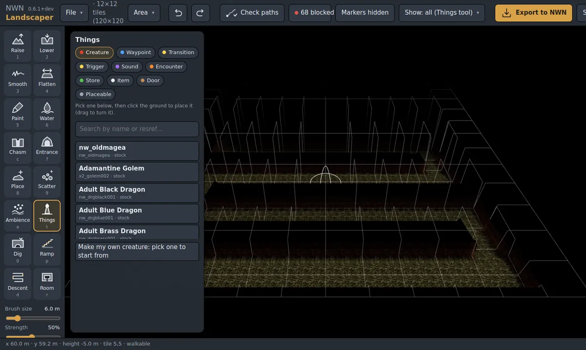

# Things

**Things** (`t`) places what the game treats as objects: creatures, waypoints, triggers and transitions, sounds, encounters,
stores, items, doors and placeables. Each comes from a blueprint: the module's, the game's, or one of your own.

## Place one

1. Pick **Things** and find a blueprint in the list by name, tag or resref.
2. Click the ground to place it. For a trigger or an encounter, click its corners and press Enter (**Finish the outline**).
3. Open **Properties** to set its tag, name, scripts and local variables.

Click a marker to select it from any tool; right-click it for its menu. A selected thing takes `Q` and `E` (turn), `Delete` and
`Esc`. The **Show** menu says which markers show outside the Things tool. In an imported building, **Show > Cut away roofs and
upper floors** hides what is above a height, so you can see inside.

An imported area's own objects show greyed. Click one to move it, turn it, take it out or change its properties.

## What you can set

- tag, name, scripts and local variables, on every kind;
- what a creature carries and wears, a container's contents, a store's stock, the creatures an encounter spawns;
- locks, keys and traps, hit points and sound timing;
- a trigger's or encounter's outline: drag, add and remove corners after drawing it;
- where a door or transition **Leads to**, including a waypoint of another area.

## Your own blueprints, conversations and scripts

- **Blueprints:** make a creature, item, placeable, door or store as a copy of an existing one, with its own name and resref, and
  change it. Items get properties, with the value worked out as the game does it.
- **Conversations:** a tree of NPC lines and player replies, with conditions, actions and links. Open one from a creature's
  Conversation setting.
- **Scripts:** an editor that compiles with the game's own compiler as you type and underlines the error. On a team server only
  admins write scripts. **View script** opens the module's or the game's script read only, with a button to make your own copy.

They are published with the areas that use them.
