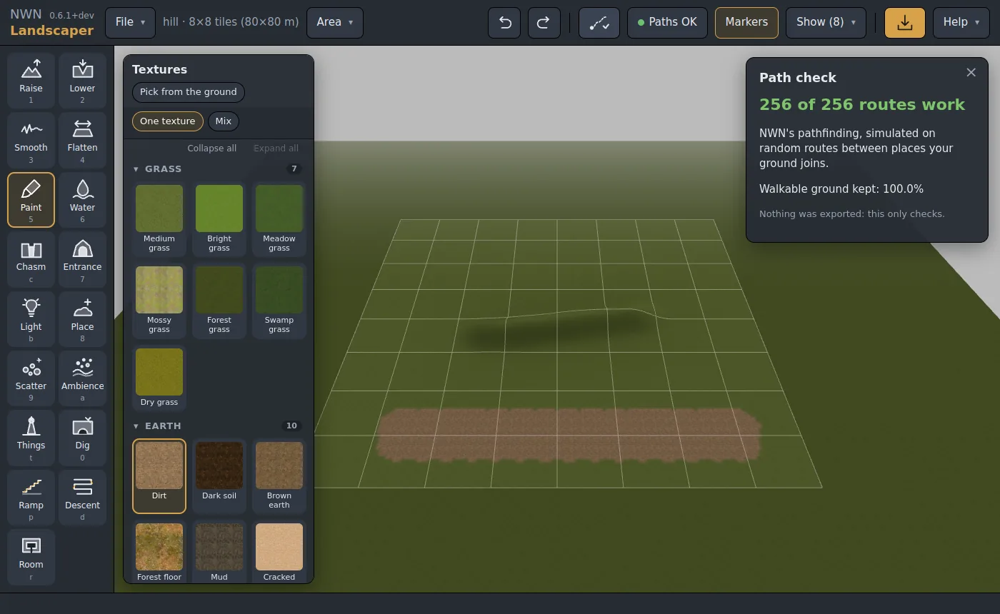

# Try it in your browser

**[Open the Landscaper in your browser](https://plenarius.github.io/nwn-landscaper/try/)**: the editor and its engine both
run in the page, with nothing to install and nothing sent to a server. It paints with textures of its own, and carries the
game's stock placeables and the shaders an export needs.

## What works

- **Sculpt, paint, water, chasms, caves, light, ambience** and the rest of the editor, as in [the handbook](index.md). The
  textures are the demo's own: CC0 photographs under the names of the game's starter set, credited in
  [packs/demo/CREDITS.md](../../packs/demo/CREDITS.md).
- **Place and Scatter** with the game's stock placeables: trees, rocks, plants and the rest of `placeables.2da`. The page
  fetches a model the first time an area or a panel needs it.
- **Check paths**, after each edit or on demand, as on the desktop.
- **Export** downloads a zip of the module and its haks: put the files of `hak/` in your Neverwinter Nights user folder's
  `hak` folder and the module in its `modules` folder (the zip's README says where those are). It asks for nothing: the
  tiles' shaders come with the page.

Things, Scripts and Import read the game's blueprints, compiler and tilesets, which the page doesn't have: they say so. Use the
Landscaper on your computer for them ([Getting started](getting-started.md)).

## Areas from your computer

**File, Open area from a file** opens an area saved by the Landscaper on your computer, or downloaded from a team server. Its
stock placeables draw, block paths and export as they do there. A placeable whose model the page doesn't have (one from a
module's haks) shows as a translucent box where it stands, and one line over the view names those models, once for the area.
The boxes don't block paths in the check, and an export leaves the baked ones out of the tiles; a placeable put down as an
object (not baked) is still in the module, for the game to draw from its haks.

**Open in Landscaper** on a [showcase](../showcase.md) card opens that area here the same way. If this browser already has an
area of that name, you choose: open yours, or the showcase's under a free name (`lsvale2`). Yours is never replaced.

## Where your areas are

In your browser's storage for this site, landscaper.layonara.com: they are there when you come back, in the same browser.
That storage is no backup: clearing the site's data removes it. A browser short of space can remove it too; the page asks
Chrome, Edge and Safari to keep it, which they may refuse. **File, Download area** saves the area open as a file;
**File, Open area from a file** brings it back, in this browser or another.

Areas saved at the page's old address, plenarius.github.io/nwn-landscaper/try/, are in that address's storage. That address
now leads here, so they can't be opened any more.

The page works in one tab at a time: a second tab waits until the first is closed.

## Size

Areas up to 16 by 16 tiles are made at once. A larger one asks first: exporting it needs more memory in the page (about 0.4
GB at 16 by 16, 1.2 GB at 32 by 32), and a phone or a small laptop may not have it. An export that runs out says the area is
too big for this browser; the Landscaper on your computer has no such limit.

## Browsers

A current Chrome, Edge, Firefox or Safari, with WebGL. The first visit takes a few seconds more than the next ones: it
prepares the textures once and keeps them. The engine and the stock models it fetched are kept too, until a release changes them.

## Credits

The stock placeables, their textures and the tile shaders are Neverwinter Nights: Enhanced Edition's, by Beamdog and
BioWare. The demo's ground textures are credited in [packs/demo/CREDITS.md](../../packs/demo/CREDITS.md).

## Licences

The engine in the page is the Landscaper's, GPL-3.0-or-later, built for WebAssembly: its source is
[nwn-landscaper](https://github.com/plenarius/nwn-landscaper), and the page serves its
[licence](https://plenarius.github.io/nwn-landscaper/try/try/LICENSE-engine.txt) and a
[note](https://plenarius.github.io/nwn-landscaper/try/try/NOTICE-engine.md) of the C and C++ libraries built into it. The
editor is [nwn-landscaper-web](https://github.com/plenarius/nwn-landscaper-web) (MIT).

## How the page is built

The docs workflow makes `/try/` with `scripts/try-page.sh`: the newest release's `landscaper-wasm.zip`, the editor at the same
tag, and `packs/demo`, put together by the editor's `scripts/try-site.sh` from listed files only. Until a release has the zip,
the workflow builds the engine itself, with the editor's main branch. A release's own run of the workflow puts the new engine
on the site.

The stock placeables come from the `demo-stock` release's `demo-stock.zip`, which `landscaper demo-stock` makes on a computer
with the game (the workflow has none): each model, its walkmesh and its textures as the game has them, `placeables.2da`,
`surfacemat.2da`, the three shaders, and the Place panel's lists. Without that release (or `NWN_ROOT`, when the script runs
on a computer with the game) the page is built without them, draws every placeable as a box, and asks for the game folder at
Export for the shaders.

The browser keeps the engine and the stock files it fetched in its Cache Storage, in caches named by their SHA-256 in
`try/site.json` (`engineSha256`, and `stockSha256` of `demo-stock.zip`): a later visit fetches neither, and a new engine or
bundle replaces its old cache. Pages tells browsers to check every file again after ten minutes; the editor's own files follow
that, so a release's editor is never stale.

The page needs no header that GitHub Pages can't send. It runs the engine on one thread, so it needs no cross-origin isolation
(that comes with threads, [DESIGN-web-demo.md](../DESIGN-web-demo.md) question 7). The Service Worker and the engine's Worker
are the site's own files, and Pages serves the engine as `application/wasm`. The page is about 14 MB, and about 210 MB with
the stock placeables (1,268 models and 579 textures in 2,841 files, the largest 3 MB), under Pages' 1 GB; a visit fetches only
the models it uses. [DESIGN-web-demo.md](../DESIGN-web-demo.md) has the rest: how the page runs the engine, and what was measured.
