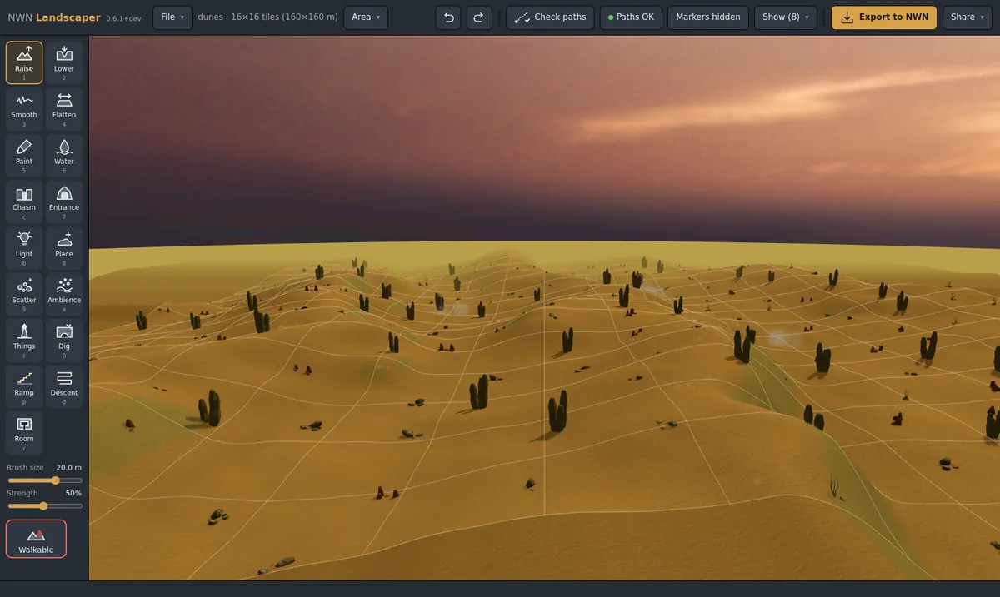

# NWN Landscaper

Draw terrain in your browser and get a Neverwinter Nights: Enhanced Edition area: its own tileset in a hak, and a module you
can open in the toolset or the game, checked against the game's pathfinding.

## Where to start

- **[The handbook](handbook/index.md):** building an area in the editor, step by step: terrain, paint, caves, scenery, light,
  particles, skies, export and hand-over.
- **[Try it in your browser](handbook/try.md):** the editor and its engine in the page, nothing to install.
- **[Showcase](showcase.md):** areas made in the Landscaper, filmed in the game.
- **[Running it](SELF-HOSTING.md):** on your own machine, or as a team server where each builder has a workspace.
- **[Internals](DESIGN-ambience.md):** the design documents behind the newer parts.

## Get it

Download the archive for your system from the [releases](https://github.com/plenarius/nwn-landscaper/releases) (Windows,
macOS, Linux), unpack it and start `landscaper`. Your browser opens the editor at `http://127.0.0.1:8765/`. You need the game
itself: the Landscaper reads its files and ships none of them. [Getting started](handbook/getting-started.md) has the details.

The engine (Rust) is [nwn-landscaper](https://github.com/plenarius/nwn-landscaper); the editor (three.js) is
[nwn-landscaper-web](https://github.com/plenarius/nwn-landscaper-web). A release holds both.
